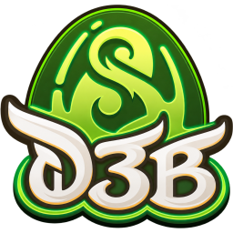
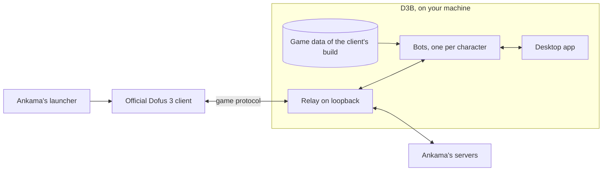

<div align="center">



# D3B

**An open-source desktop bot for Dofus 3. It plays your character through the official client.**

[](https://github.com/AerafalDev/D3B/actions/workflows/ci.yml)
[](https://github.com/AerafalDev/D3B/releases)
[](#download)
[](LICENSE)
[](https://discord.com/invite/6A6Vw9Mn24)

[Download](#download) · [Getting started](#getting-started) · [Build from source](#build-from-source) ·
[Roadmap](ROADMAP.md) · [Contributing](CONTRIBUTING.md)

</div>

> [!IMPORTANT]
> **D3B is being rewritten** in Rust and Tauri, on branch `next`, to run on Windows, macOS and Linux. The rewrite is at
> its foundations: nothing plays yet. The playable version is the C# one, for Windows, on
> [`main`](https://github.com/AerafalDev/D3B/tree/main) and its
> [latest release](https://github.com/AerafalDev/D3B/releases/latest).

> [!WARNING]
> D3B is not affiliated with, endorsed by or supported by Ankama. Dofus is a trademark of Ankama. Using a bot on the
> official servers breaches Ankama's terms of use and can get your account banned. You use D3B at your own risk.

## Features

D3B reads the game's protocol and data, and plays through the client you start from Ankama's launcher. It injects
nothing into the client and never sees your password.

| Feature | What it does | Rewrite status |
| --- | --- | --- |
| **Observe** | A live view of each character: its map, life and pods, what surrounds it, and a protocol inspector | Next |
| **Travel** | Paths across the world with zaaps and NPC ways; you take the character back at any time | Planned |
| **Harvest and bank** | Ready-made profiles with options, and node graphs for anything custom | Planned |
| **Fight** | One AI for every breed, driven by the game's own spell effects | Planned |
| **Studio** | Docked panels, a command palette, keyboard first, dark theme, French and English | In progress |
| **Updates** | Installs its own updates from this repository's releases, on six platforms | In progress |

The [roadmap](ROADMAP.md) has the steps in order, and [docs/now.md](docs/now.md) says where the work stands today.

### What D3B never does

These are out of scope for good, in the code, its modules and its documentation:

- evading Ankama's detection (simulated mistakes, timings shaped to avoid bans, forged hardware identifiers);
- creating accounts in bulk;
- automating subscriptions or payments;
- disabling or bypassing Ankama Shield;
- one proxy per account to hide multi-accounting.

Pull requests that add any of these are closed.

## Download

Every release ships these installers. Releases of the rewrite are pre-releases until it replaces the C# version.

| System | x64 | ARM64 |
| --- | --- | --- |
| **Windows** 10 and 11 | `D3B_<version>_x64-setup.exe`, `.msi` | `D3B_<version>_arm64-setup.exe` |
| **macOS** | `D3B_<version>_x64.dmg` (Intel) | `D3B_<version>_aarch64.dmg` (Apple Silicon) |
| **Linux** | `.AppImage`, `.deb`, `.rpm` (`amd64`) | `.AppImage`, `.deb`, `.rpm` (`arm64`) |

> [!NOTE]
> Only **Windows x64** is tested so far. The other five builds come from the same code and CI, but nobody has run
> them yet: if you can, [help test](#help-test).

The Windows installer installs for the current user, without administrator rights. Each version ships the game data
of one client build, so D3B works offline; when Ankama updates the client, a new version of D3B follows.

<details>
<summary><b>The installers are not signed yet</b></summary>

- **Windows**: SmartScreen may stop the installer. Choose *More info*, then *Run anyway*.
- **macOS**: Gatekeeper refuses an app from an unidentified developer. Open it once with a right click, then *Open*,
  or run `xattr -dr com.apple.quarantine /Applications/D3B.app`.
- **Linux**: make the AppImage executable with `chmod +x D3B_*.AppImage`.

</details>

## Getting started

1. Install Dofus 3 with Ankama's launcher, and D3B from its installer.
2. Start D3B first, then Dofus from the launcher, and choose a character.
3. The character shows in D3B's character list. Choose it to follow it.

D3B keeps its settings and what its bots learn in your user's application data folder, and keeps them when you
uninstall it.

## How it works



- **The relay.** While D3B runs, one line of the client's `version` file points it at a copy of Ankama's
  configuration whose game server is a relay on your machine; when D3B stops, the line goes back. No elevation, no
  injection.
- **The protocol** is decoded through a mapping from the build's obfuscated messages to readable ones; what is not
  understood passes through untouched.
- **The game data** (maps, world graph, items, spells, monsters, texts) is extracted from the client by a maintainer
  tool, published as a release asset and packed into the app. Nothing extracted from the client is in this
  repository.

## Build from source

**Requirements**: [Rust](https://rustup.rs) (the version pinned in `rust-toolchain.toml` installs itself),
[Bun](https://bun.sh) 1.4 or later, Git, and the
[system dependencies of Tauri](https://v2.tauri.app/start/prerequisites/) for your OS: WebView2 and the MSVC build
tools on Windows, Xcode's command line tools on macOS, `webkit2gtk-4.1` and its companions on Linux.

```sh
git clone https://github.com/AerafalDev/D3B.git
cd D3B
git switch next
bun install --frozen-lockfile
bun run app
```

| Command | What it does |
| --- | --- |
| `bun run app` | The desktop app in development, with hot reload. |
| `bun run dev` | The interface alone in a browser, without the back end. |
| `bun run check` | Every check CI runs: format, lint, typecheck, tests, clippy, and the extractor's (needs the [.NET 10 SDK](https://dotnet.microsoft.com/download)). |
| `bun run fix` | Applies the formatters' and linters' safe fixes. |
| `bun run data:fetch <build>` | Downloads the game data of a client build into `data/` (needs the GitHub CLI). |
| `bun tauri build` | The installers for your OS, in `src-tauri/target/release/bundle/`. |

### Project layout

| Path | Content |
| --- | --- |
| `src/` | The interface: React 19, TypeScript, shadcn/ui, Tailwind CSS. |
| `src-tauri/` | The back end in Rust: one folder per domain (data, relay, protocol, game, bot, storage) and the typed IPC. |
| `tools/extractor/` | The .NET tool that extracts the game data from the installed client ([docs/data.md](docs/data.md)). |
| `data/` | The packed game data, ignored by Git. |
| `docs/` | Where the project stands, the [decisions](docs/adr/README.md) and a page per domain. |
| `.claude/` | How we work with Claude Code: rules, skills, agents and hooks. |

## Help test

The maintainer tests on Windows x64. If you run macOS, Linux or an ARM64 machine, you can help: install the latest
pre-release, follow the [checklist](docs/testing.md), and send the result with the
[Test report](https://github.com/AerafalDev/D3B/issues/new?template=test_report.yml) form. Rounds are announced on the
[Discord](https://discord.com/invite/6A6Vw9Mn24).

## Contributing

Issues and pull requests are welcome. Read [CONTRIBUTING.md](CONTRIBUTING.md) first: it covers the setup, the
conventions and what can never be committed. Everyone taking part follows the [code of conduct](CODE_OF_CONDUCT.md).
To report a vulnerability, follow the [security policy](SECURITY.md) rather than opening an issue. To talk about D3B,
join its [Discord](https://discord.com/invite/6A6Vw9Mn24).

## License

D3B is released under the [MIT license](LICENSE). Dofus and its content belong to Ankama; this repository contains
none of them.
