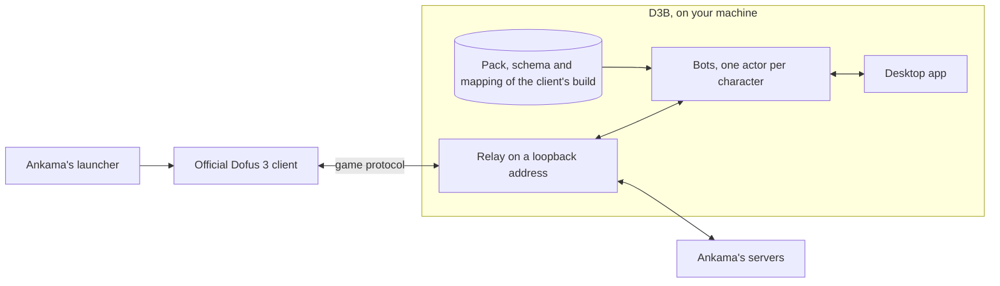

# D3B

[](https://github.com/AerafalDev/D3B/actions/workflows/ci.yml)
[](https://github.com/AerafalDev/D3B/releases/latest)
[](LICENSE)
[](https://discord.com/invite/6A6Vw9Mn24)

An open-source bot for Dofus 3, Ankama's Unity client, written in C# on .NET 10 for Windows. D3B plays your character
through the official client: it harvests, banks and fights, and a desktop app shows what each bot does. Every feature is
a module, and the game's data and protocol are read from the client you have installed.

> [!WARNING]
> D3B is not affiliated with, endorsed by or supported by Ankama. Dofus is a trademark of Ankama. Using a bot on the
> official servers breaches Ankama's terms of use and can get the account banned. You use D3B at your own risk.

## What it does

- **Harvesting and banking.** A bot tours a zone and harvests the resources its profile names, by profession or as a
  list, then banks them when its pods are full, in the bank or the guild's chest. It chooses the sub-area by each
  character's levels, takes a zaap only when it saves enough maps, learns where resources grow and how long they take
  to grow back, eats to heal, opens resource bags, and has the AI fight the fights it meets on the way, or leaves them to
  you, as its profile says. Six profiles come ready:
  an automatic harvest and one per profession. Every run is kept, and a statistics page says what the runs brought.
- **Fights.** D3B follows a fight from the protocol: the fighters, their life, AP and MP, buffs, states and cooldowns. It
  knows the rules of a cast (range, line of sight, zones, target masks, costs, cooldowns) and of a walk with its tackle,
  and foresees what each cast does from the game's data, checked against every cast of the fights captured so far. Its
  AI places the character, then each turn weighs the walks and casts, a worn sword's blow among them, against the
  monsters' reply and plays them at a pace you can follow.
- **Fighting.** A fighting activity, made as harvesting is, tours a zone, chosen or chosen for the character's level,
  and attacks the groups of monsters its profile allows: monsters chosen or left out, a group's size, and only those the
  AI judges it beats; the sub-areas where the monsters chosen live come first. One AI fights for every character, whatever
  its breed: it plays prudently a fight it judges risky, and closes the fight and refuses spectators.
- **The desktop app.** A card per bot, with where it is, its pods, kamas and activity; a live map of the bot's map, its
  path, elements, NPCs and fighters; the accounts, the profiles and their editor with a preview of the zone; a journal
  per bot, a protocol inspector, and the settings. Dark by default, in French and English. It installs without
  administrator rights and updates itself from this repository's releases.

D3B injects nothing into the client and never sees a password. The client you start from Ankama's launcher logs in as
usual; while D3B runs, one line of the client's `version` file sends it through a relay on your machine, and when D3B
stops, that line goes back to Ankama's.

## What D3B never does

These are out of scope for good, in the code, its modules and its documentation ([D2](docs/decisions.md#d2-what-d3b-never-contains)):

- evading Ankama's detection: simulated mistakes, timings shaped to avoid bans, forged hardware identifiers;
- creating accounts in bulk;
- automating subscriptions or payments;
- disabling or bypassing Ankama Shield;
- one proxy per account to hide multi-accounting.

Pull requests that add any of these are closed.

## Status

D3B is young and changes fast: settings, data formats and the app may change from one version to the next. The first
milestone, harvesting and banking, is reached. Fights are in progress: the AI that plays them and the fighting activity
are on `main`, not yet in a release, the activity being measured in game; summons, glyphs and the other breeds'
mechanisms come next, so that the AI plays every breed whole. Then several accounts
and groups, blueprint mods edited in the app, the marketplace and crafting. The [roadmap](docs/roadmap.md) has the steps
in order.

## Install

1. On Windows 10 or 11, install Dofus 3 with Ankama's launcher.
2. Download `D3B.App-win-Setup.exe` from the [latest release](https://github.com/AerafalDev/D3B/releases/latest) and run
   it. It installs D3B for the current user in `%LOCALAPPDATA%\D3B.App`, with a shortcut on the desktop and in the Start
   menu. The installer is not signed yet: if Windows SmartScreen stops it, choose *More info*, then *Run anyway*.
   A portable zip is in the same release.

Each version of D3B ships the data of one client build, extracted from the official client: its maps, items, spells and
texts, and the mapping of its protocol. When Ankama updates the client, D3B says it does not know that build yet; the
version of D3B for it comes out afterwards. D3B checks for a new version when it starts, downloads it, and installs it
when you restart it from its banner or close it. Its settings page shows its version and the client build it ships.

D3B keeps its database, settings and captures in `%LOCALAPPDATA%\D3B`. Uninstalling it from Windows' settings removes the
app and keeps that folder.

## Getting started

1. Start D3B, and wait until it says it runs for your client's build.
2. Start Dofus from Ankama's launcher, log in and choose a character. Its card shows on the bots page.
3. Choose a profile on the card, one of those given or your own from the profiles page, and start it. The bot can also
   start its profile as soon as its client connects; that is set per character on the accounts page.
4. Take the character back at any time by playing it: the bot pauses, and you resume it from its card.

Start D3B before the game: a client started while D3B is closed plays without it. If D3B ever crashes, the client cannot
connect until D3B runs again: start D3B and close it, which gives the client Ankama's configuration back, or run
`dotnet run --file scripts/client.cs -- restore` from a clone of this repository.

On a slow machine, the client may not have drawn a map or shown a window when a bot acts: raise the client's display
time on the settings page, 0.5 s by default, up to 3 s. Every other delay is there too, each measured by default.

## Build from source

You need Windows, Git and the .NET 10 SDK pinned in [`global.json`](global.json) (10.0.403 or a later 10.0 SDK). The
official client is needed to run the bots, not to build or test.

```powershell
git clone https://github.com/AerafalDev/D3B.git
cd D3B
dotnet build                          # warnings are errors
dotnet test                           # every test project, on Microsoft.Testing.Platform
dotnet format --verify-no-changes     # CI checks it
```

### Run

```powershell
dotnet run --project src/D3B.App      # the desktop app, which runs the bots' host in its process
dotnet run --project src/D3B.Host     # the same host without the app, until Ctrl+C
```

The host needs the data pack, the protocol schema and the mapping of the installed client's build, in the formats the
code reads. It looks for them in `%LOCALAPPDATA%\D3B\data`, then beside the published app. Run from source, take them
from the build's release `client-<version>`, with the [GitHub CLI](https://cli.github.com) signed in:

```powershell
dotnet run --file scripts/embed.cs -- --client-version 3.7.12.12 --output "$env:LOCALAPPDATA\D3B\data"
```

The tool checks the files, and says so when the release lacks a format your checkout reads, as happens while a format
change on `main` waits for its upload. When Ankama updates the client, the maintainer extracts and maps the new build
with the tools below, then publishes its release; mapping a build also needs captures of it.

Both the app and the host keep the accounts their relay sees, and the profiles, in `%LOCALAPPDATA%\D3B\d3b.db`. Options
are configuration keys, given on the command line:

| Option | Effect |
| --- | --- |
| `--Storage:Path <file>` | Uses another database file. |
| `--Network:Captures:Enabled true` | Records each connection in `%LOCALAPPDATA%\D3B\captures`, which the app's protocol inspector replays. A capture holds the account's login ticket: never share one. |
| `--Fights:Alone true` | Has the AI play every fight of the bots, the player's own included, whatever their activity says. |
| `--Delays:Display 1.5` | The client's display time, in seconds; the other delays are under `Delays:` too. |

### Tools

The tools are [file-based apps](https://learn.microsoft.com/dotnet/core/sdk/file-based-apps) in `scripts/`, run with
`dotnet run --file scripts/<tool>.cs`; `-- --help` lists each one's options. By default they read the client installed
in `%LOCALAPPDATA%\Ankama\Dofus-dofus3` and write under `%LOCALAPPDATA%\D3B`.

| Tool | What it does |
| --- | --- |
| `inspect.cs` | Describes the installed client: its versions, bundles, objects and texts. |
| `extract.cs` | Extracts the client's game data into the pack of its build. |
| `schema.cs` | Reads the client's obfuscated protocol schema from its code. |
| `mapping.cs` | Matches D3B's readable `.proto` files with that schema and writes the build's mapping. |
| `embed.cs` | Puts a build's pack, schema and mapping beside the published app, or in a folder of your choice. |
| `release.cs` | Publishes a build's pack, schema and mapping to its release; a dry run without `--publish`. |
| `client.cs` | Says which configuration the client reads, Ankama's or D3B's; `restore` gives it Ankama's back. |
| `capture.cs` | Describes the captures by their structure, never their content. |
| `fights.cs` | Replays the captured fights and compares what D3B foresees of each cast with what the server did. |

The repository's local tools, `dotnet-ef` for the database's migrations and Velopack's `vpk` for the installer, are
pinned in [`.config/dotnet-tools.json`](.config/dotnet-tools.json):

```powershell
dotnet tool restore
dotnet tool run dotnet-ef migrations add <Name> --project src/D3B.Storage --startup-project src/D3B.Storage --output-dir Migrations
```

### Build the installer

Pushing a tag `v<version>` runs the [release workflow](.github/workflows/release.yml), which builds, tests and publishes
the app. The same installer, built on your machine in PowerShell:

```powershell
dotnet tool restore
dotnet publish src/D3B.App -c Release -r win-x64 --self-contained -o publish -p:MinVerVersionOverride=0.1.0
dotnet run --file scripts/embed.cs -- --client-version 3.7.12.12 --output publish/data --packs "$env:LOCALAPPDATA\D3B\data"
dotnet tool run vpk pack --packId D3B.App --packVersion 0.1.0 --packDir publish --mainExe D3B.App.exe --packTitle D3B --icon src/D3B.App/Assets/d3b.ico -o releases
```

An installed app started with `--Updates:Source <folder>` takes its updates from a folder of releases packed this way.

## How it works



- **Modules.** Every feature is a module that registers its services, activities, settings and pages, assembled as in
  Bevy. The default modules bring the data, the protocol, the network, the bots and harvesting.
- **Network.** While D3B runs, the client's configuration sends it to a relay on Kestrel. The relay forwards the
  client's frames, decodes the game's messages through the build's mapping, and slips the bots' requests in between the
  client's frames.
- **Game data.** File-based apps read the client's Unity bundles and code into a pack per build, compressed with zstd,
  and a mapping from the build's obfuscated protocol to readable `.proto` files. Nothing extracted from the client is
  committed; packs and mappings ship as release assets.
- **Bots.** Each character a client plays is an async actor fed by the game it observes. Pathfinding, the rules of a
  fight and its effects live in `D3B.Engine`, pure code with no I/O.

| Project | Role |
| --- | --- |
| `src/D3B.Core` | Modules and `BotBuilder`, on the .NET Generic Host. |
| `src/D3B.Network` | The relay: Kestrel's transport, framing and codec, and the captures. |
| `src/D3B.Protocol` | The readable protocol, a build's mapping and the translation through it. |
| `src/D3B.Data` | The pack's format and readers: maps, world graph, items, spells, monsters, texts. |
| `src/D3B.Engine` | Pathfinding, line of sight, the rules of a fight, its effects and the AI's search. |
| `src/D3B.Bot` | The bots' run time: state, behaviors, activities, settings, and the host both apps share. |
| `src/D3B.Storage` | The database, SQLite through EF Core: accounts, profiles and runs. |
| `src/D3B.App` | The Avalonia desktop app. |
| `src/D3B.Host` | The host without the app. |

## Documentation

| Document | Content |
| --- | --- |
| [docs/decisions.md](docs/decisions.md) | The brief, every decision with its reasons and what it rejected, and the open questions. |
| [docs/architecture.md](docs/architecture.md) | How D3B is built: projects, modules, run time, protocol, data, app, fights. |
| [docs/roadmap.md](docs/roadmap.md) | The steps in order, what each one did, and the next one. |
| [docs/client.md](docs/client.md) | What the official client holds that D3B uses, measured. |

## Contributing

Issues and pull requests are welcome. Read [CONTRIBUTING.md](CONTRIBUTING.md) first: it covers the conventions the build
enforces and what can never be committed. Everyone taking part follows the [code of conduct](CODE_OF_CONDUCT.md). To
report a vulnerability, follow the [security policy](SECURITY.md) rather than opening an issue. To talk about D3B, join
its [Discord](https://discord.com/invite/6A6Vw9Mn24).

## License

D3B is released under the [MIT license](LICENSE). The app ships third-party components under their own licenses, listed
in [THIRD-PARTY-NOTICES.md](THIRD-PARTY-NOTICES.md).
