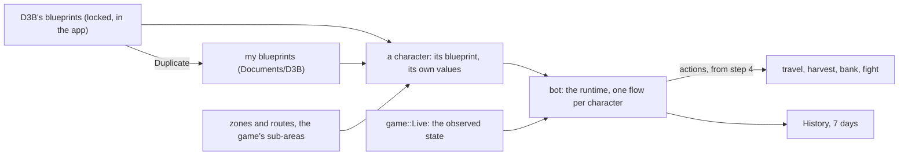

# The bot

What the player tells the bot and how they see what it does (roadmap step 3), designed with the owner on 2026-11-12
and 2026-11-13 from mock-ups, then a clickable prototype in the real shell (local branch `prototype/step3-model`,
never merged). Its model is Unreal's: a **blueprint** is a class, a **character** an instance that runs one, and a
variable marked "set per character" is a setting each character sets for itself (ADR 0014). Nothing acts in the game
before step 4: step 3 delivers the model, its editor, its storage, and its runtime tested on captures; Play, what it
does now, its History and the debugger come with step 4's first actions.

## The concepts

The six scenarios the owner chose (first launch; two characters, two zones; a goal; my own behaviour; understanding
what it does; a D3B update) need these and nothing else: no profile, activity, place or goal field.

- **Blueprint**: an event graph, functions and variables. D3B's own ship with the app, **locked**: automatic harvest,
  profession harvest (one blueprint, its profession set per character: the owner, 2026-11-14) and hunt; **Duplicate** makes one of mine, fully editable, noting "based on
  X vN": named "<name> (copie)" in the player's language, its texts taken from the interface since a given
  blueprint's are translations, its id made from its name (accents dropped, a number when taken by a blueprint or by
  any file of the folder, in any case); a copy of mine keeps what mine was based on (the owner, 2026-11-14). A given blueprint's new version reaches the characters that run it, their values kept; my copy stays as it is
  and says its original has a newer version.
- **Character**: runs one blueprint, chosen in its tab. Its **settings** are the blueprint's variables marked "set per
  character" (Unreal's Instance Editable): the blueprint holds the default, the character its own value, marked when
  it differs and reset in one click. Two characters, two zones, one blueprint.
- **Variable**: a type (zone, route, percentage, number, items, bank, profession, yes or no…), a default, bounds, a help line, set
  per character or not, and a duration: one run, or **memory**, kept per character across sessions. A goal is a
  variable tested in the graph ("stop at 5,000 harvests").
- **Zone**: maps the bot goes through its own way. The game's **sub-areas are ready-made zones** (`sub-areas.json`
  lists their resources and monsters); a zone of mine is painted map by map or a whole sub-area at a time.
- **Route**: an order of passage only: anchor maps joined by the shortest way on the world graph (its scrolls, doors
  and map actions; zaaps join it with step 4's travel), as a loop, one way or a round trip. What is done on the way comes from the blueprint.
- **History**: what each character did, as episodes ("Bank · 3 min") with their reason.

## How a blueprint runs

As decided on 2026-11-12, on Unreal's event graph (ADR 0014):

- **One flow per character, one action at a time.** "On start" is the main flow. Another event (a fight starts, life
  below, pods above, every N minutes, the map changed, reconnected) interrupts it by **priority** (1 before 2) and by
  its **mode**: interrupt then resume (the default), wait for the current action, interrupt and restart from the
  start, or in parallel for a graph that never acts. A threshold fires once and re-arms past its reset value. "You took
  control" (step 4) is above everything, outside the graph.
- **Actions are goal-shaped**: an intent and a check on the observed state that says it is done ("on map X", "pods ≥
  80 %"), so an interrupted action resumes by running again. Each ends **Done** or **Failed** with its reason; a Failed
  left unlinked blocks the character with that reason.
- Unlike Unreal's, a **function** may hold actions that last (2026-11-12): moving to a bank is one.
- **Queries** are read when the node that uses them runs; the value used is kept for the debugger.
- **Events the game forces**, when the blueprint does not handle them, have a default: a fight is fought by the
  default AI (step 6), then the flow resumes; a death stops the run, blocked.
- A setting changed while running applies at the next safe point, between actions, and says so. The states: without
  blueprint, ready, running, paused, finished, blocked (with its reason), disconnected (listed greyed, its blueprint
  and values kept). A blueprint with a problem cannot run.

## In the app

The shell's parts (`docs/shell.md`); no information is shown twice:

- **Characters** view: the characters the player has played, a closed client's greyed with its blueprint and values
  kept (a change: step 2's view lists open game connections only). From step 4, a row's hover holds Play, Pause and
  Stop, and the view's header Play all and Pause all.
- A **character's tab**: its blueprint (a list, and an arrow that opens it) and its settings above its observed state
  and map (`docs/game.md`). From step 4: one line saying what it does now (its step, on what, since when), a tick on
  the Pods gauge at the current step's target, and Play, Pause and Stop as the tab's editor actions.
- **Library** view: "Given by D3B", then "Mine"; a row opens the blueprint's editor. A row is its name alone, its
  description or what a copy is based on in its hover, an amber mark with how many problems it has; a right-click
  offers Duplicate; last, folded, "Ignored": the player's files kept as they are, blueprints' and characters', each
  with why in its hover (the owner, 2026-11-14, mock-up 9). A blueprint's tab is its editor, read-only until step 3's
  PR 13: on top its name, whose it is, its problems, its description and Duplicate; under them My Blueprint (the event
  graph, the functions, the variables with an eye on those set per character, a variable's help and default in its
  hover) and the graph chosen in it, and Details on the right (the owner, 2026-11-14): a node chosen says its sentence,
  its description, the step from which the bot does it, its inputs' values (or "wired"), what an unlinked Failed does,
  its problems, and for an event its priority and its four modes drawn as timelines, the one it has marked; a variable
  chosen in My Blueprint its type, default, bounds, whether each character sets it and its help, how long it lasts and
  the nodes that use it; nothing chosen, the blueprint's problems, each in the player's words. A node with a problem is
  marked in the graph. "Graph | Summary", the tab's editor action in the tab strip (the owner, 2026-11-14), shows the
  **Summary** in the graph's place: a section per event, "On start" first and the others by priority, with their mode;
  its steps numbered as the flow runs them, an action's Failed and an If's True and False numbered under their step
  ("2.1"), a node met again said "Back to 2" (or "Go on to 4" forward), a step's "étape N" tag; the events the game
  forces, when the blueprint leaves them, with their default (a fight by the default AI from step 6, then resume; a
  death stops the run; an unlinked Failed blocks with the reason); then each function from its entry. A step chosen
  shows its node in Details.
- The **blueprint editor** is Unreal's Blueprint Editor in a tab. Graph or Summary are its editor actions; its toolbar holds
  the graph's path, the problems, the character to debug, and Duplicate on a given blueprint, which opens locked. **My Blueprint** on the
  left lists the graphs, functions and variables, an eye on those set per character; the graph is in the centre,
  **Details** on the right. Nodes are sober sentence boxes: an icon coloured by family, the values in the sentence,
  typed pins (a triangle carries the flow, a circle a value, coloured by type), a visible Failed output. A wire dropped
  on the ground, Space or a right-click opens the picker: sentences with their description, what often comes there
  first; an action the bot does not do yet is marked with the step that brings it (the owner, 2026-11-13). "If" is a node with True and False; a function opens in place, its inputs and outputs as nodes. An event's
  Details hold its priority, its re-arming and its four modes, each drawn as a small timeline. **Summary** reads the
  blueprint as sentences. The IPC's `blueprint_graphs` gives the editor each graph's nodes (what each does, its family,
  the step from which it runs, its pins, the values typed and its place) and wires, typed; a blueprint's variables come
  with the Library's list; its problems, each with its kind, graph, node, pin and what it names, an event's priority and mode, a function's
  inputs and outputs, and a variable's bounds, for the Details (PR 8). The graph is drawn read-only
  with React Flow: each node where the file puts it (a column on the left for those it does not place), its sentence's
  holes filled with what feeds them (a variable's name, a query's own sentence, a source pin's label, a value typed or
  a default), a get as a pill of its type's colour, an action the bot does not do yet tagged "étape N", pins and wires
  coloured by type (the owner, 2026-11-14). From step 4, "Debug" a character lights the node at work and its wire; nothing is lit otherwise.
- **World** view: my zones, my routes, then the game's sub-areas, searchable. The **World tab** shows the world map
  from the data's tiles, at the level the zoom needs, with the client's **hints** as on the C# version (the owner,
  2026-11-13): zaaps, dungeons, auction houses, workshops, banks, class places and transports, each with the client's
  picture, at the zooms that have room for them, one switch per kind, the name on hover. Its tools: select, brush,
  eraser, whole sub-area, route; Details on the right. A Zone setting is chosen in a searchable list or by its target, which opens the map.
- The panel's **History** (step 4) follows the active character's tab. The **Protocol** view will show only with an
  "Advanced tools" setting, off by default (a change to `docs/shell.md`; step 2's checklist items that read the
  inspector then begin by turning it on).

The prototype fixed the model and the layout; each PR polishes its look, the World more beautiful and modern (the
owner, 2026-11-13).

## Storage

One JSON file per object in **Documents/D3B**, a schema version each, written atomically; History kept 7 days; a
`.d3b` file to share a blueprint with its zones and routes (ADR 0015). `storage` reads `blueprints/<id>.json` and
writes it whole (a `.d3b-tmp` file beside it, then a rename); a file that does not read, of a newer schema, or whose
name is not its id, in any case (a copy made by hand: the owner, 2026-11-14), is kept untouched, reported with why,
and never written over, as is one of mine holding the id of one of D3B's. The temporary file is flushed to the disk
before the rename, one save at a time. The folder is the system's documents folder's `D3B`, else the app's data
folder; the IPC lists D3B's blueprints, then mine, and the files kept with a typed reason the interface words.
A character played is `characters/<server>-<id>.json` (its id carries its server in its low 16 bits,
`artifacts/studies/character-key.md`): its id, name, level, breed, sex, when and on which map it was last seen,
written when it is first known, when who it is changes, on another map a minute after its last write, when
another character takes its connection and when the connection closes, by one writer thread so the protocol never
waits; a file that does not read is kept and listed. Forget sends it to the system's trash (the `trash` crate; on
macOS through the file manager, without asking to control the Finder: the owner, 2026-11-14). A character's file is named by a key stable across
servers, from its study (below).

A blueprint's file (`bot::json`, schema 1, the owner's choices of 2026-11-13): its `id`, `name`, `description`,
`version` and `based_on`; its `variables` (`type`, `default`, `bounds`, `per_character`, `memory`, both allowed at once
as in Unreal, and `help`); its `graphs`, an event graph or, with a `function` signature, a function, each a list of
`nodes` and of `wires` from `[node, pin]` to `[node, pin]`. A node does one thing: a catalogue `kind`, or `get`, `set`
or `call` of the blueprint's own variable or function; its `inputs` hold the values typed on pins no wire feeds, and an
event's `event` its priority and mode. Where nodes sit is under `layout`, by graph then node, at the end of the same
file, so a moved node changes only those lines. Ids are lowercase letters, digits, `_` and `-`. A file of a newer
schema, not JSON, or not of its shape (a field missing, unknown or given twice, a node doing two things) is refused; one that reads but does not hold (an id
twice, a wire to no node, a default its type or bounds refuse, a node on a variable or function the blueprint lacks)
opens with its **problems** and cannot run; a node kind this version does not know is one of them.

The **catalogue** (`bot::catalogue`, the owner's v1 list of 2026-11-13) holds 25 kinds by family: the events on start,
life below, pods above, a fight starts (forced: the default fight, then resume), died and an action fails (forced:
blocked with the reason); the actions go to a zone (step 4), harvest until, go to the bank and deposit
all but (step 5), hunt until (step 6), and notify; If, Wait, Wait for life (sitting no longer gives life back
faster: the owner, 2026-11-14) and Finish; the queries life %, pods %, level, at least,
add and the resources of a profession; a function's entry, done return and failed return. Flow pins are `run` in, `then` out, an action's `done`
and `failed` with its `reason`; a get has `value`, a set and a call their variable's or function's. Rust holds ids
only: sentences, descriptions and icons are the interface's. A wire carries one type, but a percentage feeds a number.
The catalogue adds its problems: a kind unknown or out of place (an event in a function), a priority on a node that
takes none, a value on no input or not of its type, a wire to no pin, the wrong way or of another type, a flow
output wired twice, an input fed twice or by nothing, an event held once (on start, a forced one) held again.

## Measure

On Windows x64 by the owner, on what step 3 shows; running a blueprint is measured with step 4's first actions:

1. The Library lists D3B's blueprints; one opens locked, its graph and its Summary readable.
2. Duplicate makes one in "Mine", editable; a node added, linked and saved is still there after a restart.
   The files are in `Documents/D3B/blueprints`, also in a Documents folder OneDrive syncs; on macOS, after its
   access prompt.
3. A character in game gets a blueprint in its tab; a setting changed is marked, its reset clears the mark; a second
   character keeps its own value; both are still there after a restart.
4. The World's map is sharp at every zoom; a sub-area is chosen as a Zone from the list and on the map; a zone painted
   and a route of four anchors are still there after a restart.
5. A `.d3b` exported, then imported on another D3B, shows its preview, then the same blueprint.
