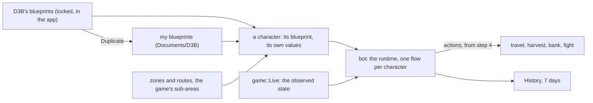
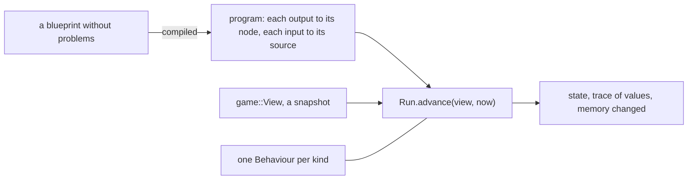
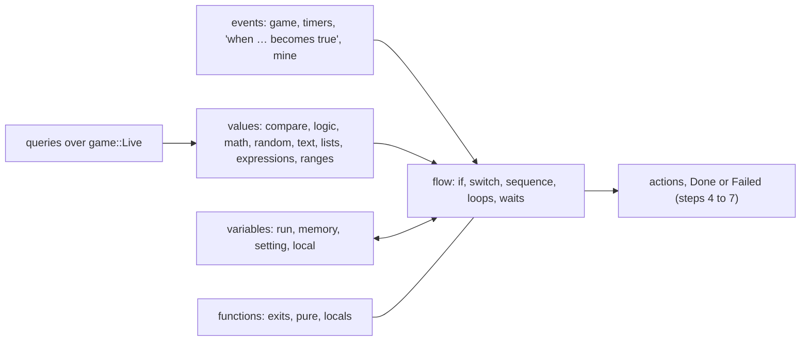
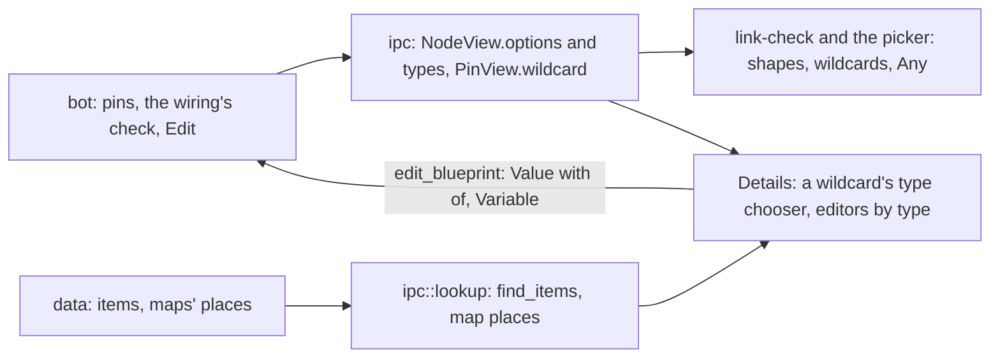
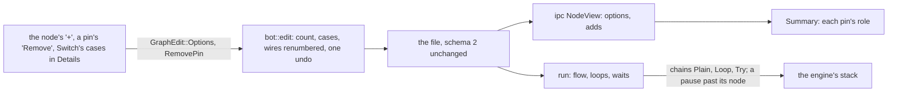

# The bot

What the player tells the bot and how they see what it does (roadmap step 3), designed with the owner on 2026-11-12
and 2026-11-13 from mock-ups, then a clickable prototype in the real shell (local branch `prototype/step3-model`,
never merged). Its model is Unreal's: a **blueprint** is a class, a **character** an instance that runs one, and a
variable marked "set per character" is a setting each character sets for itself (ADR 0014). Nothing acts in the game
before step 4: step 3 delivers the model, its editor, its storage, and its runtime tested on captures; Play, what it
does now, its History and the debugger come with step 4's first actions.

## The concepts

The six scenarios the owner chose (first launch; two characters, two zones; a goal; my own behaviour; understanding
what it does; a D3B update) need these and nothing else: no profile, activity, place or goal field.

- **Blueprint**: an event graph, functions and variables. D3B's own ship with the app, **locked**: automatic harvest,
  profession harvest (one blueprint, its profession set per character: the owner, 2026-11-14) and hunt, until v2's
  eight replace them ("The language, v2", D3B's blueprints); **Duplicate** makes one of mine, fully editable, noting "based on
  X vN": named "<name> (copie)" in the player's language, its texts taken from the interface since a given
  blueprint's are translations, its id made from its name (accents dropped, a number when taken by a blueprint or by
  any file of the folder, in any case); a copy of mine keeps what mine was based on (the owner, 2026-11-14). A given blueprint's new version reaches the characters that run it, their values kept; my copy stays as it is
  and says its original has a newer version (step 3's PR 23, the owner's choices of 2026-11-16): at start, each
  character running a given blueprint of a newer version than its file notes has its settings carried as when another
  blueprint is chosen, a value kept when the new version's setting of the same id accepts it (the old version's types
  are not shipped), and the values lost are said in a notice above its settings, live and offline, until the player
  closes it; a copy whose original is newer says "its original has a newer version, vN" in its tab's line and its
  Library hover, a blue arrow on its row, and offers nothing more yet (a compare may come later).
- **Character**: runs one blueprint, chosen in its tab, none until the player chooses one; another blueprint keeps
  the values of its settings of the same id and type and drops the others (the owner, 2026-11-16), and those out of
  their new bounds or equal to their new default. Its **settings** are the blueprint's variables marked "set per
  character" (Unreal's Instance Editable): the blueprint holds the default, the character its own value, marked when
  it differs and reset in one click. Two characters, two zones, one blueprint.
- **Variable**: a type (zone, route, percentage, number, items, bank, profession, yes or no…), a default, bounds, a help line, set
  per character or not, and a duration: one run, or **memory**, kept per character across sessions. A goal is a
  variable tested in the graph ("stop at 5,000 harvests").
- **Zone**: maps the bot goes through its own way. The game's **sub-areas are ready-made zones** (`sub-areas.json`
  lists their resources and monsters); a zone of mine is painted map by map or a whole sub-area at a time.
- **Route**: an order of passage only: anchor maps joined by the shortest way on the world graph (its scrolls, doors
  and map actions; zaaps join it with step 4's travel), as a loop, one way or a round trip. What is done on the way comes from the blueprint.
- **History**: what each character did, as episodes ("Bank · 3 min") with their reason.

## How a blueprint runs

As decided on 2026-11-12, on Unreal's event graph (ADR 0014):

- **One flow per character, one action at a time.** "On start" is the main flow. Another event (a fight starts, life
  below, pods above, every N minutes, the map changed, reconnected) interrupts it by **priority** (1 before 2) and by
  its **mode**: interrupt then resume (the default), wait for the current action, interrupt and restart from the
  start, or in parallel for a graph that never acts. A threshold fires once and re-arms past its reset value. "You took
  control" (step 4) is above everything, outside the graph.
- **Actions are goal-shaped**: an intent and a check on the observed state that says it is done ("on map X", "pods ≥
  80 %"), so an interrupted action resumes by running again. Each ends **Done** or **Failed** with its reason; a Failed
  left unlinked blocks the character with that reason.
- Unlike Unreal's, a **function** may hold actions that last (2026-11-12): moving to a bank is one.
- **Queries** are read when the node that uses them runs; the value used is kept for the debugger.
- **Events the game forces**, when the blueprint does not handle them, have a default: a fight is fought by the
  default AI (step 6), then the flow resumes; a death stops the run, blocked.
- A setting changed while running applies at the next safe point, between actions, and says so. The states: without
  blueprint, ready, running, paused, finished, blocked (with its reason), disconnected (listed greyed, its blueprint
  and values kept). A blueprint with a problem cannot run.

### The runtime

`bot::run` (step 3's (25), designed with the owner on 2026-11-16, ADR 0017) runs a blueprint for one character, a
node at a time, against the observed state, on a clock it is given. It knows no kind of node: each brings its own
behaviour, so v2's plug in without touching it. Nothing acts in the game before step 4, whose Play drives it.

- **Compiled**: a blueprint is compiled into a program, each flow output to the node it leads to and each value input
  to its wire, its typed value or its pin's default, so the file's schema stays out of the engine (v2.1's schema 2
  changes the compilation only). One with a problem is refused.
- **Advanced**: `Run::advance(view, now)` runs nodes until the flow waits on the clock or the observed state, ends or
  blocks; the clock is injected, so tests drive it. Step 4 drives it from one actor per character fed the view's
  snapshots (the owner, 2026-11-16: the engine alone in (25), the C# version's actor per character kept).
- **One behaviour per kind**, behind one trait in a registry by kind id: when the flow reaches its node it goes out of
  a pin, runs a chain and comes back (Sequence's outputs, a loop's body), waits, returns an exit, leaves the loop,
  finishes, pauses or blocks; a value node gives its output when read. Get, Set and Call are the engine's own.
- **An explicit stack**, no async: a frame per call (its locals, its nodes' counters, its outputs) and per chain, which
  comes back to the node that ran it when its flow ends; Leave the loop unwinds to the nearest loop. A waiting run is
  its stack, so an interrupted flow keeps its place, its loops' counters and its calls.
- **Values are pulled** when the node that uses them runs, through their wires, each computed once for that node
  however many inputs read it; each value used goes to a bounded trace (its node, pin, value and time, the last
  1,000) for the debugger.
- **Variables**: a run's from their defaults, a setting from the character's own value; memory is given at the start
  and its changes handed back, to be saved in the character's file under `memory` at safe points (the owner,
  2026-11-16; from step 4's wiring, the file's schema 3), kept on another blueprint for the same id and type, as a
  setting.
- **An action before its step** waits for its check on the observed state (the owner, 2026-11-16): the player doing it
  by hand completes it, and step 4 only adds the doing; a check on what D3B does not observe yet fails "D3B does not
  see this before step N", its reason the id `unseen_before_step_<N>` the interface words (settled alone). Go to a zone
  is done on a map of the zone; Harvest until and Hunt until once the pods reach their share, their harvests' count
  not given before step 5 (a node reading it blocks); Go to the bank on the bank's map, the nearest one failing until
  step 4's paths; Deposit all but failing until step 5. Wait counts its duration from when the flow came in, Wait for
  life waits for the life's share, read each second since it rises with no message; Notify's texts wait in the run, the last 100, for step 4's History. The queries
  read the view when used, one not seen yet (no life read since the connection opened) blocking with what is missing.
- **What it knows beyond the view** (whether a map is in a zone, a profession's resources) it asks of a `Knows` that
  step 4's actor answers from the game data and `storage`'s zones; unknown, an action waits and a query blocks.
- **It blocks**, with the reason and the node, on an unlinked Failed outside any Retry's try (from (v2.3), one inside
  starts the next try), a death (the character's fights lost rising:
  the forced default; a `died` event held by the blueprint is (26)'s), 10,000 nodes in a row without waiting ("runs
  without pause"), more than 64 calls at work one inside the other, a value that cannot be computed (on the node
  that computes it), or a Set out of its variable's bounds, which memory would lose at the next run (settled alone). Its states are ready, running, paused,
  finished and blocked; without blueprint and disconnected are the character's: no view holds the run, and the node
  at work runs again once the character is back, as actions are goal-shaped. A Wait counts the clock's time (settled
  alone).
- **(26)'s seam**: a stack of flows, one today; an event pushes its own, and when it ends the flow under it enters its
  node at work again; Restart empties the main flow; a safe point is the moment between two nodes. The other events
  compile as starts nothing runs before (26), so D3B's blueprints run now; a death is a fight lost since the run first
  saw the character, those lost before it not counting, and counted again from 0 after a new connection or
  selection. Away, a run waits on nothing; finished, paused or blocked, it asks to be woken by nothing.
- **On the owner's captures** (2026-11-16, the 54 game connections of 3.7.13.17): a blueprint waiting for full life,
  then a minute, then reading its life and looping ran on each of the 49 characters chosen, 6,900 turns, blocked
  only by the 6 deaths, each at its fight's end, and never "runs without pause".

## The language, v2

After measuring the editable graph, the owner asked on 2026-11-16 for blueprints "much more complete", able to do
much more, and "as practical as a Lua script and as complete" (the reference bots' Lua API and 58 profession scripts,
read for ideas only: `lua-reference-analysis.md` in the sessions' notes). v2, designed that day from a mock-up of the
catalogue and of the Summary (ADR 0016), keeps the model above and gives the player a real language: loops, many-way
branches, conditions and arithmetic, typed expressions, level ranges, lists, timers, events of their own and of any
condition, more of the game read, the actions of steps 4 to 7, and richer functions and routes. It goes from 25 kinds
to about 130.

- **Values are compact nodes**, as Unreal's: `=`, `≠`, `<`, `≤`,
  `>`, `≥`, between; AND, OR, NOT, Choose (a value if true, another if not); `+`, `−`, `×`, `÷` (whole), remainder,
  min, max, clamp, "… % of …"; a random number between two bounds, "true N % of the time" and a random element of a
  list (the owner, 2026-11-16: randomness is the player's to use); Text, a template whose `{holes}` are inputs of any
  type, and Join; N minutes and N seconds; a list made of its inputs, its length, contains, element n° (from 1),
  first, position of. They have no flow and are read when the node that uses them runs, the value kept for the
  debugger; v1's "at least" becomes `≥`.
- **Expression**, beside them (the owner, 2026-11-16, for Lua's one line): a value node holding a typed formula,
  `pods_percent >= 80 and job_level(bûcheron) < 100`, over the queries, the variables and the values' operators,
  parsed and checked by Rust (its type, each name, each argument), with completion as it is typed; it reads and never
  acts, and the Summary shows it as written. A name it does not know is a problem, as a wire would be.
- **Ranges** (the scripts' tables by level): a type "from level N: a value" of any type (a zone, a route, a number…),
  edited as a sorted table, gaps and overlaps marked, pasted from text; "According to the range of …" gives the value
  of the row a number reaches, or follows that row's output. "Equip the best I carry for my level" (below) needs no
  table.
- **Types**: v1's (yes or no, number, percentage, text, zone, route, bank, items, profession) and a **map** (a map's
  id, picked on the World), one **item**, a **duration** (whole seconds, typed "1 min 30") and a **time** of day
  ("23:00"), an **NPC**. Any type has its **list** (a list of zones, of maps, of numbers…), its pin a square. A generic pin, a
  **wildcard**, takes the type of its first wire or value, and every wildcard of a node the same one: one `=`, one
  Switch, one For each for every type. The node notes that type (the owner, 2026-11-17, as Unreal keeps its pins'
  types), since a value alone does not say it (`5` is a number, a duration, a map…): one truth for the editor, the
  Summary and the runtime. A percentage feeds a number, any value a Text's hole; numbers, percentages,
  durations and times are compared. v1's Items stays the selection actions take ("all", "none", these items); a list of
  items feeds it, and For each takes lists only.
- **Flow**: v1's If, Wait (now a duration), Wait for life and Finish; Sequence (its outputs one after another, "+" adds
  one); Switch on a value (an output per case, typed in the node, and Otherwise); Repeat N times (its index), While,
  For each element of a list (the element, its index), each with its body and Completed, and Leave the loop; Do once
  and Do N times (each re-armed by its Reset input); Alternate (A, then B, then A); Wait until a condition, with an
  optional longest wait (Then, or Too long); Retry an action up to N times, then Failed; Pick from a list, in turn,
  the least recently picked or at random (its memory per node, for the run; (v2.3) below merges Do once into Do N
  times and keeps one mode of Pick); Trigger an event of mine, now or after a duration, and Cancel its timer (with (v2.6));
  Block with a reason; Pause and notify (the player resumes it, from step 4). Gate, MultiGate and Unreal's rarer
  nodes stay out: a bot hardly uses them (the owner, 2026-11-16).
- **Variables**: a duration of one run, or **memory** per character; set per character or not; and **local** to a
  function, gone at its return. Beside Get and Set: Add N to, Reset to its default, and a list's Add, Remove and Empty.
- **Events**: v1's six; **When … becomes true**, on any condition built of values and queries, with a priority and a
  mode, firing as it turns true and re-armed when it turns false or, through its optional "Re-arm when" input, when
  that turns true (hysteresis, as Life below); **Every** a duration; **At** a time of day; the map changed (its map and
  sub-area); a fight ended (won or not, from the fight end's results, the pin
  that the death needs too, `artifacts/studies/death.md`); a level gained; reconnected (step 4); an item obtained and a profession's
  level reached (after the inventory's and the professions' studies, step 5). **Events of mine**, declared in My Blueprint with their inputs, each a node of the event graph with
  its priority and mode, are fired by Trigger, at once or by a timer; a timer lasts for the run. Life below and Pods
  above stay, ready-made.
- **Queries over `game::Live`**: v1's life %, pods %, level and a profession's resources; life, its maximum, pods and
  their maximum, kamas, energy, the level's experience %, the current map, its sub-area, whether in a zone, its X and
  Y, whether in a fight, the monster groups on the map (up to a level), the resources harvestable here, the time and
  how long the run has lasted; the run's own counts (harvests, fights won and lost, kamas earned), which the runtime
  keeps. What D3B does not observe yet is listed and marked, studied and pinned at the step that reads it (the
  owner, 2026-11-16): whether in the haven bag and the zaaps known at step 4; an item's quantity in the inventory, what
  is equipped and a profession's level and experience at step 5 (with the bank's content); the quests at step 7.
- **Actions**, each Done or Failed with its reason, marked with their step, each studied before it is done: go to a
  zone, to a map, follow a route N laps; go to the haven bag, take a zaap to a map, save a zaap, go through a door or
  use an interactive element (its skill), talk to an NPC and give its replies in order, leave the dialog (step 4, an
  **NPC** a type); harvest until, harvest this map, go to the bank, deposit all but, withdraw, deposit to the haven
  bag's chest, use an item, open the resource bags, equip the best I carry for my level, equip an item or a preset,
  set the game's own "experience received" (step 5); hunt until, attack a group (its levels), fight with the default
  AI (won is Done), leave the fight (step 6); craft N of an item, sell items at the auction house (step 7); notify,
  and note in the History (step 4); destroy items (step 5); switch to another blueprint (step 4, the owner,
  2026-11-16): the character's file then names it, its settings carried as when the tab chooses one, and it starts
  from its On start. Choosing a fight's challenges waits for step 6's design.
- **The fight AI's direction** (the owner, 2026-11-16, from the reference scripts' fight rules), designed at step 6
  with the fight's state, the spells and the effects: a **fight profile** is a value edited as an ordered list of
  rules (a spell, a target, a cell, typed conditions, how often it repeats, whether to move to cast), the first
  that holds is played and the list read again until none does; D3B ships one per class, shareable, and **the
  default AI is the character's class profile**; for advanced players, an event "On my turn" overrides it in the
  graph. The fight profile (a type) and "On my turn" (an event) are marked step 6 until then.
- **Routes** ((21), the owner, 2026-11-16): an anchor may hold an action (harvest, fight, nothing, or call a function
  of mine) and a forced exit (a door, a cell) where the world graph is not enough; Follow the route resumes from the
  map the character is on, as the scripts' "on map X, do Y"; a route is recorded while playing (the relay observes the
  maps crossed and makes them its anchors), and pasted or copied as text (`5,-18 left; 4,-18 …`, or maps' ids).
  An anchor holds its map's id, shown by its coordinates, since a building's inside and its street share them (pasted
  coordinates that two maps share take the one the world map draws, and say so); a
  forced exit's cell is picked on the map.
- No library of functions shared between blueprints: functions and per-character settings already cover the
  scripts' copies.
- **Functions** gain **named exits** beside Done and Failed ("Full", "Empty"), each a flow output of their call;
  **locals**; and the **pure** function, which computes values without flow, actions or waits, its call a value node.
  No macros: a function already holds actions that last.
- **Practical, intuitive, complete** (the owner, 2026-11-16), the bar of every kind: few kinds, each well named and
  running as it is dropped, from its defaults (an input no default can fill, a zone, a map, an NPC, an item, stays
  required, its problem saying what to choose); a node shows its main inputs in its sentence and folds the others
  under "Advanced" (a longest wait, a re-arm, a group's levels), unfolded as soon as one is wired or changed, as
  Unreal's advanced pins; data editors (routes, ranges, item lists) rather than long chains of nodes. The **picker
  groups by intent** (the owner, 2026-11-16): Move, Harvest, Bank and items, Fight, Wait and repeat, Conditions and
  calculations, Lists, then My variables, My functions, My events; "Often here" first by context, extended to v2's
  kinds; its search finds synonyms too ("boucle" finds While and For each). A node keeps its family's colour.
- **D3B's blueprints** (the owner, 2026-11-16), all configurable, all running as given with no setting changed:
  **Récolte** (every profession's resources the character can take, the Base ones such as wells left out as in the
  C# version), **Combat** (monsters for experience and loot), one per profession, **Mineur**, **Paysan**,
  **Alchimiste**, **Pêcheur**, **Bûcheron**, and **Chasseur**, the profession (job 41: fights with a hunting weapon
  for meat, after its study). This reverses 2026-11-14's one profession blueprint, its profession a setting. Where
  they go is, by default, **ranges computed from the data** as the app runs, never written in the blueprints'
  committed files: a resource's worth halved every 20 levels below its profession's, a monster's below the
  character's, nothing above, Combat's sub-areas holding at least 10 maps of the world map (no dungeon), the row of
  the level read again each tour (how, below: "The ranges computed from the data"); the monsters' levels and drops
  come from the extractor's **format 5** (the owner, 2026-11-16). A setting replaces them
  by ranges, a zone or a route of mine. Five or six settings show, those changed often: where, the pods' threshold,
  the bank (the nearest, a map, or the haven bag's chest) and the items kept, fighting on the way, the goal (a
  profession's or the character's level, a number of harvests or fights); the others fold under "Advanced",
  unfolded when one differs from its default (the owner, 2026-11-16; the C# version reached 24 and hid half): the
  order a map's resources are taken in, the rotation, the zaaps, food, the life to wait for, what follows a lost
  fight, the monsters chosen or left out, equipping the best carried for the level (on) or a named preset, an
  optional night pause, restocking (N of an item kept on the character, taken back from the bank after a deposit,
  step 5), items to destroy now and then to free pods (step 5, none by default; destroying cannot be undone, which
  the setting says, and the History notes each), and from step 6 the fight profile, the class's by default. Every
  resource of the profession is taken where the character is (only the place follows its level), and Combat attacks every group its size and the monsters left out allow, no bound of level by
  default, one optional under "Advanced" (the C# version's D387: the zone chosen for the level bounds the risk).
- **The ranges computed from the data** (`bot::places`, (v2.10)'s second PR, done in code; the owner's choices of
  2026-11-17): a table by level, from 1 to 200, rows "from level N to M: these sub-areas", consecutive levels of the
  same sub-areas in one row, as a player's ranges of a list of zones are written, so that the player can read them
  and start from them. Each row holds the sub-areas worth most, the richest first, then (settled alone) the one whose
  level is nearest the row's, then by id: at most 10, each worth at least a quarter of the richest (the C# version's
  rotation, D391). A
  profession's table follows its level: each resource of that profession a sub-area lists counts once, worth 1 at the
  profession's level, halved every 20 levels below, smoothly, nothing above (the data says which resources a sub-area
  holds, not on how many maps: the maps come with the graphics learned, step 5). Combat's follows the character's:
  each monster a sub-area lists counts once, whole when one of its grades reaches the level, nothing when even its
  lowest is above, else halved every 20 levels below from its highest grade (the C# version's D166 and D245), in the
  sub-areas not above the level drawing at least 10 maps on a world map, else, at a level where none holds a monster
  worth fighting, those drawing at least one. A sub-area of no map that the world graph reaches on a world map is
  never taken: on 3.7.13.17 they are dungeons, a mine of one resource ("Mine", 778), the tutorial and a convention's
  test zone listing 85 resources, which topped every profession from level 100. As the bot plays, a sub-area above
  the character's level, or closed to a basic account when its account is not subscribed, is left out (`fits`), and when none of its row is left, the rows below are read until one holds a sub-area it
  may enter (`reachable`; the owner, 2026-11-17: a level-20 lumberjack of 100 harvests rather than nothing).
  Measured on 3.7.13.17's data: every level from 1 to 200 has a row, Combat in 126 rows, from the Route des âmes of
  Incarnam at levels 1 to 4 (no sub-area of 10 maps shown holds a monster there) to Osavane at 200; the five
  professions in 34 to 53 rows, a lumberjack of 100 first to the Bois de Litneg as the C# version measured at 80, a
  miner of 1 to 5 to the Souterrains, whose maps the C# version found isolated (D264): the tours of step 5 leave
  those out. All six tables in under 20 ms.
- **What the C# version measured**, carried into the actions of steps 5 and 6, its values starting points to measure
  again (the owner, 2026-11-16): the **rotation** over the N richest sub-areas of the level, the one left longest ago
  first (D391, D392); **regrowth learned** by skill while playing, a tour waiting on the longest seen and stopping on
  the way at a resource offered (D145); **losses and banks made safe**: after a loss, wait for the life to resume
  at, three losses in a row stop, a bank tried three times and still full stops with the reason (D198, D405);
  **interiors**: a house entered only when known to hold what the level can take, mines kept reachable, Combat out
  of interiors but dungeons (D388, D416, D417). Its notes: `csharp-settings-for-v2.md` in the sessions' notes.
- **Kept out**: anything about other players (counting them, fleeing them, answering them), and what `CLAUDE.md`'s
  "Never" lists.

At run time ((25) and (26)): a loop's body ends where its flow does (an output wired to nothing) and the loop goes on;
Leave the loop goes to its Completed; Sequence runs its next output when the previous one ends. **10,000 nodes in a
row without the flow waiting** on the clock or on the observed state block the character, "runs without pause", on the
node (the owner, 2026-11-16): an action already done, a Notify or a Wait of 0 s does not count as waiting. A When's condition and a Wait until's are read again at each change of the observed state and each
second; Every and At follow the clock, At once a day. An interrupted flow keeps its place, its loops' counters and its
calls, so "interrupt then resume" runs the action cut again inside its loop. A random value is drawn when its node is
read and shown by the debugger; reversed bounds are swapped. A value that cannot be computed (÷ or remainder by 0,
an element out of its list, the first of an empty list) blocks the character with the reason and the node, as an
unlinked Failed does. Times are the computer's local time; "between 23:00 and 08:00" goes past midnight. Memory variables, lists too, are saved in the character's file at safe points.

The **Summary** reads a loop's or a Sequence's body as sub-steps ("1.1", "1.1.1") with Completed after them, a Switch
as one line per case ("Bûcheron → 2.1", "Sinon → 2.4"), Trigger as "Déclencher « Zone vide »" or "Dans 10 min, …"; a
section per event of mine by priority beside the game's; values are read in place in the sentence that uses them
("Tant que récoltes < objectif"), never as steps.

In the file (`bot::json`, **schema 2**, its shape settled alone in (v2.1), done in code): a map, an item
and an NPC are the game's ids (`191104002`, `289`, `774`), a duration its whole seconds (`90`), a time `"HH:MM"` from
`"00:00"` to `"23:59"`; a variable, a parameter or a local holds `"list": true` for a list, an array of its values,
and `"ranges": true` for ranges, rows `{"from": 1, "to": 49, "value": …}` with both ends included, in any order, each
row's value one or, with `"list"`, a list; two rows a level reaches at once are a problem, a gap none (the runtime says
what a level in no row does). A wildcard's type is the node's `options.type` (`{"type": "zone"}`), set by the editor's
first wire to one of its wildcards, of the wildcard's shape (a list into a list's), and dropped with its last wire or
value, a variable's change or deletion included; a first value on a wildcard of a node with no type is typed as a
type the editor gives with it (from (v2.2)), which the node notes; two wildcards are never wired to each other, and a
list of items feeds the items actions take, a list never one value. Bounds hold for a single number or percentage
only. A node's own pins (Sequence's outputs, Switch's cases, Text's
holes, a list's inputs) and the event, variable or exit it names are its `options`, every one defined in schema 2 even
where its kind comes later, so that a kind added never changes the file's shape (step 2 of (v2.1), done in code):
`type`, `count` (1 to 255, the kind's least when none is given), `cases`, `text` (a hole is a well-formed id between
braces, `{count}`, each once; other braces are text; a wire of any value feeds a hole, and a value typed there is
text), `expression` (the formula (v2.8) parses), `variable` (a kind
that changes it, Add to or a list's Add, types its wildcards by it rather than by `type`), `event` and `exit` (with
their nodes, step 3 of (v2.1)); each kind says which it takes; the blueprint's own `events`
beside its `graphs`, each with its id, name and inputs, its node `my_event` naming it in `options.event`, held once
per event, its inputs that node's outputs; a function's signature gains `exits` (an id and a name each), `locals`
(variables, each from its default at a call, one without a default having none until a Set gives it one, a Get
before blocking the character as a value that cannot be had; a Get or Set in its function reading it, and the
picker offering it there) and `pure`, its returns by
an exit `return_exit` naming it in `options.exit` and a pure function's `result` (step 3 of (v2.1), done in code: a
return by an exit and the locals run; an event of mine starts nothing before (26), and a blueprint calling a pure
function is refused, "result" not running, until the engine reads pure calls; the picker offers neither an event of
mine nor a return by an exit, which (15) and (16) add from My Blueprint). A
schema 1 file reads migrated in memory by `bot::schema` ("at least" to `≥` of numbers, a Wait's minutes typed to
its seconds, ×60, and a Wait whose minutes a wire fed to a node "N minutes" fed by that wire, left of the Wait where
it is placed; a value no whole minutes held stays and says its problem), and is written as 2 at its next change, so
a file only read stays as it is (step 4 of (v2.1), done in code: `≥` and N minutes come before v2.4's other values,
`≥` comparing numbers, percentages and durations by their value and times "HH:MM" by their order, another type
noted on it a problem, and reading numbers while its node notes no type (the owner, 2026-11-17: as "at least" did,
so the editor keeps working until (v2.2) types it), a kind's types with the first by default; Wait's input is
`duration`, 60 s by default, typed in Details as "1 min 30", "5 min" or "90 s", a bare number refused (the owner,
2026-11-17: v2.2's duration editor brought forward, so a Wait's time stays typed));
D3B's blueprints ship as 2. A node still does one thing (`kind`, `get`, `set` or `call`), with `options` beside;
the pins its options make are numbered from 1: Sequence's `then_1` to `then_n`, Switch's `case_1` to `case_n` (the
cases' values in `options.cases`) and `otherwise`, a list's inputs `in_1` to `in_n`; Text's inputs are its holes'
names (`{count}` is the pin `count`), each of any value, a hole renamed or removed dropping its wire. A call has a flow
output per exit of its function, the exit's id its pin's, beside `done`, `failed` and `reason`; a function's locals
live in its call's frame. A pure function's call has no flow pin and is read on demand, as a query is, its value kept
for the debugger. New problems: an exit named as a built-in pin (`run`, `done`, `failed`, `reason`) or as an output, an event's
input as its node's `then`,
an exit, a local or an event's input given twice, a local named as a variable, two events of mine of one id (step 3);
a wildcard wired or given a value
before its node has a type, and a type on a node without wildcards (`options` it does not take); a list or ranges
into a pin of another shape (step 1 of (v2.1), done in code; a wire of another type into a typed wildcard is v1's);
an option the node's kind does not take, and one it needs and lacks (the variable it changes, an Expression's
formula); a Switch's case not of its type or given twice, its cases using its wildcard as a wire does (step 2); an
option naming a variable the blueprint lacks (step 2), an event or an exit (step 3); a flow pin in a pure function,
an action, a wait, a Set or a return, and its result elsewhere, the picker offering a pure function none of them nor a
call of a function not pure (step 3); Leave the loop outside a loop's body; a time not "HH:MM"; an Expression that does not
parse, names what the blueprint lacks or is not of its pin's type; ranges whose rows overlap.

### The editor reads it (v2.2)

Designed with the owner on 2026-11-17: the editor checks a wire as Rust does and draws v2's types; a variable of mine
takes them, so each editor has a use measured now.

- **Wires** (the drag's check and the picker's "what fits", from the same rules as `Carries::feeds` and `types`):
  a value feeds a wildcard of its shape and types its node, an untyped wildcard never another, a list only a list,
  ranges only ranges, a list of items the items, a percentage a number, any value a Text's hole; a type a kind's
  wildcards do not take (`Kind.types`) is refused when wired. An untyped `≥` stays open to its types (its numbers
  are only what it reads while none is noted), so it compares durations and times once wired or typed: a wire that
  feeds as it reads wins, so a percentage or a number notes no type, in either order; another taken type types it
  while no other wire or value uses its wildcards as numbers, the input an edit replaces not counting; a value given
  with no type is read as a number, one with a type its kind takes types it, one it does not take is refused, and on a
  node already typed the type given is not looked at (step 1 of (v2.2), done in code).
- **The drag's check** and the picker's filter follow the same rules in the editor (step 2 of (v2.2), done in code); it
  does not know when an untyped `≥` is read as numbers by another wire or value, so the drag lets a duration in and
  Rust refuses it when saved.
- **Pins** (the owner, 2026-11-17, from a mock-up): a value a filled circle, a list a filled square, ranges a hollow
  square of the type's colour, an untyped wildcard a hollow grey circle (a hollow grey square for a list one), a typed
  wildcard drawn as its type, a variable's pill as a box's pin (step 2 of (v2.2), done in code). **Colours by family**: a map teal beside the zone and the route (`#5fb3a1`), an item
  orange beside Items (`#e0a46b`), a duration and a time violets beside the numbers they compare with (`#b5a7ff`,
  `#d6a8ff`), an NPC pale yellow (`#dcdcaa`).
- **Details**: a value typed on an untyped wildcard comes with a type chosen beside it, among the kind's (`of`), every
  type but the NPC for a kind that lists none; the first is chosen first and, for a kind reading it meanwhile (`≥`),
  sent as none; the choice is offered only while the wildcard is open, its node changing no variable and no other
  wildcard of it wired or holding a value; editors by type: a duration ("1 min 30"), a time ("23:00", one not of that
  form refused), a map, an item, a list (a row per value, + and ×) and ranges; a map, an item and an NPC show their
  id until their data comes (step 3 of (v2.2), done in code for the chooser, the time and the values' words).
- **A map** (the owner, 2026-11-17): the field's target opens the World tab's choosing mode, a hover outlining one map
  and a click taking the one the world map draws there, Escape cancelling; "5,-18" may be typed; "Where is
  <character>" takes the map a character online stands on, an inside too, which shares its street's coordinates;
  the map is shown by its coordinates and sub-area, typed coordinates are on the world the World tab shows (the
  Twelve's before it shows one), a click takes the map with the priority there else the first by id, a map at 0, 0
  without the priority none's, and Rust's `map_at` and `find_maps` look them up (step 6 of (v2.2), done in code).
- **An item** (the owner, 2026-11-17): every item but the invisible (type 203), searched by name in Rust (accents
  ignored, 50 at most), each with its icon, level and type (`find_items`; those starting with the text first, then by
  level); a click, or Enter for the first, chooses it, the one chosen shown by its icon, name and level, by its id
  without the game data (step 5 of (v2.2), done in code).
- **Ranges** (the owner, 2026-11-17): a table "From level", "To level" and the value in its type's editor, sorted
  when a field is left, overlaps marked on their rows, a gap a faint row "levels 50 to 59: nothing", + and ×, levels 1
  to 200; a text pasted, lines `1-49: value` or columns separated by tabs (a spreadsheet's), each value as it is
  typed (a name, "5,-18", "1 min 30", an id), replaces the table, undone by Ctrl+Z, a line not read said by its
  number with nothing changed; "Copy as text" gives it back (step 7 of (v2.2), done in code: a value's words are its
  editor's, a sub-area's, zone's, profession's or item's name or an id, a map's coordinates on the world the World tab shows, a list's
  separated by ";", an item by its whole name only; a map is copied by its coordinates when they read it back on
  the world the World tab shows, else by its id, an inside or another world's; a gap shows in its place, a row is
  added from the level after the highest and none once a row reaches 200, and a blank paste changes nothing).
- **My variables** (the owner, 2026-11-17: before (14), so the editors are used): the variable editor offers a map,
  an item, a duration and a time (the NPC at step 4), and two switches, "List" and "By level" (ranges), its default
  and a character's setting typed with the editors above, a list a row per value in its type's editor, × to remove one
  and a last row adding the value typed there (step 4 of (v2.2), done in code; ranges said by their rows until their
  table, step 7, done in code; a type its editor waits for, a route or a bank, shows its rows and takes no new one yet; a type read
  "Durée · liste" or "Zone · par niveau"). (14) keeps the locals and the variables' nodes.
- **A node's options** ("+" a case or an output, the owner, 2026-11-17) come with v2.3's Sequence and Switch, their
  first kinds: "+ Add an output" on the node for Sequence's outputs and a list's inputs, Switch's cases typed in
  Details a row each with + and ×, and a pin's right-click "Remove" dropping its wire (step 2 of (v2.3), done in
  code, below).

### The flow's kinds (v2.3)

Designed with the owner on 2026-11-17: the flow's kinds run, each with its problems, its words in French and English
and its reading in the Summary, and a node's options are edited, closing (v2.2). It starts before (v2.2) is measured,
both steps of blueprints v2, (v2.2)'s measures taken alongside (the owner, 2026-11-17).

- **The kinds**, and their pins (the owner, 2026-11-17, on a mock-up of the Summary: Séquence, Selon, Répéter N fois,
  Tant que, Pour chaque, Sortir de la boucle, Au plus N fois, Alterner, Attendre que, Essayer jusqu'à N fois, Prendre
  le suivant de, Bloquer, Mettre en pause et prévenir):
  - v1's If, Wait (a duration), Wait for life and Finish, as they are;
  - **Sequence** (`then_1` to `then_n`, at least 2), as Unreal's: no Completed, its last output the rest of the flow,
    the Summary reading its outputs but the last as sub-steps under it (`1.1`, `1.2`) and its last at the level of
    the steps around it (`2`), as the owner's mock-up shows;
  - **Switch** on a value (a wildcard of any type but lists and ranges, an output `case_n` per case and `otherwise`);
  - **Repeat** N times (`times`, 3 by default, `body`, `index`, `completed`), **While** (`condition`, `body`,
    `completed`), **For each** (a list, `body`, `element`, `index`, `completed`), the list read once as the flow
    enters, indexes from 1, and **Leave the loop**;
  - **Do N times** (`times`, `then`, and a second flow input `reset` re-arming it), Do once being N = 1, read "Une
    seule fois" (the owner, 2026-11-17: one kind rather than two);
  - **Alternate** (`first`, then `second`, then `first`);
  - **Wait until** a condition (`longest`, a duration, 0 none; `then`, or `too_long`), counted again after an
    interruption as Wait is;
  - **Retry**, a node whose body `try` is tried up to N times, the first included (the owner, 2026-11-17: it wraps any
    chain of actions, rather than a setting on each action or a function's call): an unlinked Failed inside it starts
    the next try, after the last one `failed` with its `reason`; a Failed wired inside it is not retried;
  - **Pick** the next of a list (`then`, `element`), the least recently picked, which is in turn while the list does
    not change; at random is (v2.4)'s random element of a list (the owner, 2026-11-17: one mode);
  - **Block** with a reason; **Pause and notify** (`text`, `then`), which pauses the run past itself, so that resuming
    (step 4) goes on after it.
- **Memory** of Do N times, Alternate and Pick is the node's for the whole run, in a function called many times too,
  and kept through "restart from the start" (the owner, 2026-11-17).
- **Out**: Trigger and Cancel its timer come with (v2.6) and (26), when an event of mine starts something (the owner,
  2026-11-17); a value read in a sentence ("Tant que récoltes < objectif") with (v2.4)'s values; "Advanced" with (v2.9).
- **A node's options**: "+ Add an output" on Sequence (a list's inputs reuse it in (v2.4)), absent on D3B's
  blueprints; Switch's cases in Details, a row each in the type's editor with + and ×, a case given twice marked; a
  pin's right-click "Remove" drops its wire and renumbers the later pins and their wires, as Unreal does, refused
  below the kind's least. Each is one change, undone in one step (`GraphEdit::Options`, `GraphEdit::RemovePin`;
  `NodeView.adds` says where "+" goes). Step 1 of (v2.3), done in code: Sequence and Switch run, their outputs and
  cases are edited in Rust (`bot::edit::options`; a count back at the kind's least is written as none, the cases of
  a Switch with no type typed by `of`), and Otherwise is drawn after the cases.
- **The engine** (ADR 0017, matching no kind): a chain is plain, a loop's (what Leave the loop ends) or a try's (where
  an unlinked Failed ends the try rather than blocking); a node's memory lasts the run; a pause stops the run on its
  node, which goes on once resumed. New problem: Leave the loop outside a loop's body (through a Sequence or a Retry inside a loop it is in
  one).
- **The Summary** reads each pin by its role, from one table: `then`, `completed` go on; `true`, `false`,
  `failed`, `case_n`, `otherwise`, `too_long`, `first`, `second` branch; `body`, `try` hold sub-steps (`1.1`) with
  Completed after them; `reset` re-arms and is no step. A Switch reads its cases on one line under it, "Bûcheron →
  2.1 · Mineur → 2.2 · Sinon → 2.3", an unwired case leading nowhere; Wait until "(au plus 5 min)" with its Too long.
  Each body says when it runs, "À chaque tour", "Pour chaque élément", "Tant que c'est vrai", "Essai", "Si tous les
  essais échouent", "Trop long", and a loop's Completed reads as what follows, "Puis (terminé) : aller à 3" (the owner,
  2026-11-17, on the mock-up).
- **Six PRs**: Sequence and Switch in Rust with the options' edits; a node's options in the editor (closing (v2.2)),
  with the numbered pins' labels ("Alors 2", a case by its value; done in code: a node's numbered outputs and cases
  are its rows, none on its head, the "+" absent on D3B's blueprints, the cases' type chosen in Details while the
  Switch notes none and given with the first case, a profession's or a zone's case named, and a pin's row offering
  "Retirer" in place of "Supprimer", greyed at the kind's least; a Sequence's outputs listed in Details, a × each,
  the keyboard's way to remove one (the owner, 2026-11-17), the cases listed there on D3B's blueprints);
  the Summary by pin roles, after its mock-up (done in code: `summary-pins.ts`, a Switch's outputs said on one line,
  an unwired one "→ rien", a function's named exit a branch "Si Plein :" by its name, which the IPC now gives a call
  (`NodeView.exits`) and its node draws too; an output of a kind the table does not know yet titled by its label);
  the loops (done in code: `bot/run/kinds/loops.rs`, a loop's chain the one Leave the loop ends, its pass counted in
  its slot, so an interrupted body keeps its index; Repeat's count read once as the flow enters, as For each's list
  (settled alone); the problem found by following the flow from where it starts, every output but a loop's `body`, a
  function's on its own; a body's title by its kind, "À chaque tour :", and a
  jump out of a loop's Completed "Puis (terminé) : aller à 1."); the kinds that remember (done in code: `bot/run/kinds/memory.rs`, the
  run's `kept` by graph and node, so a function called again keeps it; Do N times of 1 read "Une seule fois", a wire
  into its Reset said "Réarmer 1." (one this flow numbers nowhere by its sentence, "Réarmer « Une seule fois »")
  and drawn as a row, a wire into it ending its flow for the problem of Leave the loop too; its count read as the flow
  comes in, so a Reset is what re-arms it; Alternate's outputs on one line; Pick by each element's JSON and which of
  its copies it is, so one listed twice takes two turns, the memory forgetting what left the list, an empty list
  blocking the character; kept through "restart from the start" once (26) brings restarts, the memory being the
  run's); the waits and stops, in two PRs (settled alone, for their size): Wait until, Block, and Pause and notify
  (done in code: Wait until read again each second and woken at its longest, "(au plus 5 min)" in its sentence when it
  has one, its Too long titled "Trop long :", a value not seen yet waited for as Wait for life does (the owner,
  2026-11-17); Pause and notify telling its text and pausing the run on itself, resumed out of its Then, so a loop's
  body it ends goes on to its next pass and one ending the flow finishes only once resumed), then Retry with its try
  chain and a run on the captures (done in code: a chain is plain, a loop's or a try's; an unlinked Failed ends the
  nearest try, through the calls of functions too (the owner, 2026-11-17: a function in a try behaves as its actions
  would there); Retry reads its tries once, its first try made as the flow enters so 0 tries once (settled alone), its
  index from 1; its try titled "Essai :", its Failed "Si tous les essais
  échouent :"; the run on the captures, v2's flow of a Retry around a Repeat of Wait until and a Switch, waits for the
  owner's captures, and never makes its Retry fail). (v2.3) is done in code, its checklist under "Not measured" in
  `docs/now.md`. Each kind replaces the catalogue's test kinds (`test_sequence`, `test_switch`, `test_for_each`); the
  engine's own test kinds stay, proving its stack apart from any kind.
- **Measured** (nothing acts in the game before step 4): the picker's "boucle" finding the loops; "+" and "Remove"
  with their wires and Ctrl+Z; Switch's cases typed by its type, a case twice a problem; Leave the loop's problem; the
  Summary's lines; a run on the captures that never blocks "runs without pause".

## In the app

The shell's parts (`docs/shell.md`); no information is shown twice:

- **Characters** view: the characters the player has played, a closed client's greyed with its blueprint and values
  kept (a change: step 2's view lists open game connections only). From step 4, a row's hover holds Play, Pause and
  Stop, and the view's header Play all and Pause all.
- A **character's tab**: its blueprint (a list, and an arrow that opens it) and its settings above its observed state
  and map (`docs/game.md`), as the prototype laid them out (step 3's PR 11, the owner's choices of 2026-11-16): "No
  blueprint" at first; each setting by its name, its help on hover, the character's own value marked by a bar on its
  left and reset by a button saying the blueprint's value; a Zone by `ZoneField`, a number or percentage in a field
  within its bounds (one out of them marked and put back), a yes or no by a switch, a text by a line, a profession by
  the game's harvesting professions with their icons; a bank and items say their value, tagged "étape 5", until the
  step that uses them brings their editors. An offline character's tab holds the same, editable. From step 4: one line saying what it does now (its step, on what, since when), a tick on
  the Pods gauge at the current step's target, and Play, Pause and Stop as the tab's editor actions.
- **Library** view: "Given by D3B", then "Mine"; a row opens the blueprint's editor. A row is its name alone, its
  description or what a copy is based on in its hover, an amber mark with how many problems it has; a right-click
  offers Duplicate and Export…, and on mine Rename (F2 too), its name edited in its row, Enter or leaving saving and
  Escape or a blank leaving it (the owner, 2026-11-17); Import… in the view's header (step 3's PR 22); last, folded, "Ignored": the player's files kept as they are, blueprints' and characters', each
  with why in its hover (the owner, 2026-11-14, mock-up 9). A blueprint's tab is its editor, D3B's read-only and mine
  edited in its graph (step 3's PR 12): on top its name, whose it is, its problems, its description, Duplicate and Export, a click on mine's name or
  description editing it in place, as a zone's name (the owner, 2026-11-17: Enter or leaving saves, Escape or a blank
  name puts it back, a description may be emptied; its id and file stay, so its characters and `.d3b` files keep
  naming it; saved through `edit_blueprint` and undone as the editor's changes); under them My Blueprint (the event
  graph, the functions, the variables with an eye on those set per character, a variable's help and default in its
  hover) and the graph chosen in it, and Details on the right (the owner, 2026-11-14): a node chosen says its sentence,
  its description, the step from which the bot does it, its inputs' values (or "wired"), what an unlinked Failed does,
  its problems, and for an event its priority and its four modes drawn as timelines, the one it has marked; a variable
  chosen in My Blueprint its type, default, bounds, whether each character sets it and its help, how long it lasts and
  the nodes that use it; nothing chosen, the blueprint's problems, each in the player's words. A node with a problem is
  marked in the graph. "Graph | Summary", the tab's editor action in the tab strip (the owner, 2026-11-14), shows the
  **Summary** in the graph's place: a section per event, "On start" first and the others by priority, with their mode;
  its steps numbered as the flow runs them, an action's Failed and an If's True and False numbered under their step
  ("2.1"), and from (v2.3) every output by its role (a Sequence's sub-steps, a Switch's line, a named exit "Si Plein
  :"), a node met again said "Back to 2" (or "Go on to 4" forward), a step's "étape N" tag; the events the game
  forces, when the blueprint leaves them, with their default (a fight by the default AI from step 6, then resume; a
  death stops the run; an unlinked Failed blocks with the reason); then each function from its entry. A step chosen
  shows its node in Details.
- The **blueprint editor** is Unreal's Blueprint Editor in a tab. Graph or Summary are its editor actions; its toolbar holds
  the graph's path, the problems, the character to debug, and Duplicate on a given blueprint, which opens locked. **My Blueprint** on the
  left lists the graphs, functions and variables, an eye on those set per character; the graph is in the centre,
  **Details** on the right. Nodes are sober sentence boxes: an icon coloured by family, the values in the sentence,
  typed pins (a triangle carries the flow, a circle a value, coloured by type), a visible Failed output. A wire dropped
  on the ground, Space or a right-click opens the picker: sentences with their description, what often comes there
  first; an action the bot does not do yet is marked with the step that brings it (the owner, 2026-11-13). "If" is a node with True and False; a function opens in place, its inputs and outputs as nodes. An event's
  Details hold its priority, its re-arming and its four modes, each drawn as a small timeline. **Summary** reads the
  blueprint as sentences. The IPC's `blueprint_graphs` gives the editor each graph's nodes (what each does, its family,
  the step from which it runs, its pins, the values typed and its place) and wires, typed; a blueprint's variables come
  with the Library's list; its problems, each with its kind, graph, node, pin and what it names, an event's priority and mode, a function's
  inputs and outputs, and a variable's bounds, for the Details (PR 8). The editor's changes (step 3's PR 12, the owner's
  choices of 2026-11-16) go through the IPC's `edit_blueprint`, one at a time, each saved at once into a blueprint of
  mine (D3B's are refused, locked), which gives back the graphs and their problems: a wire, checked by what its pins
  carry, in place of the one that fed its input (and of the value typed there) or left its flow output, since an input
  has one value and a flow one way on; a node the picker offers, where it opened, under an id read from what it does
  (`notify`, `notify_2`, `get_zone`), wired to the first pin of its that fits the one a wire dropped on the ground came
  from; nodes moved together, one change; nodes and wires deleted together, a node's wires with it (step 3's PR 13); a
value typed on an input no wire feeds (the owner's choices of 2026-11-17), in Details only, where each such input of a
node of mine is its editor by its type, a setting's (a Zone's field, a number or percentage within its bounds, a
Set's within its variable's, a switch, a line of text, a profession; a bank and items say their value until step 5),
saved when the field is left or Enter pressed, undone as the others, a value back at the pin's default, or a text
cleared, dropped from the file, and a button saying the default putting it back; the blueprint's name and description (`about`, the blueprint's whichever graph shows), a blank name refused.
Undo and redo (the owner, 2026-11-16) are Rust's: `storage` keeps a blueprint of mine as it was before each change
that changed it, 100 at most, for the session and across its graphs, and the IPC's `undo_blueprint` and
`redo_blueprint` write it back whole under the lock every save takes, so the file and the editor never disagree; a
deletion is not confirmed, undo brings it back. In the graph, Delete and Backspace delete the nodes and wires chosen,
and a right-click on a node or a wire offers Delete, which takes the whole selection when the node is in it, as
Unreal's; the keys act with the keyboard in that graph only. Ctrl+Z undoes and Ctrl+Y or Ctrl+Shift+Z redo, read by
the letter typed whatever the keyboard's layout, while the keyboard is in the blueprint's tab, a text field keeping
its own undo; the editor sends one change at a time, so Rust takes them in their order. The Library's right-click offers Delete on mine, which closes its tab. Each graph gives the picker its **choices** (`bot::choices`) with their pins: the catalogue's
  kinds in their place, an event held once never again and a function's entry once, then the blueprint's variables,
  read and written, and its functions called. **My variables** (step 3's (14), the owner's choices of 2026-11-17)
  go through `edit_blueprint` too, the blueprint's whichever graph shows: one created, yes or no and false, under an
  id made from its name that stays when it is renamed ("Nouvelle variable" is `nouvelle-variable`); one changed whole,
  its name, type, default, bounds, help, set per character and memory, a new type dropping the wires of its nodes it
  no longer fits, a default or a Set's value it refuses and bounds it cannot have, bounds changed bringing the default
  within them; one deleted with its Get and Set nodes, without a question; each undone as the others. The characters
  running the blueprint keep the values of their settings that still fit (`bot::carried`), after an undo too, a value
  lost staying lost. "+" on My Blueprint's Variables, in a blueprint of mine, creates "Nouvelle variable"
  and chooses it; Details then edits it, its name, type among the nine, default by its type's editor, bounds for a
  number or a percentage (both emptied for none), whether each character sets it, its help and memory, each field
  saved when left, and "Supprimer la variable". A variable dragged from My Blueprint onto the graph opens a small
  menu at the pointer, "Lire …" or "Écrire …", Ctrl (Cmd) reading it at once and Alt writing it (the owner's choice
  of 2026-11-17, Unreal's); the drag is `@dnd-kit`'s, by the pointer, since the window keeps Tauri's own drop for a
  `.d3b` file, and the picker reads and writes a variable by keyboard. In a graph of mine, a wire
  dragged from a pin is checked by type as it goes: a pin that refuses it says why beside the pointer (another type,
  two ends of one side, a node to itself); dropped on a pin, it is made; dropped on the ground, it opens the picker
  there, as Space (at the pointer) and a right-click do: a search, "Often here" after a Failed (Notify, Wait, Finish),
  after another flow (If, Notify, Wait) or from a value (the first three that take or give it), then every choice by
  family, only what the dragged pin fits, the arrows and Enter choosing. A node dragged keeps its place. A change not
  saved says why, and the blueprint is read again. The graph is drawn with React Flow: each node where the file puts it (a column on the left for those it does not place), its sentence's
  holes filled with what feeds them (a variable's name, a query's own sentence, a source pin's label, a value typed or
  a default), a get as a pill of its type's colour, a wire going back (a loop) out to the right, under its two nodes and into its input from the left (the owner, 2026-11-16), an action the bot does not do yet tagged "étape N", pins and wires
  coloured by type (the owner, 2026-11-14). From step 4, "Debug" a character lights the node at work and its wire; nothing is lit otherwise.
- **World** view: my zones, my routes, then the game's sub-areas, searchable. "My zones" (step 3's PR 20, the owner's
  choices of 2026-11-16) lists mine by name with their maps, matched by the search too; "+" on its header makes
  "Nouvelle zone" on the world the tab shows and opens it there with the brush; a row opens its zone on its world, F2
  or a right-click renames it in its row (Enter or leaving saves, Escape leaves it), and the right-click deletes it to
  the system's trash, closing it on the map; a zone's file kept is listed in the Library's "Ignored". A zone of mine
  open shows on the World tab in translucent amber with a sharp outline, its name, "Zone of mine" and its maps on top
  left, the view fitted to it, and a floating toolbar on top of the map: Select (V), Brush (B), Eraser (E) and Whole
  sub-area (S), their keys taken wherever the focus is while the World tab is the active one, unless a field holds it.
  The brush and the eraser paint by a press and a drag, every map the pointer crosses (those of the world only), with
  the tool the stroke began with, shown as it goes and saved once the button is released (a stroke the system cancels
  is dropped); the right or middle button, or Space held with the main one, moves the map; the hovered map is outlined
  alone. The whole sub-area tool
  outlines the hovered map's sub-area and a click adds it, or takes it away when the zone holds all its maps there;
  Select chooses a sub-area as without a zone, which closes it, as another world does. Details then holds the zone's
  name, edited in place (Enter or leaving saves, a blank one or Escape puts it back), "Zone of mine · <world>", its
  maps, the sub-areas it touches with how many of their maps are its, by that share then by name (the floors of one
  map's coordinates may belong to two sub-areas, and the zone holds them all, so such a map counts in both), whose
  Zone it is, those sub-areas' resources
  together by profession, and Delete, to the system's trash. Ctrl+Z undoes my zones' changes and Ctrl+Y or
  Ctrl+Shift+Z redo them, wherever the focus is in the World tab or the World view but in a field being typed in (the
  owner's choices of 2026-11-17): one history for all my zones, kept by Rust for the session, 100 changes, each written
  at once as the blueprint's (`storage::history`, the IPC's `undo_zone` and `redo_zone`): a stroke of the brush or the
  eraser, a whole sub-area, a rename, a creation (undone to the system's trash) and a deletion (undone by writing the
  zone again from what it held, its copy in the trash staying there); a change that changes nothing is no step, and a
  `.d3b` imported with zones ends the history, so that no step writes over a zone it brought. A step whose zone's file
  is kept as it is (a stray letter) is refused and stays, the changes before it waiting until the file reads again. An
  undo or a redo opens the zone it changed on the World tab, on its world, and closes it once it is gone; the changes
  reach Rust one after the other, so an undo always finds the stroke made before it. The **World tab** shows the world map
  from the data's tiles, at the level the zoom needs, with the client's **hints** as on the C# version (the owner,
  2026-11-13): zaaps, dungeons, auction houses, workshops, banks, class places and transports, each with the client's
  picture, at the zooms that have room for them, one switch per kind, the name on hover. Its tools: select, brush,
  eraser, whole sub-area, route; Details on the right. A Zone setting is chosen in a searchable list or by its target, which opens the map.
  The owner's choices of 2026-11-15 (mock-up 10): the map drawn by hand, its tiles as images moved and scaled, the
  level of tiles the zoom needs; one world at a time, the list of worlds being the tab's editor action, and a sub-area
  of another world switches to it; the view's sub-areas grouped by area in a folded tree, the search unfolding what it
  finds; the sub-area chosen in translucent teal with a sharp outline, the map around it untouched. The IPC's
  `world_atlas` gives the worlds the client shows (origin, a map's size, the image's size, the client's zoom bounds,
  each zoom with its tiles' files) and the named areas' named sub-areas that hold a map, each with its level and its
  maps' coordinates on each world shown. The World view lists the sub-areas under their areas by level, then by name (the
  owner, 2026-11-15), a level on each, the search unfolding what it finds; a click opens the World tab. The World tab (`src/world/`) shows the world its editor action chose, fitted
  to the sub-area chosen in the view, its name, area, level and number of maps on top, or, for one of the 211 no world
  shows (dungeons, houses, hidden worlds), "not on the map" (the owner, 2026-11-15), or the world it is on. The client
  parks at 0, 0 the maps it draws nowhere (1,820 on the Twelve): only those flagged with the priority on the world map
  are truly there, and on a map two sub-areas share, a click and the hover take the one with that priority (the
  owner, 2026-11-16). The map takes the focus: the arrows move it, + and − zoom, 0 fits it again;
  the coarsest level's tiles lie under the others, and the tiles drawn before stay under a level's still loading, so
  zooming or moving never shows the map's background (the owner's report of 2026-11-17: black patches for a few
  milliseconds while zooming); its zoom
  shows bottom left, its buttons bottom right; a map's sub-area and coordinates on hover. The hints (the owner's mock-up 11,
  2026-11-15): the client's pictures, 28 pixels on the screen at every zoom; where two would overlap, the more useful
  kind stays, chosen over the whole world for a zoom so that moving the map never changes it; nine kinds, the picture
  read before the client's category, which mixes the zaaps with the boats and the banks with the taverns: zaaps,
  banks, dungeons, workshops, auction houses, class places, other transports, other places and passages, all shown at
  first (the owner, 2026-11-17, in place of the last two off by default of 2026-11-15); their switches, with each kind's picture and count, behind "Hints" in the tab's editor action, for
  the session; a hint's name, and a dungeon's level, on hover in place of its map's. `world_atlas` gives each world its
  hints by kind, each with its name, coordinates, level and picture's file, the one the client lacks drawn as a dot.
  The game's sub-areas as zones (the owner's mock-up 12, 2026-11-15): a Zone's value is a sub-area's id or a zone of
  mine's (the blueprint's file, `bot::variable`). A Zone setting is a field saying the zone chosen, its area and level;
  a click unfolds a list under it, searched as the World view, "My zones" first by name, with their maps, then
  the sub-areas by area and level, the arrows and Enter choosing (a zone of mine gives `{"zone": id}`, said by its
  name, "Zone of mine" and its maps, or "Zone <id> not found" once gone); its target opens the World tab in a choosing mode, a
  banner saying for what, a map hovered outlining its whole sub-area, one click choosing it and going back to the tab
  it came from, Escape cancelling. A click on the map otherwise chooses its sub-area as the view does, the map staying
  where it is (a drag chooses nothing, nor a click off the maps), and **Details**,
  a column on the World tab's right, says what it is as a zone: its area, level and maps, its resources by profession
  with their icons and levels, how many kinds of monsters live there (their names need a data format the hunt, step 6,
  can bring), and, from step 3's PR 11, whose Zone it is: the characters whose
  blueprint sets a Zone per character that their own value, or its default, makes it ("Zone de Kalyx et Orrin"). `world_atlas` gives each sub-area its resources, the items
  of its `harvestables` that a profession's skill gathers, the loot boxes left out, by profession then level, and how
  many kinds of monsters it lists, with the professions and resources named and their icons' files. The field is
  `ZoneField` (`src/zone/`), which step 3's PR 11 puts in a character's tab; the World store holds the choice on the
  map under way, for whom and what takes the sub-area, and the tab active when it began, brought back when it ends;
  choosing on the map also shows the sub-area chosen there, and a map's hover outlines its sub-area dashed in white.
- The panel's **History** (step 4) follows the active character's tab. The **Protocol** view shows only with the
  "Advanced tools" setting, off by default (step 3's PR 24, [shell.md](shell.md#settings)); step 2's checklist items
  that read the inspector begin by turning it on.

The prototype fixed the model and the layout; each PR polishes its look, the World more beautiful and modern (the
owner, 2026-11-13).

## Storage

One JSON file per object in **Documents/D3B**, a schema version each, written atomically; History kept 7 days; a
`.d3b` file to share a blueprint with its zones and routes (ADR 0015). `storage` reads `blueprints/<id>.json` and
writes it whole (a `.d3b-tmp` file beside it, then a rename); a file that does not read, of a newer schema, or whose
name is not its id, in any case (a copy made by hand: the owner, 2026-11-14), is kept untouched, reported with why,
and never written over, as is one of mine holding the id of one of D3B's. The temporary file is flushed to the disk
before the rename, one save at a time. The folder is the system's documents folder's `D3B`, else the app's data
folder; the IPC lists D3B's blueprints, then mine, and the files kept with a typed reason the interface words.
The **`.d3b` file** (step 3's PR 22, the owner's choices of 2026-11-16, ADR 0018) is one indented JSON, `{"d3b": 1,
"blueprint": {…}, "zones": [], "routes": []}`: its format read first, then the blueprint's own file, read and checked
as one of the folder; then the zones of mine it names (`{"zone": "<id>"}` in a variable's default or a value typed on
a node, in a list too), each its zone's file, read and checked as one of `zones/`; at import a zone with the name,
world and maps of mine under its id is that zone, one whose id a zone or a file of `zones/` holds, in any case, takes a
free one and the blueprint is rewritten to name it, the others keep theirs, never over a file; the zones are written
before the blueprint. Routes stay empty until PR 21 fills them, and a file that holds some is refused by a version
that cannot import them. Export… (a row's right-click in the Library, or beside
Duplicate in its tab) writes it where the player chooses in the system's save dialog, named by the blueprint; one of
D3B's goes as mine based on it, in the player's words, under an id made from its name. Import… (the Library's header),
or a file dropped anywhere on the window, opens a **preview** first, a dialog: the name, description, what it is based
on, the settings per character then the other variables with their type and default, its problems in words, and what
it holds (graphs, nodes, zones, routes); Import puts it among mine under its own id when no blueprint and no file of the
folder holds it, in any case, else a free one, never over a file, and opens its tab; Cancel leaves all as it was. A file
not named `.d3b`, that does not read, not of its shape, or of a newer format or schema is refused with why in a
notification. The dialogs are `tauri-plugin-dialog`'s, called from Rust only: the webview has no permission for them.
A character played is `characters/<server>-<id>.json` (its id carries its server in its low 16 bits,
`artifacts/studies/character-key.md`): its id, name, level, breed, sex, when and on which map it was last seen,
written when it is first known, when who it is changes, on another map a minute after its last write, when
another character takes its connection and when the connection closes, by one writer thread so the protocol never
waits; a file that does not read is kept and listed. From schema 2 (step 3's PR 11; schema 1 reads as a character
without either) it also holds the blueprint the character runs and its own values of its settings, by variable, which
are the player's: a sight in game rewrites the rest and keeps them. The IPC's `set_character_blueprint` chooses a
blueprint, or none, under the same lock, keeping the values of the settings of the same id and type, and
`set_character_setting` sets one, refused when not of its type or out of its bounds, a value set back to its default
or reset dropped, so it shows unmarked (the owner, 2026-11-16). The IPC's `delete_blueprint` sends a blueprint of mine
to the system's trash, its undo history gone, without asking first, as Forget; the characters that run it keep naming
it, their tab saying it is not found, so restoring its file gives it back to them (the owner, 2026-11-16). From schema 3 (PR 23; schema 2 reads as
running a given blueprint's version 1) it notes `blueprintVersion`, the version of D3B's blueprint its settings were
carried to (none for one of mine), and `dropped`, the settings a new version could not keep, which
`dismiss_dropped_settings` clears; choosing a blueprint notes its version and clears them. Forget sends it to the system's trash (the `trash` crate; on
macOS through the file manager, without asking to control the Finder: the owner, 2026-11-14). A character's file is named by a key stable across
servers, from its study (below).
A zone of mine is `zones/<id>.json` (step 3's PR 20, the owner's choices of 2026-11-16): schema 1, its `id`, `name`,
`world` (the game's world map id, the Twelve's 1) and `maps`, its maps' coordinates on that world, each once, in order,
one a line so that a map painted changes one line; every floor of those coordinates counts, and the runtime resolves
them into the game's maps. It is created empty on the world the World tab shows, under an id made from its name as a
copy's is (a number when any file of the folder holds it, in any case), and keeps its id when renamed. The IPC's
`zones` lists them with the files kept; `create_zone`, `rename_zone` (a name of nothing but spaces refused),
`paint_zone` (a stroke: the maps added, or taken away by the eraser, saved at once) and `delete_zone` (to the system's
trash, without asking, as Forget). A file that does not read, of a newer schema, or whose name is not its id is kept
untouched, listed with why, never written over nor sent to the trash.
The app's own settings are `settings.json` at the folder's root (schema 1, step 3's PR 24,
[shell.md](shell.md#settings)), written whole under the same lock; one that does not read gives the defaults, is
reported at start and is never written over.

A blueprint's file (`bot::json`, schema 1, the owner's choices of 2026-11-13; schema 2 from (v2.1), "The language,
v2", a schema 1 file migrated as it is read): its `id`, `name`, `description`,
`version` and `based_on`; its `variables` (`type`, `default`, `bounds`, `per_character`, `memory`, both allowed at once
as in Unreal, and `help`); its `graphs`, an event graph or, with a `function` signature, a function, each a list of
`nodes` and of `wires` from `[node, pin]` to `[node, pin]`. A node does one thing: a catalogue `kind`, or `get`, `set`
or `call` of the blueprint's own variable or function; its `inputs` hold the values typed on pins no wire feeds, and an
event's `event` its priority and mode. Where nodes sit is under `layout`, by graph then node, at the end of the same
file, so a moved node changes only those lines. Ids are lowercase letters, digits, `_` and `-`. A file of a newer
schema, not JSON, or not of its shape (a field missing, unknown or given twice, a node doing two things) is refused; one that reads but does not hold (an id
twice, a wire to no node, a default its type or bounds refuse, a node on a variable or function the blueprint lacks)
opens with its **problems** and cannot run; a node kind this version does not know is one of them.

The **catalogue** (`bot::catalogue`, the owner's v1 list of 2026-11-13) holds 25 kinds by family (v1's; v2.1 adds an event of mine, a return by an exit, a pure function's result and N
minutes, and makes "at least" `≥`, `greater_or_equal`): the events on start,
life below, pods above, a fight starts (forced: the default fight, then resume), died and an action fails (forced:
blocked with the reason); the actions go to a zone (step 4), harvest until, go to the bank and deposit
all but (step 5), hunt until (step 6), and notify; If, Wait, Wait for life (sitting no longer gives life back
faster: the owner, 2026-11-14) and Finish; the queries life %, pods %, level, at least (`greater_or_equal` from (v2.1)),
add and the resources of a profession; a function's entry, done return and failed return. Flow pins are `run` in, `then` out, an action's `done`
and `failed` with its `reason`; a get has `value`, a set and a call their variable's or function's. Rust holds ids
only: sentences, descriptions and icons are the interface's. A wire carries one type, but a percentage feeds a number.
The catalogue adds its problems: a kind unknown or out of place (an event in a function), a priority on a node that
takes none, a value on no input or not of its type, a wire to no pin, the wrong way or of another type, a flow
output wired twice, an input fed twice or by nothing, an event held once (on start, a forced one) held again. v2
(above, "The language, v2") extends this catalogue and the file to schema 2.

## Measure

On Windows x64 by the owner, on what step 3 shows; running a blueprint is measured with step 4's first actions:

1. The Library lists D3B's blueprints; one opens locked, its graph and its Summary readable.
2. Duplicate makes one in "Mine", editable; a node added, linked and saved is still there after a restart.
   The files are in `Documents/D3B/blueprints`, also in a Documents folder OneDrive syncs; on macOS, after its
   access prompt.
3. A character in game gets a blueprint in its tab; a setting changed is marked, its reset clears the mark; a second
   character keeps its own value; both are still there after a restart.
4. The World's map is sharp at every zoom; a sub-area is chosen as a Zone from the list and on the map; a zone painted
   and a route of four anchors are still there after a restart.
5. A `.d3b` exported, then imported on another D3B, shows its preview, then the same blueprint.
6. v2, once (16) declares variables and events of mine: in a blueprint of mine, a While on a goal holding a For each over a list of zones, a Switch on a profession, a
   When on "time ≥ 23:00 AND not in a fight" and an event of mine fired by a timer are drawn without a refused wire
   and read in the Summary as on the owner's mock-up of 2026-11-16; a file of schema 1 opens migrated, its
   "at least" a `≥`.
7. v2: Space opens the picker grouped by intent, "boucle" finds Tant que and Pour chaque; a Wait until dropped shows
   its condition and folds its longest wait under "Avancé", unfolded once set; the Library lists D3B's eight
   blueprints, each without problems and its settings at defaults that work (running them is measured at steps 5
   and 6).
