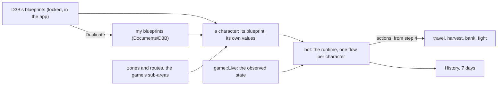

# The bot

What the player tells the bot and how they see what it does (roadmap step 3), designed with the owner on 2026-11-12
and 2026-11-13 from mock-ups, then a clickable prototype in the real shell (local branch `prototype/step3-model`,
never merged). Its model is Unreal's: a **blueprint** is a class, a **character** an instance that runs one, and a
variable marked "set per character" is a setting each character sets for itself (ADR 0014). Nothing acts in the game
before step 4: step 3 delivers the model, its editor, its storage, and its runtime tested on captures; Play, what it
does now, its History and the debugger come with step 4's first actions.

## The concepts

The six scenarios the owner chose (first launch; two characters, two zones; a goal; my own behaviour; understanding
what it does; a D3B update) need these and nothing else: no profile, activity, place or goal field.

- **Blueprint**: an event graph, functions and variables. D3B's own (automatic harvest, one per harvesting
  profession, hunting) ship with the app, **locked**; **Duplicate** makes one of mine, fully editable, noting "based on
  X vN". A given blueprint's new version reaches the characters that run it, their values kept; my copy stays as it is
  and says its original has a newer version.
- **Character**: runs one blueprint, chosen in its tab. Its **settings** are the blueprint's variables marked "set per
  character" (Unreal's Instance Editable): the blueprint holds the default, the character its own value, marked when
  it differs and reset in one click. Two characters, two zones, one blueprint.
- **Variable**: a type (zone, route, percentage, number, items, bank, yes or no…), a default, bounds, a help line, set
  per character or not, and a duration: one run, or **memory**, kept per character across sessions. A goal is a
  variable tested in the graph ("stop at 5,000 harvests").
- **Zone**: maps the bot goes through its own way. The game's **sub-areas are ready-made zones** (`sub-areas.json`
  lists their resources and monsters); a zone of mine is painted map by map or a whole sub-area at a time.
- **Route**: an order of passage only: anchor maps joined by the shortest way on the world graph (its scrolls, doors
  and map actions; zaaps join it with step 4's travel), as a loop, one way or a round trip. What is done on the way comes from the blueprint.
- **History**: what each character did, as episodes ("Bank · 3 min") with their reason.

## How a blueprint runs

As decided on 2026-11-12, on Unreal's event graph (ADR 0014):

- **One flow per character, one action at a time.** "On start" is the main flow. Another event (a fight starts, life
  below, pods above, every N minutes, the map changed, reconnected) interrupts it by **priority** (1 before 2) and by
  its **mode**: interrupt then resume (the default), wait for the current action, interrupt and restart from the
  start, or in parallel for a graph that never acts. A threshold fires once and re-arms past its reset value. "You took
  control" (step 4) is above everything, outside the graph.
- **Actions are goal-shaped**: an intent and a check on the observed state that says it is done ("on map X", "pods ≥
  80 %"), so an interrupted action resumes by running again. Each ends **Done** or **Failed** with its reason; a Failed
  left unlinked blocks the character with that reason.
- Unlike Unreal's, a **function** may hold actions that last (2026-11-12): moving to a bank is one.
- **Queries** are read when the node that uses them runs; the value used is kept for the debugger.
- **Events the game forces**, when the blueprint does not handle them, have a default: a fight is fought by the
  default AI (step 6), then the flow resumes; a death stops the run, blocked.
- A setting changed while running applies at the next safe point, between actions, and says so. The states: without
  blueprint, ready, running, paused, finished, blocked (with its reason), disconnected (listed greyed, its blueprint
  and values kept). A blueprint with a problem cannot run.

## In the app

The shell's parts (`docs/shell.md`); no information is shown twice:

- **Characters** view: the characters the player has played, a closed client's greyed with its blueprint and values
  kept (a change: step 2's view lists open game connections only). From step 4, a row's hover holds Play, Pause and
  Stop, and the view's header Play all and Pause all.
- A **character's tab**: its blueprint (a list, and an arrow that opens it) and its settings above its observed state
  and map (`docs/game.md`). From step 4: one line saying what it does now (its step, on what, since when), a tick on
  the Pods gauge at the current step's target, and Play, Pause and Stop as the tab's editor actions.
- **Library** view: "Given by D3B", then "Mine"; a row opens the blueprint's editor.
- The **blueprint editor** is Unreal's Blueprint Editor in a tab. Its toolbar holds Graph or Summary, the graph's path,
  the problems, the character to debug, and Duplicate on a given blueprint, which opens locked. **My Blueprint** on the
  left lists the graphs, functions and variables, an eye on those set per character; the graph is in the centre,
  **Details** on the right. Nodes are sober sentence boxes: an icon coloured by family, the values in the sentence,
  typed pins (a triangle carries the flow, a circle a value, coloured by type), a visible Failed output. A wire dropped
  on the ground, Space or a right-click opens the picker: sentences with their description, what often comes there
  first. "If" is a node with True and False; a function opens in place, its inputs and outputs as nodes. An event's
  Details hold its priority, its re-arming and its four modes, each drawn as a small timeline. **Summary** reads the
  blueprint as sentences. From step 4, "Debug" a character lights the node at work and its wire; nothing is lit otherwise.
- **World** view: my zones, my routes, then the game's sub-areas, searchable. The **World tab** shows the world map
  from the data's tiles, at the level the zoom needs, with its tools (select, brush, eraser, whole sub-area, route) and
  Details on the right. A Zone setting is chosen in a searchable list or by its target, which opens the map.
- The panel's **History** (step 4) follows the active character's tab. The **Protocol** view will show only with an
  "Advanced tools" setting, off by default (a change to `docs/shell.md`; step 2's checklist items that read the
  inspector then begin by turning it on).

The prototype fixed the model and the layout; each PR polishes its look, the World more beautiful and modern (the
owner, 2026-11-13).

## Storage

One JSON file per object in **Documents/D3B**, a schema version each, written atomically; History kept 7 days; a
`.d3b` file to share a blueprint with its zones and routes (ADR 0015). A character's file needs a key stable across
servers: its study comes first.

## Measure

On Windows x64 by the owner, on what step 3 shows; running a blueprint is measured with step 4's first actions:

1. The Library lists D3B's blueprints; one opens locked, its graph and its Summary readable.
2. Duplicate makes one in "Mine", editable; a node added, linked and saved is still there after a restart.
3. A character in game gets a blueprint in its tab; a setting changed is marked, its reset clears the mark; a second
   character keeps its own value; both are still there after a restart.
4. The World's map is sharp at every zoom; a sub-area is chosen as a Zone from the list and on the map; a zone painted
   and a route of four anchors are still there after a restart.
5. A `.d3b` exported, then imported on another D3B, shows its preview, then the same blueprint.
