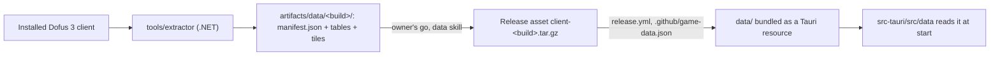

# Game data

The app ships the game data of one client build, as JSON, inside the installer: for now the world (maps, world graph,
positions, sub-areas, areas, zaaps, the world map and its tiles); items, monsters and spells come with the step that
reads them. A .NET tool extracts it from the official client, it is published as a release asset and packed by the
release workflow. Nothing of it is ever committed (ADR [0008](adr/0008-the-data-folder-and-its-archive.md)).



## The folder

- `manifest.json`: `format` (equal to `data::FORMAT`, currently 1), `build` (such as `3.7.13.17`), `extractor` (its
  version) and `tables`, one entry per file, tiles included, with its `name`, `path` and `sha256`. Unknown fields are
  refused.
- One JSON file per table, an array of records sorted by id, one record per line; names in camelCase.
- **Texts** are inline in each record, in the client's five languages: `{"fr", "en", "de", "es", "pt"}`.
- **Maps** are split in 100 files by the last two digits of their id: `maps/<id % 100>.json`.
- **Tiles** are JPEG files, `tiles/<world>/<zoom as a percentage>/<n>.jpg`, numbered from 1 row by row from the top
  left. The client holds them as BC7 textures; the extractor decodes them and encodes them at JPEG quality 75.
- The shape of each table is written down here when its reader lands.

## The extractor

`tools/extractor`, a .NET 10 console app (`Extractor.csproj`) and its test project, on AssetsTools.NET for the
client's bundles and System.CommandLine for its options; CI and `bun run check` build it and run its tests, which need
no client. It reads the client's facts as they are and fails when the client contradicts what it relies on; what the
bot derives from them (harvestables, bankers) is computed in Rust by the step that needs it.

```sh
dotnet run --project tools/extractor -- --help
dotnet run --project tools/extractor                     # the installed client into artifacts/data/<build>/
dotnet run --project tools/extractor -- --client <dir>   # another copy of the client
```

Each run extracts everything again (about 40 s on the C# version). The C# version's tools on `main`
(`scripts/extract/`, `scripts/unity/`) and its measures (`docs/client.md`) are the sources it was rewritten from.

## Where it lives

- **From source**: `bun run data:fetch <build>` downloads the release asset into `data/`, which Git ignores but for
  its README. Without it the app starts and says it has no game data.
- **In a release**: `release.yml` reads the build from `.github/game-data.json`, downloads the asset into `data/`, and
  `tauri build` bundles it (`bundle.resources`). The app reads it from `resource_dir()/data`.
- **The client's folder**, read only by the extractor: `%LOCALAPPDATA%\Ankama\Dofus-dofus3` on Windows, its default.
  Elsewhere `--client` names it: whether the macOS and Linux clients hold the same data is not measured.

## Rules

- A published `client-<build>` asset is never replaced; a fix comes with a new format.
- A change of shape bumps `data::FORMAT` and the extractor's format in the same PR.
- The app refuses a folder in another format rather than reading half of it.
