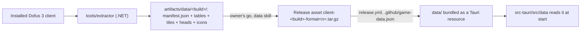

# Game data

The app ships the game data of one client build, as JSON, inside the installer: for now the world (maps, world graph,
positions, sub-areas, areas, zaaps, the world map and its tiles), the breeds with their heads, and the items, their
types, the jobs and their skills, with the items' and jobs' icons; monsters and spells come with the step that reads them. A .NET tool extracts it from the official client, it is published as a release asset and packed by the
release workflow. Nothing of it is ever committed (ADR [0008](adr/0008-world-data-first-in-five-languages-as-a-tar-gz.md), its archive's name
superseded by [0013](adr/0013-a-new-data-format-is-a-second-asset-named-by-its-format.md)).



## The folder

- `manifest.json`: `format` (equal to `data::FORMAT`, currently 3), `build` (such as `3.7.13.17`), `extractor` (its
  version) and `tables`, one entry per file, tiles included, in order of `path` (relative, forward slashes), with its
  `name` (the path without its extension, such as `maps/37`, unique) and its `sha256`. Unknown fields are refused.
- One JSON file per table, an array of records sorted by id, one record per line; names in camelCase.
- **Texts** are inline in each record, in the five languages of the client's `Content/I18n/*.bin` (3.7.12.12,
  `main:docs/client.md`): `{"fr", "en", "de", "es", "pt"}`. A text a record names but a language lacks fails the
  extraction, as in the C# version; its first measure is the texts' PR.
- **Maps** are split in 100 files by the last two digits of their id: `maps/<id % 100>.json`. On 3.7.13.17
  the files run from 434 KB to 873 KB: the ids spread well enough.
- **Tiles** are JPEG files, `tiles/<world>/<zoom as a percentage>/<n>.jpg`, numbered from 1 row by row from the top
  left. The client holds them as BC7 textures (3.7.13.17, `main:docs/client.md`, "The world's maps"); the extractor
  decodes them and encodes them at JPEG quality 75, the owner's choice on the C# version.
- **Heads** are PNG files, `heads/<breed>-<sex>.png`, 64 pixels a side with their transparency, 0 the male and 1 the
  female, two for each breed of `breeds.json`: the client's `Head_<breed><sex>` of `Content/Picto/UI/class_assets_2x.bundle`,
  BC7, drawn whole (3.7.13.17, `artifacts/studies/breeds.md`). The app refuses a folder where a breed lacks one.
- **Icons** are PNG files of 32 pixels a side with their transparency, `icons/items/<iconId>.png` and
  `icons/jobs/<iconId>.png`, one for each icon an item of `items.json` or a job of `jobs.json` names (every item's,
  the owner's choice of 2026-11-14): the textures of `Content/Picto/Items/item_assets_1x.bundle` and
  `Content/Picto/UI/job_assets_1x.bundle`, named by the icon's number, drawn whole. The items' are 64 px, BC7, but
  for three, 82,523 and 121,179 at 60 px and 25,257 RGBA32 at 62 px; the jobs' are 32 px, BC7 (3.7.13.17,
  `artifacts/studies/items.md`). Each icon texel is the mean of the texels it covers weighted by their alpha, computed
  by the extractor rather than Skia so that every CPU gives the same bytes: a 64 px icon's 2x2 squares, a 32 px one's
  texels as they are. The extraction fails on a texture that is not one square level, an item's not BC7 or RGBA32 of
  32 to 64 px, a job's not BC7 of 32 px (a larger one would be scaled by more than half, which is not measured), not
  named by a number, or named twice, and on a job whose icon is missing; four items name an icon the client lacks: they keep their
  `iconId`, are counted, and have none in the app. The app refuses a folder where a job's icon is missing (`-1` is
  none, Base's).
- **Flags** are the list of the names of the bits a record sets, in camelCase, as the client's enums name them, read
  from its code with Cpp2IL (ADR [0010](adr/0010-flags-by-the-names-of-the-clients-enums.md)).
- The shape of each table is written down here when its reader lands (`src-tauri/src/data/`, `deny_unknown_fields`).

| File | One record | From the client (3.7.13.17) |
| --- | --- | --- |
| `map-positions.json` | `id`, `x`, `y`, `subAreaId`, `worldMap` (-1 for none), `name`, `flags` (`MapInformationFlags`) | `MapInformationData`, 15,470 records, 8.4 MB |
| `sub-areas.json` | `id`, `name`, `areaId`, `level`, `zaapMapId` (or `null`), `basicAccountAllowed`, `customWorldMapId`, `harvestables`, `monsters` | `SubAreaData`, 569 records |
| `worlds.json` | `id`, `name`, `originX`, `originY`, `mapWidth`, `mapHeight`, `minScale`, `maxScale`, `startScale`, `width`, `height`, `visible`, `zooms` (`percent`, `width`, `height`, `columns`, `rows`) | `WorldMapsDataRoot`, 40 worlds, 161 zooms |
| `tiles/<world>/<percent>/<n>.jpg` | one tile, JPEG 75 | 1,250 BC7 textures, 79.7 MB |
| `maps/<id % 100>.json` | `id`, `top`, `bottom`, `left`, `right`; `flags` and `linkedZone`, 560 values each; `mapChange`, `floor`, `moveZone`, `arrow`, `speed` as `{cell: value}` where not zero; `elements` (`id`, `cellId` or -1, `gfxId`) | `ClientMapData` and `MapMetadata`, 17,623 maps, 46,490 elements, 63 MB |
| `world-graph-vertices.json` | `uid`, `mapId`, `zone` | `PathFindingData`, 11,331 vertices |
| `world-graph-edges.json` | `from`, `to` (uids), `transitions` (`type`: `scroll`, `scrollAction`, `mapAction` or `interactive`; `direction`, `cellId`, `skillId`, `mapId`, `elementId`, `criterion`) | 30,917 edges, 31,337 transitions |
| `areas.json` | `id`, `name` (a text, or `null`), `superAreaId`, `worldmapId`, `hasWorldMap` | `AreaData`, 70 records |
| `zaaps.json` | `id`, `mapId`, `subAreaId`, `activated` | `WaypointData`, 63 records |
| `breeds.json` | `id`, `name` (the text its `shortNameId` names, a string holding the text's number: its only name) | `BreedData`, 19 records, 1 to 18 and 20 |
| `heads/<breed>-<sex>.png` | one head, PNG | 38 BC7 textures, 239 KB as PNG |
| `items.json` | `id`, `name`, `typeId`, `level`, `iconId` | `ItemData` and `WeaponData`, 21,622 records, 21,621 written |
| `item-types.json` | `id`, `name`, `categoryId` | `ItemTypeData`, 236 records |
| `jobs.json` | `id`, `name`, `iconId` (-1 for none) | `JobData`, 23 records |
| `skills.json` | `id`, `name`, `parentJobId`, `gatheredItemId` (its `gatheredRessourceItem`, `null` for -1 and 0), `levelMin`, `range`, `clientDisplay` | `SkillData`, 373 records, 372 written |
| `icons/items/<iconId>.png` | one item's icon, PNG, 32 px | 12,295 textures, 11,768 written, 19.7 MB as PNG; 4 items name an icon the client lacks |
| `icons/jobs/<iconId>.png` | one job's icon, PNG, 32 px | 21 BC7 textures, 54 KB as PNG; jobs 75 and 78 share icon 42 |

A cell's `flags` pack its booleans, bit 0 first: `mov` (walkable), `los` (line of sight), `nonWalkableDuringFight`,
`nonWalkableDuringRP`, `farmCell`, `visible`, `havenbagCell`, `roleplayMonstersMovementBlocked`, `red`, `blue`: fields
of the cell, not an enum of the client, so the order is ours (`data::maps::cell`). The extraction fails when the graph contradicts the maps: a vertex's zone that no walkable cell
has, a transition through an element its map lacks, a position or a zaap on a map the client does not hold. A map's
interactive elements are in its record; the app reads a map's file when it needs the map, not at start.

Two references the client breaks are left out and counted, the owner's choice of 2026-11-14, rather than failing the
extraction: an item of a type the client lacks (item 34,569, type 264, on 3.7.13.17) and a skill gathering an item
`items.json` lacks (skill 260, item 3,656); the extractor prints how many it left out of each, and every other check
fails as before, a duplicate id in these four tables included. The app refuses a folder where an id is held twice in one of these four tables, an item's type is
missing, or a skill's job or gathered item is. Which jobs are harvesting professions (2, 24, 26, 28 and 36 on
3.7.13.17, whose skills gather what the sub-areas' `harvestables` list) will be derived in Rust by step 3's PR 4.

The app reads the whole folder once at start (`data::GameData`) and refuses it whole when a table cannot be read: the
status bar then says it has no data, and its hover why ([shell.md](shell.md)).

## The extractor

`tools/extractor`, a .NET 10 console app and its test project, being built as a stack of PRs (`docs/now.md`). The
owner chose its libraries: AssetsTools.NET for the client's bundles, Cpp2IL for the names of its enums and its protocol's schema, AssetRipper.TextureDecoder for the tiles' BC7,
SkiaSharp to encode them (with its Linux native assets for CI), System.CommandLine for its options, xUnit v3 for its
tests. CI and `bun run check` build it and run its tests, which need no client. It reads the client's facts as they are and fails when the client contradicts what it relies on (but for the two broken references above, left out and counted); what the
bot derives from them (harvestables, bankers) is computed in Rust by the step that needs it.

```sh
dotnet run --project tools/extractor/src -- --help
dotnet run --project tools/extractor/src                     # the installed client into artifacts/data/<build>/,
                                                             # and its protocol's schema (docs/protocol.md)
dotnet run --project tools/extractor/src -- --client <dir>   # another copy of the client
dotnet run --project tools/extractor/src -- --output <dir>   # another data folder
```

It writes the folder beside its target (`<target>.d3b-staging`), then swaps it in, and replaces only a folder that
holds a `manifest.json`. A file's path and its name are unique ignoring case.

Each run extracts everything again, in about 30 s on 3.7.13.17, tiles and icons included (its archive, 105 MB, the same bytes on each run). It also writes the folder's archive,
`artifacts/data/client-<build>-format<n>.tar.gz` whatever `--output` names: the folder's files at its root in order of their
paths, with a fixed date, so that two runs of one extractor on one OS give the same bytes (gzip's header names the
OS). It is the file the `data` skill publishes and `data:fetch` unpacks. Format 1's asset, published for 3.7.13.17, was
named `client-<build>.tar.gz`; format 2 added the breeds and their heads (the owner, 2026-11-13): since a published
asset is never replaced, a build's data in a new format is a second asset of the build's release, named by its format.
Format 3 adds the items, their types, the jobs and their skills, and the items' and jobs' icons (the owner,
2026-11-14). The C# version's tools on `main`
(`scripts/extract/`, `scripts/unity/`) and its measures (`docs/client.md`) are the sources it was rewritten from.

## Where it lives

- **From source**: `bun run data:fetch <build>` downloads the release asset of the format `.github/game-data.json`
  names (a Rust test keeps it equal to `data::FORMAT`) into `data/`, which Git ignores but for
  its README. Without it the app starts and says it has no game data.
- **In a release**: `release.yml` reads the build from `.github/game-data.json`, downloads the asset of its format into `data/`, and
  `tauri build` bundles it (`bundle.resources`). The app reads it from `resource_dir()/data`.
- **The client's build** is its `Dofus_Data/StreamingAssets/version` file: three `Key=Value` lines ending in CRLF,
  `Version` (digits and dots, such as `3.7.13.17`), `BuildDate` (ISO 8601 with its offset, such as
  `2026-11-03T14:09:52+00:00`) and `ConfigUrl` (measured on 3.7.13.17, 113 bytes). The extractor refuses a key twice,
  another date format, or a file over 4 KiB. The manifest's `extractor` is its version and commit, such as
  `0.1.0+54ea8c5…`.
- **The client's folder**, read by the extractor and by studies: `--client`, else the `DOFUS_CLIENT` environment
  variable, else `%LOCALAPPDATA%\Ankama\Dofus-dofus3` on Windows. On macOS and Linux, where Dofus 3 has native
  clients, it must be named: where their launchers install it, and whether they hold the same data, is not measured.

## Rules

- A published `client-<build>` asset is never replaced; a fix comes with a new format.
- A change of shape bumps `data::FORMAT` and the extractor's format in the same PR.
- The app refuses a folder in another format rather than reading half of it.
