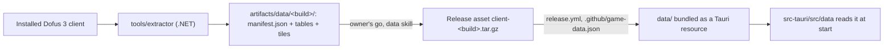

# Game data

The app ships the game data of one client build, as JSON, inside the installer: for now the world (maps, world graph,
positions, sub-areas, areas, zaaps, the world map and its tiles); items, monsters and spells come with the step that
reads them. A .NET tool extracts it from the official client, it is published as a release asset and packed by the
release workflow. Nothing of it is ever committed (ADR [0008](adr/0008-world-data-first-in-five-languages-as-a-tar-gz.md)).



## The folder

- `manifest.json`: `format` (equal to `data::FORMAT`, currently 1), `build` (such as `3.7.13.17`), `extractor` (its
  version) and `tables`, one entry per file, tiles included, in order of `path` (relative, forward slashes), with its
  `name` (the path without its extension, such as `maps/37`, unique) and its `sha256`. Unknown fields are refused.
- One JSON file per table, an array of records sorted by id, one record per line; names in camelCase.
- **Texts** are inline in each record, in the five languages of the client's `Content/I18n/*.bin` (3.7.12.12,
  `main:docs/client.md`): `{"fr", "en", "de", "es", "pt"}`. A text a record names but a language lacks fails the
  extraction, as in the C# version; its first measure is the texts' PR.
- **Maps** are split in 100 files by the last two digits of their id: `maps/<id % 100>.json`. How evenly the ids
  spread is measured by the maps' PR, before anything is published.
- **Tiles** are JPEG files, `tiles/<world>/<zoom as a percentage>/<n>.jpg`, numbered from 1 row by row from the top
  left. The client holds them as BC7 textures (3.7.13.17, `main:docs/client.md`, "The world's maps"); the extractor
  decodes them and encodes them at JPEG quality 75, the owner's choice on the C# version.
- **Flags** are the list of the names of the bits a record sets, in camelCase, as the client's enums name them, read
  from its code with Cpp2IL (ADR [0010](adr/0010-flags-by-the-names-of-the-clients-enums.md)).
- The shape of each table is written down here when its reader lands (`src-tauri/src/data/`, `deny_unknown_fields`).

| File | One record | From the client (3.7.13.17) |
| --- | --- | --- |
| `map-positions.json` | `id`, `x`, `y`, `subAreaId`, `worldMap` (-1 for none), `name`, `flags` (`MapInformationFlags`) | `MapInformationData`, 15,470 records, 8.4 MB |
| `sub-areas.json` | `id`, `name`, `areaId`, `level`, `zaapMapId` (or `null`), `basicAccountAllowed`, `customWorldMapId`, `harvestables`, `monsters` | `SubAreaData`, 569 records |
| `areas.json` | `id`, `name` (a text, or `null`), `superAreaId`, `worldmapId`, `hasWorldMap` | `AreaData`, 70 records |
| `zaaps.json` | `id`, `mapId`, `subAreaId`, `activated` | `WaypointData`, 63 records |

The app reads the whole folder once at start (`data::GameData`) and refuses it whole when a table cannot be read: the
status bar then says it has no data, and its tooltip says why.

## The extractor

`tools/extractor`, a .NET 10 console app and its test project, being built as a stack of PRs (`docs/now.md`). The
owner chose its libraries: AssetsTools.NET for the client's bundles, Cpp2IL for the names of its enums, AssetRipper.TextureDecoder for the tiles' BC7,
SkiaSharp to encode them (with its Linux native assets for CI), System.CommandLine for its options, xUnit v3 for its
tests. CI and `bun run check` build it and run its tests, which need no client. It reads the client's facts as they are and fails when the client contradicts what it relies on; what the
bot derives from them (harvestables, bankers) is computed in Rust by the step that needs it.

```sh
dotnet run --project tools/extractor/src -- --help
dotnet run --project tools/extractor/src                     # the installed client into artifacts/data/<build>/
dotnet run --project tools/extractor/src -- --client <dir>   # another copy of the client
dotnet run --project tools/extractor/src -- --output <dir>   # another data folder
```

It writes the folder beside its target (`<target>.d3b-staging`), then swaps it in, and replaces only a folder that
holds a `manifest.json`. A file's path and its name are unique ignoring case.

Each run extracts everything again (41 s on the C# version, tiles included). The extractor also writes the folder's
archive, `client-<build>.tar.gz`, beside it: the file the `data` skill publishes (the stack's last PR). The C# version's tools on `main`
(`scripts/extract/`, `scripts/unity/`) and its measures (`docs/client.md`) are the sources it was rewritten from.

## Where it lives

- **From source**: `bun run data:fetch <build>` downloads the release asset into `data/`, which Git ignores but for
  its README. Without it the app starts and says it has no game data.
- **In a release**: `release.yml` reads the build from `.github/game-data.json`, downloads the asset into `data/`, and
  `tauri build` bundles it (`bundle.resources`). The app reads it from `resource_dir()/data`.
- **The client's build** is its `Dofus_Data/StreamingAssets/version` file: three `Key=Value` lines ending in LF,
  `Version` (digits and dots, such as `3.7.13.17`), `BuildDate` (ISO 8601 with its offset, such as
  `2026-11-03T14:09:52+00:00`) and `ConfigUrl` (measured on 3.7.13.17, 113 bytes). The extractor refuses a key twice,
  another date format, or a file over 4 KiB. The manifest's `extractor` is its version and commit, such as
  `0.1.0+54ea8c5…`.
- **The client's folder**, read by the extractor and by studies: `--client`, else the `DOFUS_CLIENT` environment
  variable, else `%LOCALAPPDATA%\Ankama\Dofus-dofus3` on Windows. On macOS and Linux, where Dofus 3 has native
  clients, it must be named: where their launchers install it, and whether they hold the same data, is not measured.

## Rules

- A published `client-<build>` asset is never replaced; a fix comes with a new format.
- A change of shape bumps `data::FORMAT` and the extractor's format in the same PR.
- The app refuses a folder in another format rather than reading half of it.
