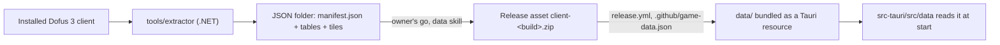

# Game data

The app ships the game data of one client build, as JSON, inside the installer: maps, world graph, items, monsters,
spells, texts and the world map's tiles. It is extracted from the official client by a .NET tool, published as a
release asset, and packed by the release workflow. Nothing of it is ever committed.

## The folder

- `manifest.json`: `format` (equal to `data::FORMAT`, currently 1), `build` (such as `3.7.13.17`), `extractor` (its
  version) and `tables`, one entry per file with its `name`, `path` and `sha256`. Unknown fields are refused.
- One JSON file per table; the large ones (maps) split by a key in a subfolder. Tiles are image files under `tiles/`.
- The shape of each table is written down here when its reader lands (step 1).

## Where it lives

- **From source**: `bun run data:fetch <build>` downloads the release asset into `data/`, which Git ignores but for
  its README. Without it the app starts and says it has no game data.
- **In a release**: `release.yml` reads the build from `.github/game-data.json`, downloads the asset into `data/`, and
  `tauri build` bundles it (`bundle.resources`). The app reads it from `resource_dir()/data`.
- **The client's folder**, read only by the extractor: `%LOCALAPPDATA%\Ankama\Dofus-dofus3` on Windows; on macOS and
  Linux, to be measured (`docs/now.md`).

## Rules

- A published `client-<build>` asset is never replaced; a fix comes with a new format.
- A change of shape bumps `data::FORMAT` and the extractor's format in the same PR.
- The app refuses a folder in another format rather than reading half of it.
