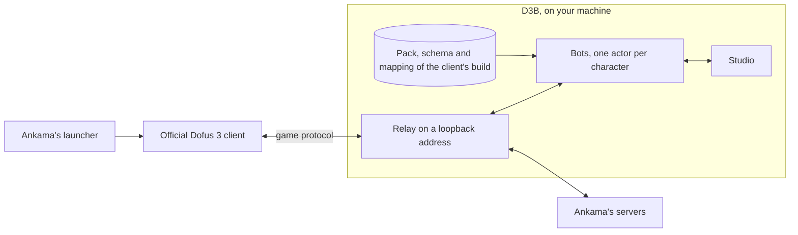

# Development

How to build, run and maintain D3B from source. The [README](../README.md) is for players;
[CONTRIBUTING.md](../CONTRIBUTING.md) has the conventions the build enforces and the checks before a pull request.

## Build

You need Windows, Git and the .NET 10 SDK pinned in [`global.json`](../global.json) (10.0.403 or a later 10.0 SDK). The
official client is needed to run the bots, not to build or test.

```powershell
git clone https://github.com/AerafalDev/D3B.git
cd D3B
dotnet build                          # warnings are errors
dotnet test                           # every test project, on Microsoft.Testing.Platform
dotnet format --verify-no-changes     # CI checks it
```

CI runs the same on Windows ([ci.yml](../.github/workflows/ci.yml)), builds every tool of `scripts/` and every hook, and
runs the tests with `--hangdump --hangdump-timeout 5m --crashdump`: a test host that hangs five minutes or crashes leaves
a dump, uploaded as the run's `test-dumps` artifact with the hang's log of the tests then running. Under
Microsoft.Testing.Platform a host that died reports exit code 1 and no failed test, so the dump is what is left to read.
The same options work after a local `dotnet test`. [docs.yml](../.github/workflows/docs.yml) runs
`dotnet run --file scripts/docs.cs -- check` on every push and pull request, those that change only Markdown included,
which `ci.yml` skips.

## Run from source

```powershell
dotnet run --project src/D3B.App      # the desktop app, which runs the bots' host in its process
dotnet run --project src/D3B.Host     # the same host without the app, until Ctrl+C
```

The host needs the data pack, the protocol schema and the mapping of the installed client's build, in the formats your
checkout reads. It looks for them in `%LOCALAPPDATA%\D3B\data`, then beside the published app. Fetch them from the build's
release `client-<version>` with the [GitHub CLI](https://cli.github.com) signed in:

```powershell
dotnet run --file scripts/embed.cs -- --client-version 3.7.14.18 --output "$env:LOCALAPPDATA\D3B\data"
```

The tool checks the files, and says so when the release lacks a format your checkout reads, as happens while a format
change on `main` waits for its upload.

The host keeps its database in `%LOCALAPPDATA%\D3B\d3b.db` (the accounts its relay sees, what the bots learn, the
characters' variables) and the profiles, routes and behaviors you make in `%LOCALAPPDATA%\D3B\studio`, one JSON file each.

## Host options

The app and the host read the same configuration keys, given on the command line:

| Option | Effect |
| --- | --- |
| `--Storage:Path <file>` | Uses another database file. |
| `--Studio:Path <folder>` | Uses another folder for the profiles, routes and behaviors. |
| `--Fights:Alone true` | Has the AI play every fight of the bots, the player's own included. |
| `--Delays:Display 1.5` | The client's display time, in seconds; the other delays are under `Delays:` too. |
| `--Banking:FullAt 98` | The share of pods, from 50 to 100, at which the bots bank; `--Banking:UseZaaps false` has them walk to the bank. A profile with its own banking rules ignores both. |
| `--Network:Captures:Game false` | Stops recording the game connection, recorded by default in `%LOCALAPPDATA%\D3B\captures\game` so that a bug can be replayed and reported. |
| `--Network:Captures:Retention:Days 7`, `--Network:Captures:Retention:Megabytes 1024` | How long and how much of those captures are kept, pruned at each start of the host; `0` lifts a limit. |
| `--Network:Captures:Enabled true` | Also records the connection phase, which only the mapping tool reads and which holds the account's login token. |
| `--Updates:Source <folder>` | Takes the installed app's updates from a local folder of packed releases. |
| `D3B_REPORT_WEBHOOK` (environment variable) | The Discord webhook bug reports are posted to instead of the one the release `report-channel` names, for a fork or a test. Never commit one. |

A capture holds the account's login ticket: never share one. Describe it with `scripts/capture.cs`.

## Tools

The tools are [file-based apps](https://learn.microsoft.com/dotnet/core/sdk/file-based-apps) in `scripts/`. Run one with
`dotnet run --file scripts/<tool>.cs -- --help` to see its options. By default they read the client installed in
`%LOCALAPPDATA%\Ankama\Dofus-dofus3` and write under `%LOCALAPPDATA%\D3B`.

| Tool | What it does |
| --- | --- |
| `inspect.cs` | Describes the installed client: its versions, bundles, objects and texts. |
| `extract.cs` | Extracts the client's game data into the pack of its build. |
| `schema.cs` | Reads the client's obfuscated protocol schema from its code. |
| `mapping.cs` | Matches D3B's readable `.proto` files with that schema and writes the build's mapping. |
| `embed.cs` | Puts a build's pack, schema and mapping beside the published app, or in a folder of your choice. |
| `release.cs` | Publishes a build's pack, schema and mapping to its release; a dry run without `--publish`. |
| `client.cs` | Says which configuration the client reads, Ankama's or D3B's; `restore` gives it Ankama's back after a crash. |
| `capture.cs` | Describes the captures by their structure, never their content. |
| `report.cs` | Unpacks and checks a bug report (a `.d3breport`), prints its message, then describes it; `--replay` replays its fights. |
| `fights.cs` | Replays the captured fights and compares what D3B foresees of each cast with what the server did. |
| `docs.cs` | Finds the links of the Markdown files whose file or heading does not exist. |
| `icons.cs` | Takes the IntelliJ Platform icons the studio draws, checks their Apache 2.0 notice, writes them for Avalonia. |

The repository's local tools, `dotnet-ef` for the database's migrations and Velopack's `vpk` for the installer, are
pinned in [`.config/dotnet-tools.json`](../.config/dotnet-tools.json):

```powershell
dotnet tool restore
dotnet tool run dotnet-ef migrations add <Name> --project src/D3B.Storage --startup-project src/D3B.Storage --output-dir Migrations
```

## Packs, mappings and releases

Nothing extracted from the official client is committed. When Ankama updates the client, the maintainer extracts the
new build's pack (`extract.cs`), reads its schema (`schema.cs`), maps it (`mapping.cs`, which also needs captures of
the build) and publishes the three files to the release `client-<version>` (`release.cs --publish`).

The app's own release is built by the [release workflow](../.github/workflows/release.yml) when a tag `v<version>` is
pushed: it builds, tests, embeds the client build's files and publishes the installer. The same installer, built locally:

```powershell
dotnet tool restore
dotnet publish src/D3B.App -c Release -r win-x64 --self-contained -o publish -p:MinVerVersionOverride=0.1.0
dotnet run --file scripts/embed.cs -- --client-version 3.7.14.18 --output publish/data --packs "$env:LOCALAPPDATA\D3B\data"
dotnet tool run vpk pack --packId D3B.App --packVersion 0.1.0 --packDir publish --mainExe D3B.App.exe --packTitle D3B --icon src/D3B.App/Assets/d3b.ico -o releases
```

## How it works



- **Modules.** Every feature is a module that registers its services, activities, settings and pages.
- **Network.** The relay, on Kestrel, forwards the client's frames, decodes the game's messages through the build's
  mapping, and slips the bots' requests in between the client's frames.
- **Game data.** The tools read the client's Unity bundles and code into a pack per build, compressed with zstd, and a
  mapping from the build's obfuscated protocol to D3B's readable `.proto` files. Both ship as release assets.
- **Bots.** Each character is an async actor fed by the game it observes. Pathfinding, the rules of a fight, its effects
  and the AI's search live in `D3B.Engine`, pure code with no I/O.

| Project | Role |
| --- | --- |
| `src/D3B.Core` | Modules and `BotBuilder`, on the .NET Generic Host. |
| `src/D3B.Network` | The relay: Kestrel's transport, framing and codec, and the captures. |
| `src/D3B.Protocol` | The readable protocol, a build's mapping and the translation through it. |
| `src/D3B.Data` | The pack's format and readers: maps, world graph, world map tiles, items, spells, monsters, texts. |
| `src/D3B.Engine` | Pathfinding, line of sight, the rules of a fight, its effects and the AI's search. |
| `src/D3B.Bot` | The bots' run time: activities (harvest, hunt, follow), banking, groups, reports, and the host. |
| `src/D3B.Studio` | The studio's model: assets, behaviors and nodes, routes, zones. |
| `src/D3B.Storage` | The database, SQLite through EF Core: accounts, runs, what the bots learn, the characters' variables. |
| `src/D3B.App` | The Avalonia desktop app. |
| `src/D3B.Host` | The host without the app. |

[architecture.md](architecture.md) has the detail, section by section.

## Documentation

| Document | Content |
| --- | --- |
| [status.md](status.md) | Where the project stands: what exists, what is not measured, what comes next, the known debt. |
| [roadmap.md](roadmap.md) | The steps in order, what each one did, and the next one. |
| [architecture.md](architecture.md) | How D3B is built: projects, modules, run time, protocol, data, app, fights. |
| [decisions-index.md](decisions-index.md) | One line per decision, grouped by step, linking to its entry in [decisions/](decisions/README.md). |
| [client.md](client.md), [client-game.md](client-game.md) | What the official client holds that D3B uses, and its game connection, measured. |
