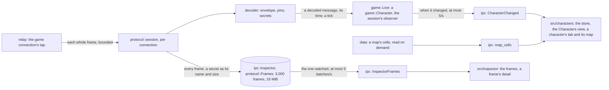

# The game

D3B keeps what it reads of each character played through the relay: who it is, where it stands, its life, pods and
kamas, and what is around it on its map. The `game` domain builds that state from the protocol's decoded messages, and
the app shows it live, one entry per game connection, beside a protocol inspector. Nothing is sent to the game.

The facts below come from the study `artifacts/studies/live-view.md` (the owner's 56 game connections of 3.7.13.17,
the build's schema, the client's tables, and the C# version's docs), each `inferred` unless said `verified`.

## The state of a character

`game::Character` is fed each decoded message with the time it was read (time injected, so tests drive it). The
protocol knows nothing of it: `protocol::session` hands its messages, a tick every 200 ms and its end to an observer
the relay's owner gives it when the connection opens, as it already hands its report, so `game` depends on `protocol`
and never the reverse (ADR 0002). That observer is `game::Live`: it keeps the connection's `Character` and, at each
tick, sends its view when it changed.

- **Who** (verified): `CharacterSelectionEvent` gives its id, name, level and breed, and its sex, which picks its
  breed's head: field 4 of its look's appearance (`CharacterLook` field 1), absent for a male and 1 for a female
  (`artifacts/studies/breeds.md`: the look's skins, the client's heads table and the heads drawn agree; present in all
  137 looks of the owner's captures). A look without an appearance, or with a sex the enum lacks, leaves it unknown. Characteristics read since the
  last selection are kept, since the first `CharacterStatsEvent` comes before it; everything else is reset to the new
  character (a second selection on one connection was never seen: each of the 51 connections chose once).
- **Level** (verified, 36 of 36): `CharacterLevelUpEvent` (`kqp`) field 1 is the new level.
- **Where** (verified): `MapCurrentEvent` sets the map; `MapInformationEvent` carries its own map id, which wins when
  they differ (a dropped `MapCurrentEvent`). The character's cell is its own actor in the map's information (its id is
  the selection's in all 66,171), then the last cell of each `MapMovementEvent` naming it; cells are plain numbers
  from 0 to 559. A walk cut short keeps the last cell until the next walk or map information (the 0.8% of the
  character's walks that did not start where the last one ended; the walk's cancel request is not read). The map's
  coordinates, sub-area and area come from the game data, only when its build is the connection's.
- **Life** (verified on all 634 `LifeRegenEndEvent`): from `CharacterStatsEvent`, a characteristic's value being the
  sum of its numbers, max life is characteristic 0 plus 11 (vitality), and life is max life plus 97 (life lost, never
  above 0). `LifeRegenStartEvent` starts a regeneration of one point per `interval` tenths of a second (always 5),
  life then being min(max, life at the start + elapsed / interval, rounded down), marked estimated until it reaches
  the max (the server ends the regeneration only later, a fight or a sit: a full bar no longer says it regenerates,
  the owner, 2026-11-13); characteristics
  read meanwhile replace the life at the start but keep its time; `LifeRegenEndEvent` sets life and max and ends it;
  an interval of 0 regenerates nothing. The estimate is computed in Rust at each tick: while it grows, the view
  changes, and is sent, at most twice a second.
- **Pods** (verified): `InventoryWeightEvent`, sent on entering the game and after every inventory change.
- **Kamas** (verified, 480 of 480): `CharacterStatsEvent` field 6, then `KamasUpdateEvent` (`ith`) field 2.
- **Also shown**, the owner's choice (2026-11-12): action points (characteristic 1), movement points (23), energy (29
  of 47), and experience, fields 8, 11 and 2 of the characteristics read as the level's floor, the experience and the
  next floor (the order is measured, its meaning inferred until the owner checks it in game).
- **Fights**: a fight's `ContextCreationEvent` sets the context to fight and ends any regeneration; its
  `MapCurrentEvent` names the fight's map (634 of 634) and no map information follows. What is around is cleared.
  Life changes in a fight are not read (they need messages not pinned yet: step 6): it shows the last
  characteristics', those of the fight's start, then those sent at its end; a roleplay context and its map
  information bring the rest back. Meanwhile, actors shown, others' walks and element updates are not followed.
- **Stale**: each part (map and around, life, pods, kamas) keeps the protocol's dropped count of its last refresh and
  is shown as stale while the connection has dropped more since. A protocol lost freezes the whole view, marked lost.

## What is around

- **Actors** (verified): `Actor.information` (field 3) holds a roleplay kind, a oneof: a player (its name), an NPC (its
  id), a monster group (its main monster and the others, each with its id, grade and level; their levels all match the
  client's monster grades). Any other member, set or not declared (two rare ones, likely tax collectors and prisms;
  never seen: a treasure hunt's NPC, a portal, a fighter), is shown as "other". No field holds another player's
  level. `MapActorShownEvent` adds or updates actors, `MapActorRemovedEvent` removes one (an unknown id changes
  nothing), `MapMovementEvent` moves one to its last cell (an unknown actor is ignored; another player's first cell
  is where it stood in 75% of walks, so others' cells are approximate until the next map information).
- **Elements** (verified): interactive elements (their interactive and skills, enabled or disabled) and stated
  elements (state 0 available, 2 being harvested, 1 harvested, the meanings inferred). Only those on the current map
  are kept (`on_current_map` false are the eight neighbouring maps'). An element's cell is in the map's data, by its
  id (all 411,781 found). `InteractiveElementUpdatedEvent` and `StatedElementUpdatedEvent` replace the known one of
  its id, and add one only when it says it is on the current map: updates do not say so reliably (verified: all
  71,882 stated updates, and 3,655 of 71,888 interactive ones, say they are not).
- **Every map information replaces what is around whole**, with or without a `MapCurrentEvent` before it: a
  profession's level-up sends the same map's information again (964 of 964).
- **Names**, the owner's choice (2026-11-12): players by their name, as the game shows them; monsters, NPCs and
  resources by their ids and levels. Their names come in a later feature that adds the client's monsters, NPCs and
  interactives tables to the game data (a later format; the skills came with format 3). Drawing the actors from
  their looks (`Actor.information` field 2, not read) was studied, then dropped by the owner on 2026-11-13: the
  client's sprites (about 6.4 GB of skeletons and skins) would take too much room.

## In the app

Rebuilt in the new shell ([shell.md](shell.md)), the owner's choices of 2026-11-12 from mock-ups:

- **The Characters view** of the primary side bar (`src/characters/`): one row per game connection from its open
  to its close, its avatar (its breed's head for its sex, 28 px in a rounded square, else its initials), name, level,
  place or state, and a dot:
  green exploring, amber fighting, grey waiting or unread, red lost. Before a selection a row shows its connection's
  number. A row is marked while its character's tab is active. Under a line, the characters played whose client is
  closed (`docs/bot.md`, "Storage"), greyed, the most recently seen first, saying how long ago ("Seen 2 hr. ago",
  read again each minute); a right-click offers Open and Forget, Forget also in the command palette, a failure said
  in a notification (the owner's choices of 2026-11-14 from mock-up 8). Empty of both, the view says to start Dofus
  from Ankama's launcher.
- **An offline character's tab** (mock-up 8, variant D): its header, "Offline", and when and where it was last seen
  ("today at 11:40, in Astrub (5, -18)"), without a map or gauges; once the character plays again it becomes its live
  tab.
- **A character's tab**, layout "A": opened from its row, named after the character once known. On the left its
  state: who (its breed's head for its sex, 40 px in a rounded square, else its initials; its level, its breed's name
  in the interface's language, exploring or fighting; the owner's choice from mock-ups, 2026-11-13), where (area, sub-area, coordinates, cell), life (marked while it
  regenerates, until it is full), pods, experience, energy, action and movement points, kamas, what is around (players, monster
  groups, NPCs, and resources: every interactive element whose state is known, harvested or not), and a line when
  frames were dropped; on the right the character's map. A connection whose protocol is off says why; a lost one
  keeps its view, marked lost.
- **The protocol** of the character whose tab is active, in the panel's Protocol view under it
  ([protocol.md](protocol.md#the-inspector)), the owner's choice of 2026-11-13 over a tab inside the character's tab.
- **The character's map**, the owner's style "B" (2026-11-12): its 560 cells (14 columns over 40 staggered rows)
  from the game data's cells, read by `map_cells` when the map changes; only the walkable ground and the exits are
  drawn, as discreet diamonds. What stands on it is a dot: the character blue and ringed, players purple, monster
  groups amber, NPCs teal, resources green (darker once harvested), others grey, under a legend. It fills its column
  at the largest scale that fits and follows its size. In a fight it says positions are not read yet; without a map
  the data places, or a map the data lacks, it says so. The dots stay: drawing the actors' sprites was dropped
  (the owner, 2026-11-13).

The step-2 interface removed on 2026-11-12, for reference, was:

- **The characters** on the left, one entry per game connection, from its open to its close: before a selection it
  shows the connection's number and its protocol's state; a connection whose protocol is off (a build without pins,
  no build) stays listed with the reason, its view and its frames empty; one whose protocol is lost keeps its view
  as it was, marked lost. Then name, level, map, roleplay or
  fight, a life bar. The one chosen fills the workspace with two tabs, **View** and **Protocol**.
- **The view**: who and where (coordinates, sub-area, area, cell, roleplay or fight), life (estimated while it
  regenerates), pods, experience, kamas, energy, action and movement points, staleness; what is around grouped by
  kind; and the map.
- **The map**: its 560 cells drawn as diamonds, 14 columns over 40 staggered rows, from the game data: walkable,
  obstacle, blocking line of sight, map exits; resources, actors by kind (a letter and a colour) and the character.
- **The protocol**: see [protocol.md](protocol.md#the-inspector).

`CharacterChanged` carries a connection's whole view when it changed, at most five times a second, and `null` once it
closes; `map_cells` reads a map's cells from the game data. Both name the map only when the data's build is the
connection's, and so the event names the breed (`breedName`, French and English) and gives its head's file for the
character's sex (`head`, a path in the data's folder, which the webview loads through the asset protocol, its scope
`$RESOURCE/data/**`).

## Tests

Unit tests per message on synthetic decoded messages, with an injected clock: the regeneration rounded down and capped,
no longer marked once full, ended by `LifeRegenEndEvent` and by a fight, characteristics during it, an interval of 0; a map information that
replaces whole, the same map again, against a differing `MapCurrentEvent`; an unknown actor removed or moved; an unknown
actor kind as "other"; a second selection, with characteristics before it; staleness. The game's capture replay
(`D3B_CAPTURES`) checks, by counts only: the life counted as each fight starts within one point of the fight's
`LifeRegenEndEvent`, the character's cell known after every map information, each of the character's walks starting on
its known cell in at least 99% of them, and at least 90% of the stated elements' updates out of fights naming an element
on the list. On 2026-11-12, over the owner's 54 connections: all 634 lives within a point, the character on all 66,166
maps, 90,632 of 91,224 walks from its cell, and 67,713 of 71,882 updates on a known element. Vitest: the store per
connection; a connection's state (lost, off, waiting, fighting, exploring); a place's name and the avatar's initials;
a row's head in place of its initials;
the Characters view (its empty line, a row by name, level and place or by connection, an unread protocol, the row
chosen, its tab opened); a character's tab (who and where, its breed named in the interface's language or its level alone, its breed's head or
its initials without one or when it fails to load, its gauges, what is around, its title, waiting, a protocol off, a
closed connection); the map's geometry (cells 0, 13, 14 and 559), the ground drawn, what stands on it in
drawing order, and its notices (a fight, no map, a map the data lacks).
