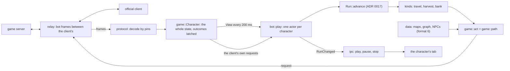

# Playing in game

A character plays in game: Play on its tab runs its blueprint against the live game, through acts the game layer sends
and checks. The first slice makes D3B's given **Récolte automatique** play on Windows: walk to the zone, harvest map
after map up to the pods' threshold, bank everything not worn, come back, loop (step 4 minimal, the owner, 2026-11-23).

## The game layer (ADR 0021)

The owner asked for game code "much better and much more complete than the C#" and able to back "as many things as the
Lua scripts". Three rules make it so.

- **One owner of the state.** `game::Character` holds everything known of the character and its map, fed by the
  protocol: identity, level, life, AP/MP, energy, xp, kamas, pods, the inventory by uid (worn or not), the professions,
  states, the party, the context (in a fight, in a dialog, at a bank), the map, the cell, its actors and interactives.
  [game.md](game.md) lists each field with its source message and whether it is verified, inferred or not decoded yet.
  The C# version gave each feature its own observer and its own copy of the state.
- **Read everything early, act step by step.** The first PRs decode, read only, every family the C# version reads
  (about 262 messages in 19 `.proto` families: movement, maps, interactives, NPCs, exchanges, inventory, jobs, texts,
  teleportation, haven bags, fights, fight actions, spells, characters, characteristics, actors, context, game, party),
  each checked on the owner's captures replayed; a family no capture holds (the haven bag) waits for its capture. Acts
  that send come with the step that uses them. A generated `docs/protocol-coverage.md` lists, per build, each message
  pinned, decoded or encoded, which Lua call it backs, and, from the last local replay, its counts and whether it is
  measured in game; CI fails when its pinned, decoded and encoded columns are stale.
- **Typed acts with deadlines.** Each act (walk, change map, use an element, talk, reply, leave a dialog, move to
  storage) is a state machine: `start(view, now)` gives the request, `poll(view, now)` gives `Pending`, `Done`,
  `Refused(why)`, `NoAnswer` or `Interrupted(fight, moved, closed)`. Every deadline comes from one table, each value
  citing its measure; the server's refusals are typed per act. A running run sending nothing for 10 minutes, its
  blueprint's own waits included, turns blocked with its reason, well before the server's idle kick at about 30 (the
  owner, 2026-11-23; the watchdog's ADR); a paused run and a fight the player plays by hand are not running.
- **The bot's frames between the client's.** The relay holds the client's bytes only until its frame in progress ends,
  then writes the bot's frame, as the C# version measured (D61); the bot's requests carry the request id the C# version
  measured for them, so the client's own numbering is untouched, and the server's answers reach the client, which
  follows what the bot does. The relay still rewrites only its one frame (ADR 0011) and passes the rest untouched.

### What the C# version already knows

The C# version measured most of what these acts meet; its docs on `main` (`docs/client-game.md`, `docs/client.md`,
read through `study`) and its own code (never `vendor/`) are the first source of each act, turned into named tests:

- walks: the server's answer and the client's confirm, a walk held then refused (D85, which the captures correct: a
  refusal puts the character on the held walk's **first** cell, 541 of 591), no walk of no step (D89), a walk ending
  where the last one ended split (D260), the cells another bot of the host walks to (D456), a map action's cell avoided
  unless it is the target (D488), 500 ms after an arrival before the next request (D77);
- map changes: by a side from an edge cell, by a map action, landing elsewhere by the graph's scroll actions;
- interactives: used from a neighbour cell only, never from another floor (a difference of 100 or more, D495), a
  resource taken by another, regrowth (D145, later);
- NPCs and banks: the dialog's replies, a bank map with no banker (D251), deposit all and the uids refused, the client's
  two closes after the bank (not the player's);
- the session: the idle kick after 30 minutes (D464), fights met on the way, a loss, a death (D481).

The six studies of step 4 (map walk, map change, interactives and harvest, NPC dialog, bank, zaaps and haven bag) check
these on the owner's 56 connections of 3.7.13.17. Every request is proven byte for byte against the C# bot's own,
which those captures hold.

## The slice

- **Play, Pause, Stop** on the character's tab, one line saying what it does now, and why it is blocked. A
  reconnection of the same character takes its run back; after D3B restarts, Play starts again from On start.
- **The player wins**: a walk, map change, use, talk or reply the client sends itself pauses the run ("Tu as pris la
  main") until Play. The client's automatic requests (map information, the walk's confirm, the closes after a bank)
  are not the player's.
- **Fights before step 6**: the run sends nothing in a fight, notifies, the player fights by hand, the action resumes
  after. A fight lost blocks the run.
- **The tour**: each map of the zone once per tour, the nearest not yet visited first, a resource taken by another
  skipped.
- **The bank**: the nearest bank's inside, its banker and the reply that opens it from the extractor's NPC tables
  (format 6, published on the owner's go), deposit everything not worn, close, go back.
- Left for the next slices, in the order D3B's eight blueprints need them: zaaps, items used (food, potions, resource
  bags), withdrawing and the haven bag (each after its capture), equipment; then the events at run time with "Life
  below" (the interruption's ADR), regrowth learnt, the fights (step 6: the AI, then capturing mounts and
  archmonsters, and a fight AI of the player's own in blueprints, the owner's asks of 2026-11-23), the party (step 7).

## Tests

- Paths: property tests on generated maps (each step a walkable neighbour of the staggered 14-column grid, the floors'
  rule, never a path of no step); the world path on the extractor's fixture graph (scroll, map action, door, a
  criterion skipped, a map out of reach typed).
- The state, on synthetic messages; the acts, each outcome, refusal and deadline on a fixed clock; the watchdog.
- Replays of the owner's captures (`D3B_CAPTURES`, ignored without): each request of the C# bot re-encoded to its bytes,
  the state's counts equal to the studies', the engine's 54-connection replay still passing.
- A scripted fake game over the relay's in-memory streams on paused time: a server answering as the studies measured,
  with refusals and silences scripted, and a client confirming walks and asking map information as the real one does.
  It runs Récolte automatique end to end and is never counted as a measure.

## The stack

Each PR is one behaviour, under 1,000 lines, its checklist small, so that nothing piles up unmeasured
([lessons.md](lessons.md)); the first walk in game is R3's.

| PR | What | Measured in game after it |
| --- | --- | --- |
| F1 | The coverage report and the state table, by family, both builds | none (a doc) |
| F2 | The relay: bot frames between the client's, kept in captures | plays as before, no frame untrusted |
| F3 | Requests and the client frame writer; movement and map pins, the C# frames re-encoded | the inspector names the client's walks |
| F4–F7 | Reading, family by family: characters, characteristics, actors, context, game, inventory and jobs; interactives, NPCs, exchanges and texts; fights, fight actions and spells; party and teleportation | each family's counts equal on the replays; 5 minutes played, a fight by hand and a party made: the new names in the inspector, no frame untrusted |
| F8 | The cell path | none |
| F9 | The world path | none |
| F10 | Acts: the core, walk and map change, and the fake game | none (fake) |
| R1 | The actor, its knowledge, the watchdog, `play`, `pause`, `stop`, `RunChanged` | with R2 |
| R2 | The tab's actions and its line | Play, Pause, Stop; the client closed says "Déconnecté" |
| R3 | Go to a zone | a zone three maps away, one through a map action, reached |
| R4 | The player wins, the run taken back | a click pauses it; Wi-Fi off and on: it goes on |
| R5 | Use an element; doors in travel | a zone behind a door reached |
| R6 | Harvest until: the tour, the floors' and neighbours' rules | Forêt d'Astrub harvested map after map, pods rising |
| R7 | The NPC tables: the extractor's format 6 | `bun run data:fetch`: bankers listed |
| R8 | NPC dialog and storage acts | none (fake) |
| R9 | Go to the nearest bank, deposit all but what is worn | **the loop runs 30 minutes unblocked** |

R9's half hour is the slice's measure; it also measures the runtime (ADR 0017) and the owner's choices of 2026-11-23.
Before F4, a study of the existing captures: the inventory sent at the character's selection.
