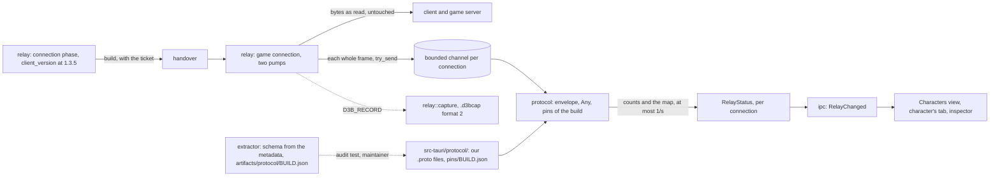

# The protocol

D3B reads the game connection's frames as readable messages: the relay splits the game connection into frames while
it copies every byte untouched, and the protocol decodes the frames of a build it has pins for. A build without pins
is relayed as before, with the protocol off for that connection
(ADR [0012](adr/0012-pins-per-build-over-our-own-proto-files.md)).

The facts below come from the study `artifacts/studies/protocol.md` (the owner's 225 captures, the installed client
3.7.13.17 read with Cpp2IL, and the C# version's measured docs `main:docs/client.md` and `main:docs/client-game.md`).
Each is `inferred` unless said `verified`.

## On the wire

- **Framing** (verified, 54 game connections of 3.7.13.17): every byte, both ways, is in varint-length frames, as in
  the connection phase; no TLS, no compression. The largest frame is 88,581 bytes; 4.6% of the server's reads end
  inside a frame, so frames are reassembled across reads.
- **The envelope** (verified): a client frame is the root's field 4, an `int32` then a `google.protobuf.Any`; a server
  frame is the root's field 3 (an event, an `Any`) or field 1 (a response, an `int32` then an `Any`). The root's field
  2 and the event's list are never set. Every type URL is `type.ankama.com/` and a type's three-letter name.
- **The names** are obfuscated: three lowercase letters for a type, and the members' names too. The type URL names the
  message, so pins pair our readable names with these names, build by build.
- **The build** of each connection (verified, 171 connection phases): the identification request carries the client's
  version at path 1.3.5, equal to the build each capture recorded. No game frame holds it, so the relay reads it in the
  connection phase and hands it over with the ticket.
- **Between builds**: 3.7.13.17's schema is 3.7.12.12's byte for byte (the C# version, D361); what a build that changes
  the schema does is not measured (the C# version's Q17). Patch builds come every one to two weeks.

## The tap

- The game connection is copied by two pumps, one per direction, each writing the bytes it read before anything else,
  then feeding them to a frame reader (`relay::frame::Frames`). Each whole frame goes to the connection's protocol task
  through a bounded channel (about 1,024 frames) with `try_send`: when it is full the frame is dropped and counted,
  never waited for, so the protocol can never slow the game.
- A framing error (a sixth length byte, a frame over 16 MiB) stops the tap for that connection, whose protocol is then
  **lost**; the copy goes on. `protocol::session` is that task: the relay's `game_connection::serve` opens it once a
  ticket is taken, with the build the handover carried; its gate reads a build with pins and leaves any other unread; it
  counts each frame's outcome, keeps the map of the last `MapCurrentEvent`, and tells the relay's status at once, then
  at most once a second while something changed, and once more when the connection ends, which removes it. Each
  message it decodes goes to the connection's observer, which the relay's owner makes for it, with the dropped count
  then; the observer is also told the time every 200 ms and the connection's end, so that `protocol` never depends on
  `game` ([game.md](game.md)). Half-close
  and errors behave as with `copy_bidirectional` today.
- A dropped frame can leave the state stale (a dropped current map keeps the last one shown until the next): the
  status shows the count, and the live view says so ([game.md](game.md#the-state-of-a-character)).
- `src-tauri/src/relay/` already holds 10 code files: the frame reader goes into `frame.rs`, the pumps into
  `game_connection.rs`, the build into `connection_phase.rs` and `handover.rs`, and captures into a new
  `relay/capture/` (the reader moved out of `tests.rs`, and the writer).

## Decoding

- **Our readable `.proto` files** in `src-tauri/protocol/game/` (`character.proto`, `maps.proto`, package `d3b.game`),
  written by us with the field numbers checked by hand against 3.7.13.17's schema, then by the audit test, compiled with
  `prost` by `prost-build` and `protox` in `build.rs` (no `protoc` to install) into `protocol::game`;
  `protocol::message::Message` holds the live view's messages by their readable names. Names are the C# version's
  (inferred); a message declares only the fields D3B reads (partial, so its frames are "read"), an enum it does not need
  is read as its number, and no map is declared (prost's maps would not keep the client's order).
- **Pins**, `src-tauri/protocol/pins/<build>.json`: `{build, schemaSha256, messages: {Readable: "abc"}, secrets:
  ["abc"]}`, one entry per message a feature reads, embedded in the app. `secrets` names the build's messages that
  carry a session secret (the ticket's request, and those the study found holding secrets): their frames are dropped
  before any decoding, and a name both pinned and secret fails the pins' check. `protocol::pins` checks a file as it
  reads it: its build, a lowercase SHA-256, readable names among `protocol::message`'s, names of 1 to 8 lowercase
  letters, none pinned twice. 3.7.13.17's pin the live view's 15 messages, the pairs the C# version measured by play
  (inferred, `main:src/D3B.Protocol/Pins/3.7.13.17.json`), 2 more the live view's study paired (verified),
  `CharacterLevelUpEvent` and `KamasUpdateEvent` ([game.md](game.md)), and 6 secrets: the ticket's request (verified,
  the 54 game connections' first frames), the 4 the study found holding session secrets (inferred), and `koh`: each of
  its 231 frames holds a distinct string of 74 to 78 hexadecimal characters (verified), a session secret by its shape
  and timing (inferred). `protocol::decoder` reads one frame with them: its envelope, a secret left undecoded, a pinned name decoded, then its outcome.
- **The gate**: a connection whose build has pins is decoded; one without (**unmapped**), or with no build read
  (**unknown build**), has the protocol off and the reason in its status. Nothing else changes for it.
- **Four outcomes** per frame (`.claude/rules/game-data.md`: a mapped message that does not re-encode to the same
  bytes is not trusted). prost 0.14 writes a oneof where its lowest field number would be, whichever member is set
  (verified, 2026-11-12, `protocol::message`'s tests), and drops unknown fields, where the client writes fields in
  number order, so the frame and its re-encoding are compared field by field in number order, read by
  `relay::wire`:
  - **understood**: decoded, and the same fields with the same bytes;
  - **read**: decoded, the same but for fields our `.proto` lacks, present in the frame only;
  - **unknown**: a name without a pin, or an envelope not as above, passed on and counted;
  - **not trusted**: a pinned name whose bytes do not decode, or a declared field that re-encodes otherwise.

  `protocol::envelope` opens a frame by the wire format alone, with no allocation: exactly the fields above, an id of 0
  left out, an empty message's `Any` without its value, a name of 1 to 8 lowercase letters (3.7.13.17's are 3).
  `protocol::outcome` compares down to 16 levels of nested messages (the live view's deepest is 7, a monster of a group in the map's information) and 131,072 fields in
  all (4 MiB; the largest frame measured holds under 45,000); a repeated field keeps its count and order, and a field
  prost wrote that the frame lacks is not trusted. With no schema at hand, "read" also covers a field our `.proto`
  declares without the presence the build gives it, sent at 0, and a oneof sent twice: the audit test checks that our
  `.proto` keeps the build's `optional` and oneofs. A secret message's frames count as unknown.
- **To start**, the messages the live view needs: the character chosen, the current map and its information (and its
  request), the context created and destroyed, actors shown, removed and moving, interactive and stated elements
  updated, the characteristics, life regeneration, the weight, a level gained and the kamas.

## A new build

1. The maintainer runs the extractor on the new client: it reads the protocol's schema from the IL2CPP metadata with
   Cpp2IL (messages, field numbers, types, oneofs; no machine-code pass) and writes
   `artifacts/protocol/<build>.json`, with a `format` and the SHA-256 of its canonical form (keys and messages sorted).
   Nothing of it is committed or shipped. A change of that format updates every pinned build's `schemaSha256` in the
   same PR. The same command writes the data folder (the owner, 2026-11-12). Format 1 (`tools/extractor/src/Protocol/`)
   lists the game connection's messages by name, a nested one after its declaring types with dots, each field's
   number, kind (`int32`, `int64`, `uint32`, `bool`, `string`, `float`, `enum`, `message`, `map` on 3.7.13.17), its
   type, `repeated` or `optional`, and its oneof; and the enums the fields hold, with their values. The canonical form
   is compact and omits the build, so two builds of one schema share their digest. The metadata gives C# types: an
   `int` is written `int32` though `sint32` and `sfixed32` are `int` too (none on 3.7.12.12, the C# version's D40); a
   decode that does not re-encode the same bytes shows one. Measured on 3.7.13.17 (verified, 2026-11-12): 2,175
   messages, 6,302 fields (401 `optional`, 770 `repeated`, 201 maps, 349 in oneofs), 422 enums, in the same run as
   the data; two runs write the same bytes.
2. When the digest equals a pinned build's, its pins are copied under the new build. Otherwise the pins are made again
   and the audit test (ignored unless that schema exists) checks that every pinned message and field exists with the
   same number and kind and that `schemaSha256` matches; a capture of the new build replayed must show no frame
   "not trusted".
3. The pins are committed; the next release decodes that build.

## Captures

`D3B_RECORD=<folder>` records each game connection to `<folder>/<build>-<Unix milliseconds>-<n>.d3bcap`, in the C#
version's format 2, which the replay reads (`relay::capture`): each read of each side as it came, the client's first
ones as one record up to its first frame. Nothing is written for a game server that cannot be reached. The build is the
connection's own, from its connection phase, or `unknown` when none was read. Game connections only: the connection
phase holds the launcher's login token. Each read is handed to a blocking writer without waiting, at most 1,024 waiting;
one more cuts the capture, and so does a write that fails: nothing more is recorded, the file ends at its last whole
record and its name ends in `-cut`. A folder that cannot be made, or a name already taken, gives no capture, and the
game goes on. `D3B_RECORD` is taken only as an absolute folder. No interface: a capture holds the account's ticket and
is never shared. It is the one exception to the relay's secrets rule ([relay.md](relay.md#secrets)).

## In the app

`RelayStatus.connections` holds one entry per game connection: its build, its protocol state (on, unmapped, unknown
build, lost), updated at most once a second, the counts of the four outcomes and of dropped frames (saturating at
`u32::MAX`), and its current map's coordinates from the game data when the data's build is the connection's: only
these prove a name was paired with the right message. The old relay tooltip showed each connection (removed on
2026-11-12 with the old UI); in the new shell the relay's hover no longer does (the owner, 2026-11-13): a connection's
protocol state shows in the Characters view and its character's tab, its map in the tab, and its counts in the
inspector, below. No new command.

## The inspector

The owner's choices of 2026-11-12, on the mockup, then of 2026-11-13 in the new shell ([shell.md](shell.md)), from
mock-ups: the panel's **Protocol** view (the panel under the editor area, Ctrl+J; its name "Protocol" in both languages)
lists the frames of the character whose tab is active, live, newest last, and shows the one clicked in a column on its
right. Its header holds, on one line, the connection's counts (understood, read, unknown, not trusted, dropped, from
`RelayStatus.connections`), then the side, the name filter and the pause.

- **Which connection**: the one whose character's tab is active, while the panel shows; none otherwise, so nothing is
  streamed to a hidden panel. Without such a tab the view says to open a character; for a connection whose protocol
  is not read, or closed, it says it keeps nothing and shows no counts (the character's tab says why: nothing is said
  twice). A protocol lost keeps its frames and counts. Only the count of frames not trusted is in colour, when above 0,
  as are those frames' outcome in the list.
- **Kept**: each connection's last 3,000 frames and 16 MiB at most, whichever comes first, from its start, freed at
  its close: the protocol hands each frame of a connection with pins to the connection's observer, which the IPC keeps
  in `ipc::inspector` (`protocol::Frames`), each with its number, time, side, name, readable name, outcome and size. A
  secret's frame keeps its name and size only, never its bytes. A frame the tap dropped is not there; the relay's
  status counts them.
- **Streamed only while watched**: `inspector_watch(Some(connection))` answers with the kept frames' summaries and
  starts `InspectorFrames`, at most five batches a second (at the protocol's ticks) of at most 1,000 summaries each, with the count of those
  skipped beyond (the peaks measured on one connection: 737 frames in a second; 93 KB in another, one frame). One
  connection is watched at a time, the one whose tab is shown: `inspector_watch(None)`, a connection closed, or the
  front end starting (after a reload too) stops it. `inspector_frame(connection, number)` answers a `FrameAnswer`: the
  frame's lines (`DetailLine`, a 64-bit value written out since JavaScript's numbers would round it), or that its
  connection closed, or that it is no longer kept.
- **A frame's detail**, in the column on the list's right: a pinned message decoded, its fields by their names (players'
  names as the game shows them), nested ones indented, without its own name, which its row shows; under it, dimmer,
  the fields our `.proto` does not read, by number. Any other frame, by the wire walker (`relay::wire`)
  alone, at its top level: field numbers, wire types, varints, and a length for anything length-delimited, never
  opened, since the walker cannot tell a text from a nested message. **Text is never shown**: an unpinned message may
  hold the chat, the account's nickname or names, and no list of them is kept per build. No bytes, no export, no
  copy. A secret's detail says its content is never kept; a frame forgotten since it was listed, that it is no longer
  kept. A connection whose protocol is off keeps no frame: a build without pins has no list of its secrets.
- **The list** (`src/inspector/`) keeps the last 3,000 frames, as the back end does, and shows the visible rows only
  (22 px each, by hand): number, time since the connection opened, side (↑ client, ↓ server), the readable name (or
  the build's name, dimmer, for a message not pinned), outcome and size. A connection numbers its frames one after
  another, so where the numbers jump a row says how many frames were not listed. Scrolled to its end, the list follows
  the frames; scrolled up, the row at its top stays in place as the oldest frames go. A row clicked is chosen, a
  rounded grey row, and its detail shows. It filters by side (all, ↑ client, ↓ server) and by a text its name as
  listed holds (the readable one, else the build's), whatever its case, both kept from one character to the next; "No frame matches." when
  none does. The pause, pressed, stops the list and holds what streams meanwhile (3,000 at most), saying how many
  arrived, all of them; released, those held are listed. A connection watched anew starts unpaused, nothing chosen.

## Tests

Unit tests per file with their failure cases, on synthetic frames: the frame reader (a header split across reads,
several frames per read, an 88,581-byte frame over 11 reads; a sixth length byte, a frame over the limit), the pumps
(bytes out equal bytes in with the channel full), the build at 1.3.5, the envelope, the pins' checks (a name pinned
twice, a readable name the `.proto` lacks, a secret message pinned), each message, the capture writer read back. The
capture replay (`D3B_CAPTURES`) checks every frame is passed on, none mapped is "not trusted", and the live view's
messages are decoded (understood or read), printing counts by readable name only.

The pins' audit (`protocol::audit`, ignored unless run with `--ignored`; it reads `artifacts/protocol/<build>.json`, or
the folder `D3B_SCHEMAS` names) starts from each pinned pair and follows the messages their fields hold: every field
our `.proto` declares must be in the build's message with its number, kind (an `int32` may read an enum), list,
presence and oneof, each of our messages paired with one of the build's, the digest the pins'. `build.rs` describes
our messages for it in `OUT_DIR/protocol-shapes.txt`. On 2026-11-12, 3.7.13.17's 17 pins hold. The protocol's replay
(`protocol::replay`, `D3B_CAPTURES`) read the owner's 54 game connections of 3.7.13.17: of 3,048,392 frames, 284,214
understood, 256,933 read, 2,507,245 unknown (messages not pinned) and none not trusted; each of the 17 messages was
decoded, as many times as the study counted them in these 54 (it read 2 more, of
`Desktop\d3b-captures`, which hold the other 2 `KamasUpdateEvent` of its 1,374).

The inspector's, each with its failure case: the frames kept bounded by count and by bytes (an 88 KB frame evicts the
oldest), a secret's frame kept without its bytes, nothing kept for a connection whose protocol is off; a batch capped
at 1,000 with its count skipped, nothing streamed but the connection watched, the stream stopped by `None`, another
connection watched, or the connection closed; a frame evicted answered as gone; an unpinned frame's string shown as
its length only, and in Vitest a fixture's text never reaching the page. Vitest: the store (kept then streamed frames in
any order, a watch overtaken, the last 3,000, the back end told when none is watched), a frame's time, the list (its
columns, the frames not listed, the newest drawn, its top row kept while scrolled up, following again at its end, its rows' hidden texts kept inside its box so
the window never scrolls), and
the panel (counts, only frames not trusted in colour, no frames of another connection, no tab, panel hidden, protocol
not read, closed, lost, a detail without the frame's name and its unread fields dimmer, a secret, a frame gone, the
side and name filters, the pause). The store: a detail answered late for a frame chosen before dropped, the choice
forgotten for another connection, frames held while paused and listed once resumed, no more held than kept while all are counted, the frames kept that answer after the pause held, a secret
remembered when chosen. Rust: a
decoded message's fields without its name, nested ones indented, none for a message without fields; a 64-bit value
written out.
