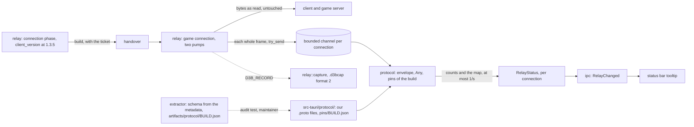

# The protocol

D3B reads the game connection's frames as readable messages: the relay splits the game connection into frames while
it copies every byte untouched, and the protocol decodes the frames of a build it has pins for. A build without pins
is relayed as before, with the protocol off for that connection (ADR [0012](adr/0012-pins-per-build-over-our-own-proto-files.md)).

The facts below come from the study `artifacts/studies/protocol.md` (the owner's 225 captures, the installed client
3.7.13.17 read with Cpp2IL, and the C# version's measured docs `main:docs/client.md` and `main:docs/client-game.md`).
Each is `inferred` unless said `verified`.

## On the wire

- **Framing** (verified, 54 game connections of 3.7.13.17): every byte, both ways, is in varint-length frames, as in
  the connection phase; no TLS, no compression. The largest frame is 88,581 bytes; 4.6% of the server's reads end
  inside a frame, so frames are reassembled across reads.
- **The envelope** (verified): a client frame is the root's field 4, an `int32` then a `google.protobuf.Any`; a server
  frame is the root's field 3 (an event, an `Any`) or field 1 (a response, an `int32` then an `Any`). The root's field
  2 and the event's list are never set. Every type URL is `type.ankama.com/` and a type's three-letter name.
- **The names** are obfuscated: three lowercase letters for a type, four for a member. The type URL names the message,
  so pins pair our readable names with these names, build by build.
- **The build** of each connection (verified, 171 connection phases): the identification request carries the client's
  version at path 1.3.5, equal to the build of its `version` file. No game frame holds it, so the relay reads it in the
  connection phase and hands it over with the ticket.
- **Between builds**: 3.7.13.17's schema is 3.7.12.12's byte for byte (the C# version, D361); what a build that changes
  the schema does is not measured (the C# version's Q17). Patch builds come every one to two weeks.

## The tap

- The game connection is copied by two pumps, one per direction, each writing the bytes it read before anything else,
  then feeding them to a frame reader (`relay::frame::Frames`). Each whole frame goes to the connection's protocol task
  through a bounded channel (about 1,024 frames) with `try_send`: when it is full the frame is dropped and counted,
  never waited for, so the protocol can never slow the game.
- A framing error (a sixth length byte, a frame over 16 MiB) stops the tap for that connection; the copy goes on.
  Half-close and errors behave as with `copy_bidirectional` today.

## Decoding

- **Our readable `.proto` files** in `src-tauri/protocol/`, written by us with the field numbers checked against the
  captures, compiled with `prost` by `prost-build` and `protox` in `build.rs` (no `protoc` to install).
- **Pins**, `src-tauri/protocol/pins/<build>.json`: `{build, schemaSha256, messages: {Readable: "abc"}}`, one entry per
  message a feature reads, embedded in the app. Messages carrying a session secret (the ticket's request and its
  kin) are never pinned, so never decoded.
- **The gate**: a connection whose build has pins is decoded; one without, or with no build read, has the protocol
  off and the reason in its status. Nothing else changes for it.
- **Four outcomes** per frame: **understood** (decoded, and encodes back to its own bytes), **read** (decoded, with
  fields our `.proto` lacks), **unknown** (a name without a pin, or an envelope not as above), **not trusted** (a
  pinned name whose bytes do not decode).
- **To start**, the messages the live view needs: the character chosen, the current map and its information (and its
  request), the context created and destroyed, actors shown, removed and moving, interactive and stated elements
  updated, the characteristics, life regeneration, and the weight.

## A new build

1. The maintainer runs the extractor on the new client: it reads the protocol's schema from the IL2CPP metadata with
   Cpp2IL (messages, field numbers, types, oneofs; no machine-code pass) and writes
   `artifacts/protocol/<build>.json` with its SHA-256. Nothing of it is committed or shipped.
2. When the digest equals a pinned build's, its pins are copied under the new build. Otherwise the pins are made again
   and the audit test (ignored unless that schema exists) checks that every pinned message and field exists with the
   same number and kind and that `schemaSha256` matches; a capture of the new build replayed must show no frame
   "not trusted".
3. The pins are committed; the next release decodes that build.

## Captures

`D3B_RECORD=<folder>` records each game connection to `<folder>`, in the C# version's `.d3bcap` format 2, which the
replay already reads, its file named with the build. Game connections only: the connection phase holds the launcher's
login token. Written off the copy path; a writer that falls behind marks the capture cut. No interface: a capture
holds the account's ticket and is never shared.

## In the app

`RelayStatus` gains one entry per game connection: its build, its protocol state (on, unmapped, unknown build, lost),
the counts of the four outcomes and of dropped frames, and its current map's coordinates from the game data when the
data's build is the connection's: only these prove a name was paired with the right message. The relay's tooltip
shows one line per connection. No new command.

## Tests

Unit tests per file with their failure cases, on synthetic frames: the frame reader (a header split across reads,
several frames per read, an 88,581-byte frame over 11 reads; a sixth length byte, a frame over the limit), the pumps
(bytes out equal bytes in with the channel full), the build at 1.3.5, the envelope, the pins' checks (a name pinned
twice, a readable name the `.proto` lacks, a secret message pinned), each message, the capture writer read back. The
capture replay (`D3B_CAPTURES`) checks every frame is passed on, none mapped is "not trusted", and the live view's
messages are understood, printing counts by readable name only.
