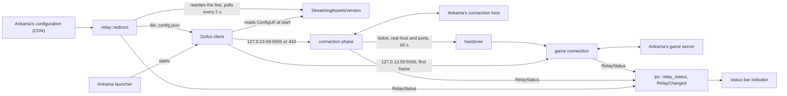

# The relay

D3B sits between the official client and Ankama's servers on the same machine. At start it points the client's
`ConfigUrl` at a copy of Ankama's configuration whose connection host is the relay on loopback, and it puts the line
back at quit. Every frame passes through untouched, but one: the server's answer to the server selection, whose game
host and ports become the relay's (ADR [0011](adr/0011-the-relay-redirects-configurl-and-rewrites-one-frame.md)).

The facts below come from the study `artifacts/studies/relay.md`: the C# version's measured docs
(`main:docs/client.md`, "Connection") on 3.7.12.12 and 3.7.13.17, and the installed client 3.7.13.17. Each is
`inferred` unless said `verified`.

## The redirect

- **The lever**: the client reads `Dofus_Data/StreamingAssets/version` at start and loads its `ConfigUrl` with
  `UnityWebRequest` before showing anything. `http:` is refused, `file:` is read, and the client connects to the
  connection host the JSON names, an IPv4 address included. The file is three `Key=Value` lines, CRLF (verified,
  3.7.13.17); only the `ConfigUrl` line changes, every other byte is kept, the file is bounded at 4 KiB.
- **The configuration**: Ankama's JSON names its connection hosts in `connectionHosts`, `<name>:<host>:<ports>`, one
  entry with ports `5555,443`. D3B writes a copy with that host replaced by `127.0.13.59` and every other key kept, and
  refuses a JSON with more than one connection host (a relayed connection carries no host name to tell them apart) or
  whose host is already a D3B address.
- **The state** lives in the app's local data folder (`app_local_data_dir()/redirect`), outside the per-user install
  folder: `config-url` (Ankama's original URL), `ankama-config.json` (the last JSON read from Ankama, used when the CDN
  cannot be reached) and `config.json` (the copy the client reads).
- **The lifecycle**, decided by the owner on 2026-11-11:
  - at app start, read `ConfigUrl`; if it is already D3B's (after a crash) take the kept original; download Ankama's
    JSON (else the kept copy, else fail with a typed error and touch nothing); write the state; rewrite the line;
  - every 2 s, read `version` again: when the launcher rewrote it (an update or a repair, both measured), redirect again;
  - at quit, and before the updater installs, put the original URL back, only if the line is still D3B's.
- **The client folder**: `DOFUS_CLIENT`, else `%LOCALAPPDATA%\Ankama\Dofus-dofus3`, as for the extractor
  ([data.md](data.md)).
- **What it cannot do**: a client started before D3B loaded Ankama's configuration and goes straight to Ankama for its
  whole life; the indicator's tooltip says to start the client after D3B. A client started while D3B is gone but the
  line is still redirected (a crash) cannot connect until D3B starts again or the launcher repairs.

## The connections

- **Listeners**: `127.0.13.59` (not `127.0.0.1`, so no other local program's port is taken), ports 5555 and 443 for
  the connection phase (the launcher's `connectionPort` picks one) and 5556 for the game. The ports are fixed; when one
  cannot be taken, D3B does not redirect and the indicator names the port.
- **Framing**: every byte, both ways, is in frames of a protobuf varint length (at most 5 bytes) then that many bytes.
  A frame over 16 MiB, or a sixth length byte, closes the connection. Nothing is encrypted or compressed.
- **The connection phase**: the relay resolves Ankama's connection host at each connection (a load balancer) and
  connects on the port the client chose. Four frames: the identification (with the launcher's login token) and its
  answer, then the server selection and its answer, after which the server closes.
- **The one rewrite**: after the client's `request.server_selection` (path 1.4), the relay holds the server's bytes
  whole (64 KiB and 5 s at most) until the answer, `response.server_selection.success` (path 2.4.1:
  `ticket = 1`, `host = 2`, `ports = 3` packed). It is read with a small protobuf wire walker, by field path: only if
  the frame is read whole and encodes back to its own bytes are `host` and `ports` replaced with `127.0.13.59` and
  `5556`. Otherwise the frame passes untouched, the game connection goes straight to Ankama, and the indicator says the
  handover was not understood. The real host, ports and ticket are kept in memory for 60 s, taken once.
- **The game connection**: the client speaks first, a frame holding the ticket (the `AuthenticationRequest`). The
  relay reads that frame, finds a waiting ticket among its length-delimited values by the wire format alone, connects
  to that ticket's real host and port, relays the frame first, then pipes both ways. No waiting ticket, or no whole
  frame within 5 s: the connection is closed.
- **Several clients and accounts** at once are matched by their tickets.
- **Builds**: the relay reads no game mapping, so it carries any build; the only build-dependent step, the rewrite,
  fails safe. The version gate belongs to the protocol (step 2, next feature).

## Secrets

The login token, the ticket and the game frames identify the account: they are never logged, shown, or written to disk.
A ticket's `Debug` prints `<redacted>`; tests on captures print only file names, offsets and lengths.

## Platforms

Windows x64 only for now (the owner, 2026-11-11). On macOS and Linux the indicator says the relay is not measured on
this platform and nothing is redirected: `127.0.13.59` may not exist on macOS, port 443 needs a privilege on Linux, and
where the client keeps its `version` file is unknown. The first testers there report the study's facts
([testing.md](testing.md)).

## Tests

Unit tests per file with their failure cases, synthetic frames only. The owner's C# captures (`.d3bcap` format 2) are
replayed through the relay by `src-tauri/tests/relay_replay.rs` when `D3B_CAPTURES` names their folder (ignored in CI):
bytes out equal bytes in, but the one rewritten frame per connection phase. Recording captures comes with the protocol
feature.
