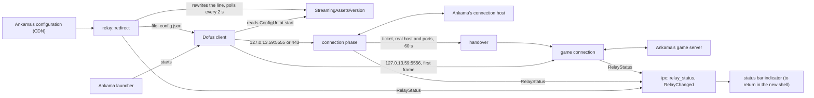

# The relay

D3B sits between the official client and Ankama's servers on the same machine: for the app's life, the client's
`ConfigUrl` names a copy of Ankama's configuration whose connection host is the relay on loopback. Every frame passes
untouched but the server-selection answer, whose game host and ports become the relay's
(ADR [0011](adr/0011-the-relay-redirects-configurl-and-rewrites-one-frame.md).

The facts below come from the study `artifacts/studies/relay.md`: the C# version's measured docs
(`main:docs/client.md`, "Connection") on 3.7.12.12 and 3.7.13.17, and the installed client 3.7.13.17. Each is
`inferred` unless said `verified`.

## The redirect

- **The lever**: the client reads `Dofus_Data/StreamingAssets/version` at start and loads its `ConfigUrl` with
  `UnityWebRequest` before showing anything. `http:` is refused, `file:` is read, and the client connects to the
  connection host the JSON names, an IPv4 address included. The file is three `Key=Value` lines, CRLF (verified,
  3.7.13.17); only the `ConfigUrl` line changes, every other byte is kept, the file is bounded at 4 KiB. It is
  written to a temporary file beside it, then renamed over it, so a client starting meanwhile never reads half of it.
- **The configuration**: Ankama's JSON names its connection hosts in `connectionHosts`, `<name>:<host>:<ports>`, one
  entry with ports `5555,443`. D3B writes a copy with that host replaced by `127.0.13.59` and every other key kept, and
  refuses a JSON with more than one connection host (a relayed connection carries no host name to tell them apart) or
  whose host is a loopback address (already redirected). The JSON is bounded at 64 KiB (768 bytes on 2026-10-27).
- **The state** lives in the app's local data folder (`app_local_data_dir()/redirect`), outside the per-user install
  folder: `config-url` (Ankama's original URL), `ankama-config.json` (the last JSON read from Ankama, used when the CDN
  cannot be reached) and `config.json` (the copy the client reads).
- **The lifecycle**, decided by the owner on 2026-11-11:
  - at app start, read `ConfigUrl`: D3B's own (the `file:` URL of its `config.json`, after a crash) means the kept
    original; an `https:` URL is Ankama's; anything else (another program's redirect, the C# D3B's) is refused, with
    the launcher's repair named as the way back. Download Ankama's JSON (else the kept copy, else fail with a typed
    error and touch nothing); write the state; rewrite the line;
  - every 2 s, read `version` again: when the launcher rewrote it (an update or a repair, both measured), redirect
    again;
  - at quit, put the original URL back, only if the line is still D3B's. On Windows the updater ends the process
    itself while installing, so `src/updates/` awaits the `relay_restore` command before it installs.
- **The client folder**: `DOFUS_CLIENT`, else `Ankama/Dofus-dofus3` in the user's local data folder, taken through
  `app.path()`, as the extractor does ([data.md](data.md)).
- **What it cannot do**: a client started before D3B loaded Ankama's configuration and goes straight to Ankama for its
  whole life; the interface tells the player to start the client after D3B (the indicator did until 2026-11-12). A client started while D3B is gone but the
  line is still redirected (a crash) cannot connect until D3B starts again or the launcher repairs. Quitting or
  updating D3B drops every relayed client's game connection, and its reconnection fails while D3B is gone (D88,
  D91): the interface says so while connections are live (the indicator did until 2026-11-12).

## The connections

- **Listeners**: `127.0.13.59` (not `127.0.0.1`, so no other local program's port is taken), ports 5555 and 443 for
  the connection phase (the launcher's `connectionPort` picks one) and 5556 for the game. The ports are fixed; when one
  cannot be taken, D3B does not redirect and the relay's status names the port.
- **Framing**: every byte, both ways, is in frames of a protobuf varint length (at most 5 bytes) then that many bytes.
  A frame over 16 MiB, or a sixth length byte, closes the connection; the relay reads frames in the connection phase
  and the game connection's first frame, then copies the game's bytes untouched while it splits each way into frames
  for the protocol; there such a frame stops only the splitting, and the copy goes on
  ([protocol.md](protocol.md#the-tap)).
  Nothing is encrypted or compressed.
- **The connection phase**: the relay resolves Ankama's connection host at each connection (a load balancer) and
  connects on the port the client chose. Four frames: the identification (with the launcher's login token) and its
  answer, then the server selection and its answer, after which the server closes.
- **The one rewrite**: after the client's `request.server_selection` (path 1.4), the relay holds the server's bytes
  whole (64 KiB and 5 s at most) until the answer, `response.server_selection.success` (path 2.4.1:
  `ticket = 1`, `host = 2`, `ports = 3` packed). It is read with a small protobuf wire walker, by field path, and is
  understood only when read whole, encoding back to its own bytes, with the expected shape: a ticket of 32
  characters, a DNS host name, ports from 1 to 65535. Then `host` and `ports` are replaced with `127.0.13.59` and
  `5556`. Otherwise the frame passes untouched, the game connection goes straight to Ankama, and the relay's status says the
  handover was not understood. The real host, ports and ticket are kept in memory for 60 s, taken once, with the
  client's build its identification named (path 1.3.5, digits and dots, at most 32 bytes; none when not read), which
  the game connection never carries ([protocol.md](protocol.md#on-the-wire)).
- **The game connection**: the client speaks first, a frame holding the ticket (the `AuthenticationRequest`). The
  relay reads that frame, finds a waiting ticket among its length-delimited values by the wire format alone, connects
  to that ticket's real host on the first real port (the client takes the first port listed), relays the frame first,
  then pipes both ways. No waiting ticket, or no whole
  frame within 5 s: the connection is closed. The ticket is taken before the game server is reached, so a client
  whose game server cannot be reached is refused, and so is a retry with the same ticket (not measured).
- **Several clients and accounts** at once are matched by their tickets.
- **Builds**: the relay reads no game mapping, so it carries any build. The only build-dependent step is the rewrite,
  whose field path held from an older build to 3.7.13.17 but is not measured beyond (Q17 of the C# version); on
  another build it is tried with the shape checks above, which let a renumbered answer pass untouched rather than
  rewrite it wrongly (the owner, 2026-11-11). The version gate belongs to the protocol (step 2, next feature).

## In the app

- `relay::Relay` is started in `setup` on the installed client and stopped on `RunEvent::Exit`; the updater awaits the
  `relay_restore` command before it installs. `relay_status` and the event `RelayChanged` carry its state (starting,
  ready, failed with its reason, unsupported, stopped), the client's build, the game connections open and the answers
  not understood.
- The status bar's indicator (`src/relay/`, removed on 2026-11-12 with the old UI until the new shell has a status
  bar) showed the state and the game connections; its tooltip the reason, the
  client's build, what the protocol reads of each game connection ([protocol.md](protocol.md#in-the-app)), that
  quitting ends the game connections, and to start the client after D3B.
- A restore Windows refuses (a process holding `version`) is tried five times over about 3 s.

## Secrets

The login token, the ticket and the game frames identify the account: they are never logged, shown, or written to disk,
but in a capture the maintainer asks for with `D3B_RECORD` ([protocol.md](protocol.md#captures)).
A ticket's `Debug` prints `<redacted>`; tests on captures print only file names, offsets and lengths.

## Platforms

Windows x64 only for now (the owner, 2026-11-11). On macOS and Linux nothing is redirected and the relay's status says
it is not measured on this platform (the indicator that showed it was removed on 2026-11-12 with the old UI): `127.0.13.59` may not exist on macOS, port 443 needs a privilege on Linux, and
where the client keeps its `version` file is unknown. The first testers there report the study's facts
([testing.md](testing.md)).

## Tests

Unit tests per file with their failure cases, synthetic frames only. Time comes in as a parameter (the 2 s poll, the 5 s
and 60 s limits) and the connections are generic over Tokio's streams, so tests run in memory on paused time. The
owner's C# captures (`.d3bcap` formats 1 and 2) are replayed through the relay by `src-tauri/src/relay/tests.rs` (inside
the crate, since the relay is not public) when `D3B_CAPTURES` names their folder (ignored in CI): bytes out equal bytes
in, but the one rewritten frame per connection phase. The C# version recorded each side's bytes as read, before its own
rewrite, so a capture holds the answer as Ankama sent it. A game capture's ticket, at path 4.2.2.1 of its first frame,
is seeded into the handover. A connection phase handed over must hand over the build its capture recorded. On
2026-11-11, the owner's 225 captures: 171 connection phases, 161 handed over, each with its capture's build, 54 game
connections relayed byte for byte, their 3,048,392 frames split as each side sent them. D3B records its own captures
with `D3B_RECORD` ([protocol.md](protocol.md#captures)).
