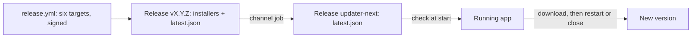

# Updates

The app updates itself from this repository's releases. At start it checks its channel, downloads a newer version in
the background, and shows a bar offering to restart into it; if the player does not, the update installs as the app
closes. Nothing is checked in development or in the browser preview.

## Pieces

- **Back end**: `tauri-plugin-updater`, with its public key and endpoint in `src-tauri/tauri.conf.json`
  (`plugins.updater`). It refuses any update not signed by the project's private key.
- **Front end**: `src/updates/`. `updater.ts` is the store (idle, checking, downloading, ready, installing, failed),
  `use-auto-update.ts` checks once at start and handles the close, `update-banner.tsx` is the bar. A failed install
  keeps the update: the bar offers it again and closing tries again. Errors go to the app's log.
- **Closing**: the hook's close listener takes the close over, so the window needs `core:window:allow-destroy`. During
  an install the close waits; with an update downloaded, it installs without restarting (Windows' installer would
  otherwise relaunch the app), then quits.
- **Release**: `tauri.release.conf.json` makes the build sign its updater artifacts with the secrets
  `TAURI_SIGNING_PRIVATE_KEY` and `TAURI_SIGNING_PRIVATE_KEY_PASSWORD`; tauri-action attaches `latest.json`; the
  `channel` job copies it onto the release `updater-next` once all six targets are built.

## The channel

GitHub's `releases/latest` ignores pre-releases, and the rewrite publishes pre-releases until it replaces the C#
version. So the app reads `releases/download/updater-next/latest.json`, which every release of `next` rewrites, once
`latest.json` names all six platforms ([ADR 0007](adr/0007-the-updater-next-channel.md)). At the switch, the release
that moves the endpoint to `releases/latest/download/latest.json` is still published on `updater-next`, so that every
installed copy reaches it; the `channel` job goes only in the release after.

## Not yet

- A bot running will veto the restart and the install on close, once bots exist.

## The signing key

The owner holds the private key (`~/.tauri/d3b.key`) and its password; the repository holds them only as secrets.
Losing either means installed apps can never be updated again: keep a backup outside this machine.
