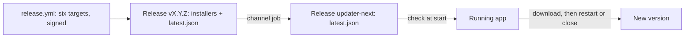

# Updates

The app updates itself from this repository's releases. At start it checks its channel, downloads a newer version in
the background, and installs it as the app closes, or sooner from the status bar's offer to restart. Nothing is checked in development or in the browser preview.

## Pieces

- **Back end**: `tauri-plugin-updater`, with its public key and endpoint in `src-tauri/tauri.conf.json`
  (`plugins.updater`). It refuses any update not signed by the project's private key.
- **Front end**: `src/updates/`. `updater.ts` is the store (idle, checking, downloading, ready, installing, failed),
  `use-auto-update.ts` checks once at start and handles the close. `update-item.tsx` is the status bar's offer, on
  its right after the game data (the owner's choice "3a" from mock-ups, 2026-11-13): the orange update icon
  and "Restart to update to 0.14.0"; chosen, it installs and restarts at once, then says "Installing 0.14.0…" and
  cannot be chosen again. Its hover adds only what the label does not say: the release's notes (six lines at most;
  the channel's are empty today), and that restarting ends the game connections while some are open. A failed install
  keeps the update: closing tries again, and so does the offer. Errors go to the app's log. Before installing,
  the store awaits `relay_restore`, which puts the client's configuration back: Windows' installer ends the app before
  its exit hook runs ([relay.md](relay.md)).
- **Closing**: the hook's close listener takes the close over, so the window needs `core:window:allow-destroy`. During
  an install the close waits; with an update downloaded, it installs without restarting (Windows' installer would
  otherwise relaunch the app), then quits.
- **Release**: `tauri.release.conf.json` makes the build sign its updater artifacts with the secrets
  `TAURI_SIGNING_PRIVATE_KEY` and `TAURI_SIGNING_PRIVATE_KEY_PASSWORD`; tauri-action attaches `latest.json`, whose
  Windows x64 entry is the NSIS installer (`updaterJsonPreferNsis`), the one players install, never the MSI; the
  `channel` job copies it onto the release `updater-next` once all six targets are built.

## Third-party notices

Every package carries `THIRD-PARTY-NOTICES.txt`, the licences of what the app bundles, as a resource beside the app
(the owner's choice, 2026-11-13, over an About entry or the installer's licence page): next to `data/`, in the app's
resource folder, so in the install folder on Windows (NSIS and MSI), `D3B.app/Contents/Resources/` on macOS, and the
resource folder of the deb, the rpm and the AppImage. `tauri.release.conf.json` adds it to `bundle.resources` and
runs `scripts/notices.ts` after the front end's build, for the target Tauri builds (`TAURI_ENV_TARGET_TRIPLE`). It
joins three lists, each from the tool that bundles:

- the interface's code: Vite's `build.license` (`dist/.vite/license.md`), Lucide's among them. A package Vite finds
  no licence file in (today `react-remove-scroll-bar`) gets MIT's text with its `package.json` author; under any other
  licence, it fails;
- the interface's styles and font: the packages `src/index.css` imports that Vite has not listed (Inter's OFL-1.1,
  Tailwind's, shadcn's, tw-animate-css'), with the licence file of each;
- the crates the binary links for that target, build and dev dependencies left out: `cargo about generate`
  (cargo-about 0.9.3, built with `--features cli`), under the eight licences `src-tauri/about.toml` accepts (MIT,
  Apache-2.0, ISC, BSD-2-Clause, BSD-3-Clause, Zlib, Unicode-3.0, MPL-2.0: those in use, the owner's list of
  2026-11-13), in that order of preference when a crate offers a choice. MPL-2.0's section links each crate's source
  on crates.io, as that licence asks.

A crate under another licence fails the notices; `bun run check` writes them for the host, and CI for the six
targets on every PR, so a new licence is met there, and accepting it is the owner's call. Locally that needs
`cargo install cargo-about@0.9.3 --locked --features cli`. A plain `tauri build` without the release configuration
carries no notices.

The AppImage also packs system libraries: GTK, WebKitGTK and what they need, about 360 files from 128 packages of
Ubuntu 22.04 (the release's runner), mostly LGPL, a few GPL (jbigkit) or permissive. linuxdeploy and its GTK plugin
choose them, and the list follows the runner's image (the ARM64 one even packs another app's GSettings schema), so it
is read from a real build, never kept by hand. The AppImage alone carries `SYSTEM-LIBRARIES-NOTICES.txt` beside
`THIRD-PARTY-NOTICES.txt` (`bundle.linux.appimage.files`), which on Linux names it; the deb and the rpm use the
system's libraries and carry no such file (the owner's choices, 2026-11-13: a file of its own, built in two passes).

- **Two passes**: on Linux, `release.yml` runs `scripts/appimage-notices.ts` before tauri-action. It builds a first
  AppImage (no updater artifacts, never shipped), extracts it, finds the Debian package of each file (`dpkg-query -S`,
  under both spellings of the merged `/lib`), and writes `src-tauri/gen/SYSTEM-LIBRARIES-NOTICES.txt`: each package
  with its version, its source package and the files it gives; each copyright file of `/usr/share/doc` once; the
  texts of `/usr/share/common-licenses` they cite, which the AppImage would otherwise lack; and each source package.
  tauri-action then builds the AppImage it ships on the same machine, so with the same libraries, and this file in
  it. A file no package owns, other than the app's own, linuxdeploy's AppRun and hooks and the GTK plugin's caches,
  fails the notices, as does a missing copyright file or licence text. linuxdeploy also copies most packages'
  copyright files into the AppImage's `usr/share/doc/`, but misses those under `/lib`, the GIO modules and the data,
  and never the licence texts: the notices do not rely on them.
- **Sources** (LGPL and GPL ask for them): the file names each source package at its exact version, with its page on
  Launchpad (`https://launchpad.net/ubuntu/+source/<source>/<version>`, the epoch kept) and `apt-get source
  <source>=<version>`; Ubuntu's archive keeps every version it published (the owner's choice, 2026-11-13, over
  attaching the sources to each release, which a strict reading of GPL-2 §3 and LGPL-2.1 §6 would prefer, about
  300 MB a release).
- **Checked on PRs**: `.github/workflows/appimage.yml` builds the x64 AppImage in the same two passes on the pull
  requests that touch the release workflow, the notices' scripts, Tauri's configurations or `Cargo.lock` (the
  owner's choice, 2026-11-13), and checks the AppImage holds the file it wrote and that `THIRD-PARTY-NOTICES.txt`
  names it. A Linux build of the release configuration outside these workflows needs the file to exist: run
  `scripts/appimage-notices.ts` first.

## The channel

GitHub's `releases/latest` ignores pre-releases, and the rewrite publishes pre-releases until it replaces the C#
version. So the app reads `releases/download/updater-next/latest.json`, which every release of `next` rewrites, once
`latest.json` names all six platforms ([ADR 0007](adr/0007-the-updater-next-channel.md)). At the switch, the release
that moves the endpoint to `releases/latest/download/latest.json` is still published on `updater-next`, so that every
installed copy reaches it; the `channel` job goes only in the release after.

## Not yet

- A bot running will veto the restart and the install on close, once bots exist.

## The signing key

The owner holds the private key (`~/.tauri/d3b.key`) and its password; the repository holds them only as secrets.
Losing either means installed apps can never be updated again: keep a backup outside this machine.
